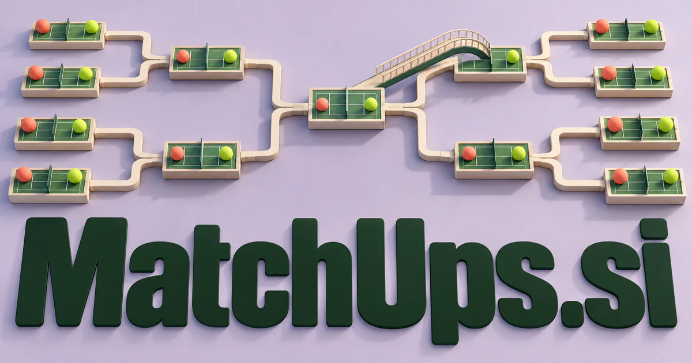

# MatchUps.si — Compare the participants, then understand the pairing

MatchUps.si builds on matchup: a meeting or comparison between participants or alternatives. Sports and competitive games are immediate uses, but the same relationship-based idea can serve mentor selection, suppliers or collaborating agents. A comparison platform could make its value visible by explaining which characteristics matter in context, rather than produce a universal ranking or a mysterious compatibility score.

## Name roots and associations

Matchups is the plural of matchup, a meeting or comparison between people, teams, or competing options, recorded by [Merriam-Webster](https://www.merriam-webster.com/dictionary/matchup). The word naturally suggests more than a static list: examine the participants, compare their characteristics, and understand how they relate. Sports and games are immediate fits, but a brand can also apply the idea to mentoring, suppliers, creators, products, and collaborative agents. A buyer could emphasize competition, compatibility, or an informed choice between alternatives.

## Ten directions a buyer could build

### 1. Sports comparison publishing

A sports comparison assistant could connect team records, playing context and alternative tactical explanations, preparing source-linked comparisons for an analyst. Readers would understand which factors shape a matchup rather than mistake a confident headline for a guaranteed sporting outcome. Editorial memberships could support expert analysis and explanatory visualizations, with a clear distinction between reported data, interpretation, and a prediction about an uncertain result.

### 2. Tournament operations

A tournament planning tool could compare participant constraints, venue schedules, competition rules and possible bracket structures, identifying conflicts before publication. Organizers would evaluate fairness and operational feasibility together instead of repair the draw after registrations are complete. Organization subscriptions could support repeated competitions and make changes to fixtures visible without forcing organizers to coordinate everything through disconnected spreadsheets and messages.

### 3. Esports practice coordination

An esports practice coordinator could connect team roles, recorded weaknesses and proposed opponents, designing practice sessions with explicit objectives. Coaches would choose matchups that expose a useful skill gap and compare the resulting evidence during debriefing. Team subscriptions could organize agreements, preparation notes, and debrief records while allowing participants to choose what performance information they share.

### 4. Agent-to-agent evaluations

An agent evaluation workbench could construct adversarial and cooperative tasks, compare agent behavior traces and identify why one strategy succeeds under particular conditions. Developers would learn about planning and recovery limits rather than reduce every evaluation to a leaderboard position. Developer plans could preserve prompts, tool permissions, outputs, and review notes, making a matchup an inspectable experiment rather than an unsupported ranking.

### 5. Mentor and learner matching

A mentorship matching service could compare a learner's current work, desired skills and preferred feedback style with a mentor's expertise and availability. Programs would create a concrete collaboration plan and questions for the first meeting rather than provide an unexplained matching score. Business subscriptions could coordinate introductions, bookings, feedback, and rematching while leaving the participants free to decide whether the fit feels useful.

### 6. Creator collaboration discovery

A creative partnership planner could connect creators' portfolios, working methods, audience interests and project goals, proposing complementary collaborations. Creators would see what each partner contributes and how the combined work could differ from a simple exchange of publicity. Marketplace fees or memberships could support portfolios, scoped briefs, availability, and a clear record of ownership and delivery expectations.

### 7. Supplier and buyer shortlists

A supplier research assistant could compare a buyer's actual requirements with supplier capabilities, evidence and commercial constraints, identifying questions that would distinguish similar bids. Procurement teams would review a reasoned shortlist and explicit trade-offs before entering negotiations. Software subscriptions could connect a proposed supplier match with the original evidence and the approvals needed before a commercial commitment.

### 8. Product comparison tools

A product comparison guide could interpret the user's intended job, compare relevant product capabilities and explain where published measurements are not equivalent. Buyers would choose from contextual comparisons rather than a universal ranking that ignores their actual use. Retail licensing or disclosed commerce links could support useful explanations instead of declaring one universal winner for every customer.

### 9. Debate and classroom pairings

A debate facilitation tool could connect participants' arguments, experience and learning goals, proposing pairings that create a productive disagreement. Teachers would receive discussion prompts and ways to compare reasoning quality without rewarding confrontation for its own sake. Classroom licenses could make comparison and discussion a learning process, with feedback focused on evidence and reasoning rather than personal labels.

### 10. Community activity partners

A community activity coordinator could reconcile members' interests, availability, accessibility preferences and activity goals, proposing small groups and feasible plans. Organizers would turn a shared interest into an actual meeting with a clear purpose and practical coordination. Organization subscriptions could support introductions and booking while keeping member preferences and personal information under appropriate control.

## A Super Intelligence product story

MatchUps.si could present Super Intelligence as pairing with an explanation. Agents gather permitted information, identify candidate matches, expose uncertainty, and show why a particular pairing may work. The human decides whether to proceed. In a technical product, matched agents could then be evaluated on the same clearly defined task.

## Why this name can carry a business

The plural suggests an ongoing collection of opportunities rather than a single transaction. The name is active, social, and comfortable across competition and cooperation. A buyer can choose a focused audience while retaining the broader organizing principle of finding and understanding useful pairings.

## Related names to compare

- [PeerBot.si](peerbot-si.md) for the ongoing interaction between collaborators after a match.
- [HireUp.si](hireup-si.md) for recruitment and team capability decisions.
- [LVQ.si](lvq-si.md) for classification and similarity as analytical techniques.

## Explore MatchUps.si

For acquisition enquiries about **MatchUps.si**, contact [hedge.pike02@icloud.com](mailto:hedge.pike02@icloud.com?subject=Domain%20enquiry%3A%20matchups.si). Direct enquiries can discuss a preferential offer or a portfolio arrangement.

[View the marketplace listing](https://www.dynadot.com/market/user-listings/matchups.si) · [Marketplace and Escrow.com transaction options](../guides/how-to-buy.md) · [Browse all domains](../README.md)

## Research references

- [Merriam-Webster: matchup](https://www.merriam-webster.com/dictionary/matchup)

[Browse all domains](../README.md)
