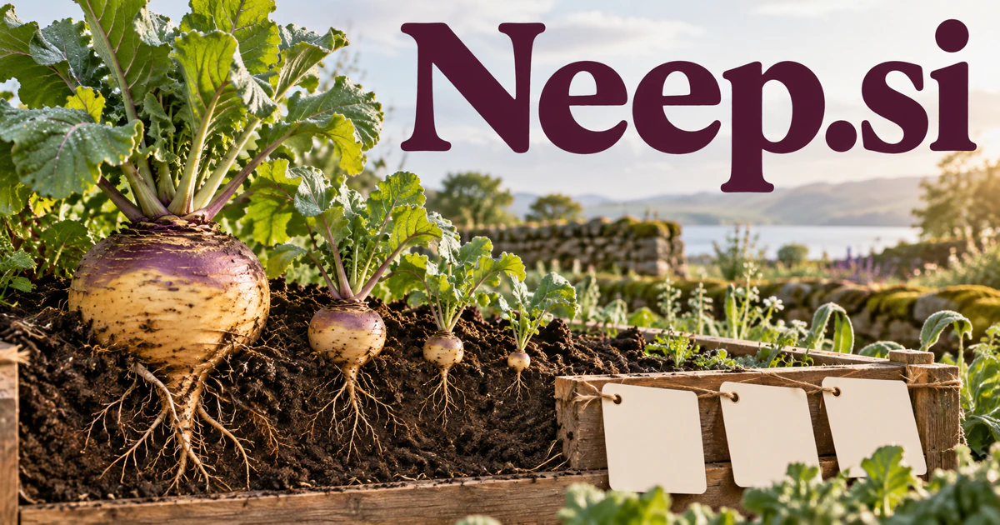

# Neep.si — A friendly little name with room to grow

Neep.si is a short, single-syllable identity grounded in a real Scottish English word for a root vegetable. Food and gardening are direct uses, while a friendly assistant or learning character draws on the name's approachable sound. A household planning companion could connect meals, notes and small practical tasks; that broader interpretation is a creative brand direction rather than another literal meaning.

## Name roots and associations

Neep is a real Scottish English word for a root vegetable, commonly associated with a swede or rutabaga, and pronounced /niːp/, as recorded by [Cambridge Dictionary](https://dictionary.cambridge.org/us/dictionary/english/neep). Four letters, a single syllable, and the repeated vowel give it an approachable sound. The literal meaning supports food, gardening, and growth; as an independent brand, the same shape could suit a lightweight assistant, educational character, useful household object, or playful developer tool. These wider applications are creative directions rather than additional dictionary meanings.

## Ten directions a buyer could build

### 1. Seasonal meal planning

A seasonal meal planner could compare available produce, household preferences, cooking time and leftover plans, assembling practical meals with substitutions. Families would receive a coordinated week of cooking rather than an attractive recipe whose unused ingredients become another planning problem. A subscription could adapt portions and preparation time, while farm shops could license a companion experience for their customers.

### 2. A friendly personal AI assistant

A personal planning companion could connect the user's notes, commitments and stated priorities, identify a useful next action and ask where intent is ambiguous. A friendly character would make capable assistance approachable while the person retains control of memory and connected tools. Consumer subscriptions could focus on completing a few repeatable jobs well, with a memorable character and visible control over what the assistant can access.

### 3. A home gardening companion

A garden observation assistant could organize planting records, site conditions, photographs and a gardener's observations, generating questions and experiment plans. Gardeners would learn from changes in their own plot rather than receive universal instructions that ignore local conditions. Paid growing plans or retailer partnerships could connect supplies with the actual space and experience of each gardener rather than broad generic advice.

### 4. Children’s learning adventures

A family learning character could build stories and practical puzzles around a child's interests, adapt when an explanation reveals confusion and connect play with a learning goal. Adults would choose the experience and review how the activities develop over time. Family memberships, classroom licenses, and printed activity packs could make progress concrete through stories and achievable learning projects.

### 5. Produce subscription operations

A produce-box planning service could connect seasonal supply, household preferences, box composition and delivery constraints, proposing balanced variations and useful recipe notes. Producers would coordinate a better customer experience without treating each substitution as a separate manual exception. Supplier subscriptions could connect available harvest quantities with packing lists and useful recipe ideas while retaining clear operational control for the producer.

### 6. A lightweight notes workspace

A personal notes assistant could connect short notes with related projects, recover why an idea mattered and suggest a small next step. Users would turn casual capture into usable knowledge instead of build another archive of fragments they cannot put to work. A personal subscription could offer organized retrieval and review prompts, while team plans support deliberately small shared collections rather than an overloaded knowledge platform.

### 7. Ambient sound and focus tools

A focus environment guide could compare a user's chosen task, working preferences and reflections on previous sessions, proposing a suitable sound and session structure. The product would help the person discover a useful routine without claiming that one audio pattern suits everybody. Audio collections and optional subscriptions could serve students, remote workers, and people who want a simple ritual around concentrated work.

### 8. A desktop or household companion device

A household companion device could connect a small device's permitted sensing, user conversations and household routines, offering reminders and explanations through a consistent character. Families would choose which contexts the companion remembers and which actions require confirmation. Hardware sales and optional connected features could make the friendly name part of a tangible everyday habit.

### 9. Food education for families

A food learning tool could connect a child's questions about ingredients with kitchen experiments, growing activities and family meals, adapting explanations to their observations. Educators would turn familiar food into a route toward practical vocabulary, curiosity and evidence-based thinking. Course bundles and school licenses could combine a recognizable character with real recipes, seasonal projects, and resources adults can use alongside children.

### 10. A compact developer utility

A lightweight developer companion could turn a focused developer request into a small inspectable plan, connect relevant documentation and propose validation steps. The compact brand could stand for a utility that solves one recurring workflow cleanly before expanding into related capabilities. Individual licenses and team plans could support concrete developer workflows while the short name gives documentation, commands, and interface labels a consistent personality.

## A Super Intelligence product story

Neep.si could carry a Super Intelligence story centered on helpfulness at a manageable scale. A personal agent notices an unfinished task in an approved note, asks a clear question, and proposes the next action. In a food product, the same intelligence could connect ingredients, household schedules, and a sensible cooking plan.

## Why this name can carry a business

The name is short enough to feel like a character and concrete enough to support a growth-themed visual identity. It can begin with one lightweight application and extend to education, physical products, or a family of useful tools without requiring a technical explanation in the brand name itself.

## Related names to compare

- [Koken.si](koken-si.md) for a more direct culinary identity and kitchen workflows.
- [MaoMi.si](maomi-si.md) for a cat-based character and pet-related services.
- [Jiff.si](jiff-si.md) for speed and reduced friction in practical utilities.

## Explore Neep.si

For acquisition enquiries about **Neep.si**, contact [hedge.pike02@icloud.com](mailto:hedge.pike02@icloud.com?subject=Domain%20enquiry%3A%20neep.si). Direct enquiries can discuss a preferential offer or a portfolio arrangement.

[View the marketplace listing](https://www.dynadot.com/market/user-listings/neep.si) · [Marketplace and Escrow.com transaction options](../guides/how-to-buy.md) · [Browse all domains](../README.md)

## Research references

- [Cambridge Dictionary: neep](https://dictionary.cambridge.org/us/dictionary/english/neep)
- [Dictionaries of the Scots Language: neep](https://dsl.ac.uk/entry/snd/neep_n1_v)

[Browse all domains](../README.md)
