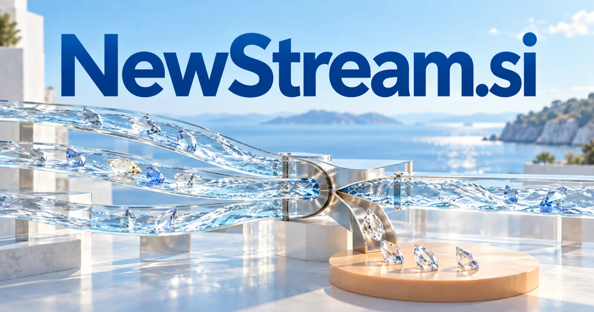

# NewStream.si — Find the new signal that changes what you understand

NewStream.si pairs newness with a word that can describe flowing information, media or software events. A research briefing service could connect incoming developments with an ongoing question, explaining what changed and why it matters. Creator broadcasting, scientific data and event-driven infrastructure need different products beneath that broad idea. The strongest starting point would choose one audience and a recognizable kind of useful update.

## Meaning and naming depth

New suggests something recently available, changed, or different; stream can mean a flow of water, a continuing sequence, or media delivered progressively. Together the words support several distinct readings: a new information feed, a new broadcasting channel, a new data pipeline, or a fresh direction for an existing activity.

The name is therefore broader than news aggregation. A founder could sell curated understanding, live delivery, technical infrastructure, or a cultural channel. The unifying question is what flows through the product and why a customer returns. The strongest businesses would make that flow useful through selection, context, and reliable delivery.

## Business opportunities

### 1. An industry intelligence feed

An industry signal analyst could connect new announcements, primary documents and historical context, testing whether an apparent trend changes a customer's decision. Analysts would receive an explained development brief with competing interpretations instead of a faster stream of unfiltered headlines. Commercial options include selling topic subscriptions, team briefings, and commissioned monitoring rather than merely reposting headlines.

### 2. A streaming media channel

A media programming assistant could organize a channel's archive, audience questions and upcoming programming into coherent viewing paths and editorial briefs. Producers would build a continuing explanation of a subject rather than fill a schedule with disconnected content. Memberships, ticketed premieres, licensed programming, and production services would support a media business under a clear, flexible name.

### 3. Event-driven software infrastructure

An event-stream reasoning agent could connect incoming events with business state, dependencies and expected outcomes, identifying which changes require action. Developers would build workflows that explain the reason for a response rather than trigger tools on an isolated keyword or event type. Commercial options include selling managed infrastructure, usage plans, and integration services for organizations moving from periodic imports to event-based workflows.

### 4. A creator broadcast workspace

A live production collaborator could coordinate source notes, audience questions, production cues and follow-up material during a broadcast. Creators would sustain a coherent discussion while retaining editorial control over what the assistant proposes for the audience. Commercial options include selling individual subscriptions, studio plans, and managed production support for educators and audience businesses.

### 5. Personal research briefings

A personal research briefing service could connect new sources with a user's ongoing questions, flag changed assumptions and maintain competing explanations. Researchers would see why an update matters to their current investigation rather than receive another summary of everything published today. Commercial options include selling research memberships and shared watchlists for professional teams.

### 6. A customer and account update service

An account context assistant could compare permitted customer updates with account history and a seller's actual services, proposing relevant questions or support actions. Teams would respond to a meaningful change in context rather than automate outreach around any new mention of a company. Commercial options include selling monitored-organization subscriptions and integrations into customer-management workflows.

### 7. Scientific data streaming

A scientific stream analyst could connect sensor events, experimental conditions and a research protocol, identify anomalies and suggest targeted follow-up measurements. Researchers would inspect the evidence behind an alert and distinguish a changed phenomenon from a changed measurement process. Commercial options include selling laboratory software, private deployments, and integrations for workflows that produce more than isolated files.

### 8. A fresh audio and music discovery brand

A music discovery guide could connect a listener's interests with musical attributes, editorial context and feedback from previous sessions, proposing a navigable exploration path. Curators would explain relationships between artists and works rather than repeatedly offer stylistic near-duplicates. The business could combine memberships, live events, licensed content, and creator services.

### 9. Website and document change monitoring

A document change investigator could compare document versions, interpret the affected clauses or requirements and connect changes to a user's projects. Teams would receive a reasoned account of what deserves attention instead of an alert for every edited character. Commercial options include selling monitoring plans, shared collections, and specialist reporting services.

### 10. A business reinvention studio

A business renewal advisory team could connect customer evidence, operational constraints and emerging capabilities, generate several reinvention scenarios and identify tests of their assumptions. Consultants would help a company choose a new direction through learning rather than a prediction presented as certainty. Project fees, retained support, and jointly developed products would give the “new direction” reading a non-media commercial expression.

## A Super Intelligence brand

NewStream.si can position Super Intelligence as a continuously refreshed understanding of a changing environment. A possible product would connect incoming sources, detect relevant changes, and turn them into a brief or an actionable task. The identity accommodates both the information pipeline underneath and the clear customer experience above it.

## Why the name works

The word pair is familiar, positive, and open enough for publishing, infrastructure, and creative work. It offers natural divisions such as NewStream Research, Live, Data, and Studio. **“Stay with what’s next.”** communicates continuity and discovery without promising that every new item is important.

## Related names to compare

- [DataFeeds.si](datafeeds-si.md) for reliable delivery and integration of incoming data.
- [Readouts.si](readouts-si.md) for understanding outputs and measurements after collection.
- [LeadOff.si](leadoff-si.md) for the opening move before ongoing monitoring begins.

## Explore NewStream.si

For acquisition enquiries about **NewStream.si**, contact [hedge.pike02@icloud.com](mailto:hedge.pike02@icloud.com?subject=Domain%20enquiry%3A%20newstream.si). Direct enquiries can discuss a preferential offer or a portfolio arrangement.

[View the marketplace listing](https://www.dynadot.com/market/user-listings/newstream.si) · [Marketplace and Escrow.com transaction options](../guides/how-to-buy.md) · [Browse all domains](../README.md)

## Sources and further reading

- [Merriam-Webster: stream](https://www.merriam-webster.com/dictionary/stream) — The ordinary and media-related senses that support the naming directions.
- [CloudEvents](https://cloudevents.io/) — A technical reference for consistent event descriptions across software systems.
