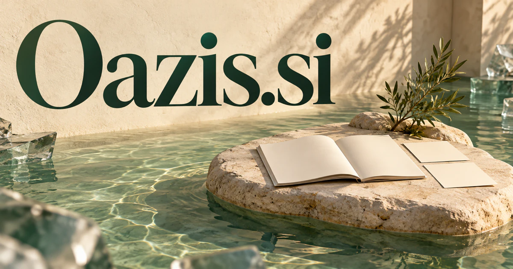

# Oazis.si — A quieter place to think, discover and recover context

Oazis.si evokes an oasis and also has documented multilingual connections explored below. The shared association is refuge or replenishment, which can be physical, emotional or informational. A private knowledge workspace could offer a useful digital interpretation: retain context, reduce noise and help a person follow one worthwhile question. Retreat discovery, reflective tools and hospitality experiences provide different routes into the same calm identity.

## Name roots and associations

Oazis evokes an oasis: a place associated with water, refuge, and relief within a demanding landscape. The underlying oasis meaning is recorded by [Cambridge Dictionary](https://dictionary.cambridge.org/us/dictionary/english/oasis); Oazis offers a distinct spelling for a buyer to develop as an independent brand. There is also a real multilingual route: Russian **оазис**, documented by [Gramota’s dictionary collection](https://gramota.ru/poisk?mode=slovari&query=%D0%BE%D0%B0%D0%B7%D0%B8%D1%81), can be represented in Latin letters as oazis. Hungarian [**oázis**](https://www.arcanum.com/hu/online-kiadvanyok/Lexikonok-a-magyar-nyelv-ertelmezo-szotara-1BE8B/oazis-4247D/) offers an unaccented-domain reading as well, appearing in the Hungarian explanatory dictionary. These language connections strengthen the name beyond a visual resemblance to the English word. The strongest shared theme is a useful place of replenishment. That can be emotional, physical, or informational: a quiet retreat, an organized research collection, an uncluttered work environment, or an assistant that reduces the effort of navigating a noisy digital day.

## Ten directions a buyer could build

### 1. A private reflection journal

A reflection journal companion could connect a person's chosen journal entries, recurring questions and stated goals, offering prompts that reveal patterns without declaring what the person must feel. The user would direct the interpretation and decide which reflections become practical next steps. Consumer subscriptions could support a calm routine and personal organization while keeping the user in control of what is stored or shared.

### 2. Meditation content publishing

A contemplative content guide could compare a listener's preferences, available time and responses to previous sessions, proposing a coherent route through approved meditation content. Teachers would maintain their own approach while supporting a more personal learning journey through the collection. Creator subscriptions and program purchases could support carefully produced resources and a direct relationship between an independent practitioner and the people following their work.

### 3. A focused work environment

A focused-work assistant could connect a user's current task, supporting material and interruptions, proposing a small plan and preserving context between sessions. The product would reduce avoidable cognitive switching while the person decides what deserves sustained attention. Consumer subscriptions could make the workspace feel clear and inviting, helping users choose what deserves attention rather than presenting an ever-growing dashboard of demands.

### 4. Retreat and quiet-stay discovery

A retreat discovery service could reconcile a traveler's desired quiet, mobility needs, preferred activities and practical arrangements, comparing suitable retreat experiences. Hosts would help guests understand how a stay actually works rather than sell a vague promise of universal transformation. Booking fees or advisory packages could connect an appealing experience with clear expectations, arrival arrangements, schedules, and the facilities actually available.

### 5. A personal knowledge refuge

A personal knowledge workspace could organize a person's approved documents, notes and questions into a navigable personal library, retrieving evidence without expanding into an overwhelming feed. Users would recover the context of an idea and decide which line of inquiry to pursue next. Subscription tools could help users retrieve context and build understanding without requiring their private library to become a public content stream.

### 6. Workplace quiet resources

A workplace space planner could compare employee preferences, booking patterns and space constraints, proposing room configurations and scheduling alternatives. Facilities teams would support different working needs with concrete evidence rather than assume one type of quiet environment serves every task. Business plans could focus on access and usefulness, offering people a quiet option without making personal wellbeing a compulsory reporting exercise.

### 7. Nature-inspired hospitality products

A hospitality experience designer could connect a property's intended atmosphere, guest feedback and product choices, designing coordinated room and service experiences. Hospitality teams would see how materials, amenities and communication contribute to the same restful identity. Retail and hospitality partnerships could connect an attractive physical collection with a consistent sense of space, texture, and practical comfort.

### 8. Water and garden experiences

A nature experience planner could reconcile a garden's conditions, visitor needs and proposed activities, comparing plans for routes, seating and interpretation. Designers would create a usable, coherent environment with explanations of the trade-offs rather than an isolated collection of beautiful features. Course sales, venue services, or retail collections could connect the oasis metaphor with tangible places and achievable projects.

### 9. A calm creator community

A creative community coordinator could connect members' project goals, preferred feedback and available time, proposing small collaborations and thoughtful critique sessions. Community organizers would encourage meaningful participation without continually pressure people to publish more content or remain permanently online. Memberships could support thoughtful participation and original work rather than a product designed around constant posting and rapid reaction.

### 10. An intelligent information concierge

A selective information concierge could compare incoming material with a person's active questions and priorities, explain what changed and hold unrelated updates for later. The product's intelligence would be visible in what it helps the user understand, not in the volume it delivers. Consumer or team plans could filter for the actual question being asked and preserve source links, giving people a clear entrance into a complex subject.

## A Super Intelligence product story

Oazis.si could position Super Intelligence as an oasis within information overload. A user brings a question; agents organize approved sources, explain the most relevant ideas, and prepare a concise next-step plan. The interface provides space to think, review, and choose, rather than adding another layer of urgency.

## Why this name can carry a business

Five letters and a distinctive central consonant give Oazis a recognizable wordmark while retaining an immediately understandable calm-place association. The identity can move between software, content, hospitality, and physical products through a coherent promise of clarity, replenishment, and room to breathe.

## Related names to compare

- [Rapt.si](rapt-si.md) for deep engagement and sustained attention.
- [Neep.si](neep-si.md) for a playful, approachable household companion.
- [TravelBox.si](travelbox-si.md) for the practical organization of journeys and experiences.

## Explore Oazis.si

For acquisition enquiries about **Oazis.si**, contact [hedge.pike02@icloud.com](mailto:hedge.pike02@icloud.com?subject=Domain%20enquiry%3A%20oazis.si). Direct enquiries can discuss a preferential offer or a portfolio arrangement.

[View the marketplace listing](https://www.dynadot.com/market/user-listings/oazis.si) · [Marketplace and Escrow.com transaction options](../guides/how-to-buy.md) · [Browse all domains](../README.md)

## Research references

- [Cambridge Dictionary: oasis](https://dictionary.cambridge.org/us/dictionary/english/oasis)

- [Gramota: оазис dictionary entries](https://gramota.ru/poisk?mode=slovari&query=%D0%BE%D0%B0%D0%B7%D0%B8%D1%81)
- [Hungarian explanatory dictionary: oázis](https://www.arcanum.com/hu/online-kiadvanyok/Lexikonok-a-magyar-nyelv-ertelmezo-szotara-1BE8B/oazis-4247D/)

[Browse all domains](../README.md)
