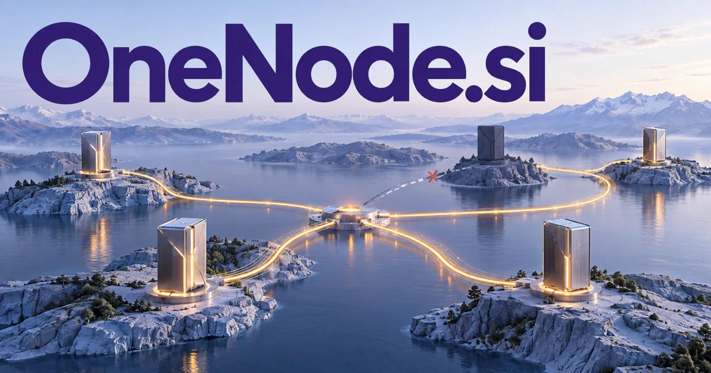

# OneNode.si — One place to coordinate the connections that matter

OneNode.si combines unity with a word used for an element in a network or computing system. A node-operations workspace could connect workloads, state and permitted actions, giving a team a clear view of a distributed service. A personal knowledge hub offers a different interpretation of the same name. Edge fleets, integrations and specialist agent hosting sit between those infrastructure and knowledge directions.

## Meaning and naming depth

A node is a point within a connected structure. In computing it can be a machine participating in a cluster; in a graph it is an entity joined to other entities; in ordinary language the idea extends to a center or junction. One creates an organizing emphasis rather than requiring the product to use a single machine.

That distinction lets the name support both “start with one node” and “manage every node from one place.” A founder could build around distributed infrastructure, a unified data model, or a personal hub. The word pair is concrete enough for engineers and simple enough to explain to nontechnical buyers.

## Business opportunities

### 1. Cloud node operations

A cloud operations assistant could connect workload goals, node health and resource constraints, comparing placement or recovery plans before execution. Operators would inspect why a change is proposed and how it affects the service rather than receive an unexplained optimization command. Commercial options include selling managed hosting plans, operational tooling, and premium support for teams that want a clear view of their infrastructure.

### 2. Edge fleet management

An edge fleet coordinator could reconcile remote device conditions, connectivity, software versions and permitted tasks, prioritizing interventions with recovery paths. Teams would manage a distributed fleet as a coordinated system while retaining a clear account of each device's actual state. Revenue could follow managed devices and installation services, making OneNode an infrastructure brand with a tangible operational use.

### 3. Hosting for specialist agents

An agent hosting orchestrator could match an approved task with an agent's tools, resource requirements and operating boundaries, coordinating execution and review. Customers would host purpose-built assistants with explainable orchestration instead of simply deploy another model endpoint. Commercial options include selling runtime subscriptions, templates, and deployment assistance.

### 4. A personal knowledge hub

A personal knowledge assistant could connect a person's approved files, notes and conversations around an active question, preserve source links and propose useful follow-ups. The single-node story promises continuity of understanding across information that would otherwise remain scattered. Individual subscriptions, team sharing, and specialized knowledge templates would support a different interpretation of node.

### 5. A home server appliance

A home-server guide could explain the relationships among household services, storage, backups and access preferences, proposing understandable maintenance actions. A home appliance would make self-managed digital infrastructure approachable without requiring every resident to become a systems administrator. Commercial options include selling a compact device that gathers household files, automations, and local applications into one manageable system. Hardware bundles, maintenance subscriptions, and installation support could build a business around an understandable physical starting point.

### 6. Distributed network participation

A network participation analyst could compare a node's participation options, operational requirements and observed performance, explaining consequences for its owner. Infrastructure tools would support informed configuration and monitoring rather than make opaque promises about an unfamiliar network. The business could sell infrastructure services or educational packages without making financial-return claims about network participation.

### 7. An integration hub for small firms

A business integration assistant could connect a company's customer records, scheduling, invoicing and internal knowledge through a common task context. Owners would approve a complete workflow and understand how a change in one system should affect the others. Subscription connectors and setup projects would suit customers who need integration expertise more than raw computing capacity.

### 8. Scientific compute coordination

A scientific compute coordinator could connect an experiment's tasks, resource needs and data dependencies, choosing a reviewable execution sequence and recovery plan. Research teams would trace a completed result back through the compute decisions that produced it. Commercial options include selling laboratory workspaces, managed deployments, and specialist workflow configuration.

### 9. A network and graph education platform

A network learning tool could turn a learner's question into an interactive graph, vary connections and compare predicted with observed behavior. Educators would explain networks through causal experiments rather than ask students to memorize diagrams without understanding their consequences. Schools and technical course providers could buy curricula, classroom access, and workshop kits.

### 10. A distributed-team community hub

A distributed community organizer could connect member expertise, shared questions and project dependencies, proposing useful introductions and maintaining collective context. A community would act as a productive knowledge node where contributions connect to real work instead of disappear in a chat archive. Commercial options include selling memberships, events, or organization-branded community software around the same connection metaphor.

## A Super Intelligence brand

OneNode.si could frame Super Intelligence as connected capability with one coherent interface. A user might ask a question that requires a private document, a remote tool, and a specialist agent; the platform could organize those resources as discoverable nodes. Starting with one dependable deployment, the brand can expand into an operating layer for a much larger network.

## Why the name works

Two short familiar words give the name a calm, structured feel. It works for a cloud dashboard, a hardware badge, or a knowledge application. **“One starting point. A connected world.”** offers a memorable promise, while OneNode Cloud, Edge, Home, and Graph make natural product extensions.

## Related names to compare

- [NCQ.si](ncq-si.md) for queues, workloads and infrastructure diagnosis.
- [KeyID.si](keyid-si.md) for the identities and permissions connecting services.
- [NineFold.si](ninefold-si.md) for multiple specialized roles coordinated around one project.

## Explore OneNode.si

For acquisition enquiries about **OneNode.si**, contact [hedge.pike02@icloud.com](mailto:hedge.pike02@icloud.com?subject=Domain%20enquiry%3A%20onenode.si). Direct enquiries can discuss a preferential offer or a portfolio arrangement.

[View the marketplace listing](https://www.dynadot.com/market/user-listings/onenode.si) · [Marketplace and Escrow.com transaction options](../guides/how-to-buy.md) · [Browse all domains](../README.md)

## Sources and further reading

- [Kubernetes: Nodes](https://kubernetes.io/docs/concepts/architecture/nodes/) — Official documentation of nodes within a computing cluster.
- [W3C: SKOS Reference](https://www.w3.org/TR/skos-reference/) — A foundation for connected knowledge organization concepts.
