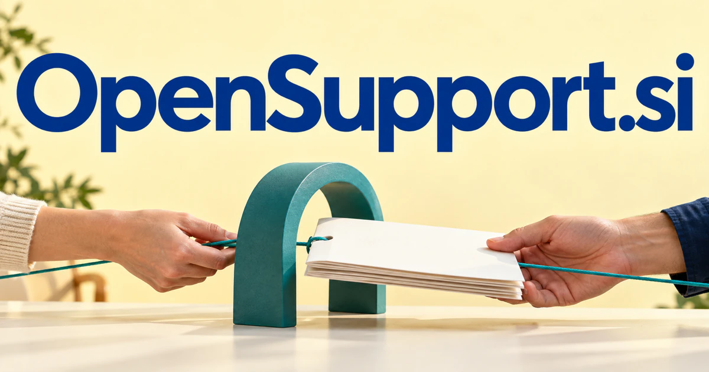

# OpenSupport.si — Help that connects the question with a route to resolution

OpenSupport.si joins a service promise with openness: accessible help, shared knowledge or a transparent process. A helpdesk that reasons across the request, approved context and previous attempts is a clear starting point. Developer communities, repair networks and employee service desks need different forms of that coordination. The name can support a shared-support model without implying that every future product must be open-source.

## What the name opens up

Open can describe availability, transparency, interoperability, an invitation to participate, or an open-source development model. Support can mean customer assistance, technical maintenance, peer encouragement, or the infrastructure that helps another activity work. They offer several credible positions: support that is easier to reach, easier to inspect, or easier to connect to existing tools. [OpenAPI's specification](https://spec.openapis.org/oas/latest.html) provides one technical reference for describing interoperable HTTP interfaces.

## Business opportunities

### 1. Customer helpdesk

A customer-resolution assistant could connect a customer's request, permitted account context and approved troubleshooting knowledge, planning the steps toward resolution. Support teams would inspect what has been tried and why an escalation is needed instead of repeatedly collect the same explanation. Per-agent or organization subscriptions would support a clearly defined customer-assistance business.

### 2. Community support

A community knowledge guide could connect a new question with relevant discussions, compare proposed solutions and identify where product versions change the answer. Moderators would develop a maintained knowledge resource while preserving the community members and evidence behind it. Hosted community editions and commercial support could fund an extensible platform.

### 3. Support operations

A support process analyst could compare ticket histories, handoff patterns and unresolved dependencies, identifying the process change most likely to remove repeated friction. Operations teams would improve the route to resolution rather than optimize handling speed without understanding why customers return. Agency subscriptions would align the product with the actual coordination work behind an outsourced support contract.

### 4. Developer assistance infrastructure

A developer support assistant could connect documentation, a reproducible example and error traces, propose diagnostic checks and prepare a focused escalation package. Infrastructure companies would help developers reach a working integration with an understandable account of the problem. Usage pricing or enterprise licenses could support teams that want a coherent experience inside their own applications.

### 5. Repair knowledge networks

A repair research tool could connect a device model, symptom description and approved repair material, gathering the information needed for a qualified diagnosis. Repair networks would share useful experience while making uncertain matches and expert-only tasks explicit. The open invitation suits a community that shares practical knowledge across brands and trades.

### 6. Member-support cooperatives

A cooperative service coordinator could reconcile members' needs, volunteer skills, available resources and service boundaries, proposing workable assistance plans. Cooperatives would coordinate mutual support around a shared understanding of the request rather than scatter responsibility across informal messages. Group subscriptions could include separate spaces for professional, educational, or neighborhood communities.

### 7. Accessibility assistance

An accessibility support companion could ask about a person's preferred interaction, compare available assistance methods and adapt explanations or message formats. Organizations would support the user's own way of accomplishing a task rather than impose a single supposedly accessible workflow. Consulting retainers and organization subscriptions could combine practical support with specialist review of what actually needs changing.

### 8. Employee service desks

An employee service coordinator could connect a staff request with policies, system ownership and approvals, coordinating the correct service teams. Employees would see the next step and missing dependency instead of navigate separate desks that each treat the request as somebody else's problem. Per-employee subscriptions could finance a focused internal-service product.

### 9. Support training schools

A support training simulator could simulate customers with different contexts, adapt the scenario to a learner's questions and explain the consequences of a response. Training teams would teach diagnosis, empathy and escalation judgment together rather than grade only the wording of a reply. Commercial options include selling realistic customer-service simulations, annotated conversations, and supervisor coaching workspaces.

### 10. Partner service exchanges

A partner-resolution workspace could connect cases spanning several providers, separate ownership of each dependency and assemble the evidence for a coordinated response. Service partners would share a clear problem model without duplicate investigations or an endless chain of forwarded messages. A marketplace commission, directory subscription, or managed matching service would turn support expertise into a visible offering.

## A Super Intelligence product vision

An OpenSupport SI product could connect a customer's question to permitted documentation, recent product changes, and the relevant service team. Specialized agents might investigate an error, suggest an answer, or draft a reproducible issue. The original evidence would remain beside the response, and unresolved cases would pass to someone with the right expertise. A useful starting business would sell faster, better-contextualized handoffs to software companies. Over time, the same brand could accommodate shared knowledge publishing, partner assistance, and tools that customers operate within their own environments.

## Related names to compare

- [ServiceCall.si](servicecall-si.md) for the request, appointment and field-service handoff.
- [GuideX.si](guidex-si.md) for guidance while a person performs a task.
- [PeerBot.si](peerbot-si.md) for peer interaction and collaborative help rather than a service desk.

## Explore OpenSupport.si

For acquisition enquiries about **OpenSupport.si**, contact [hedge.pike02@icloud.com](mailto:hedge.pike02@icloud.com?subject=Domain%20enquiry%3A%20opensupport.si). Direct enquiries can discuss a preferential offer or a portfolio arrangement.

[View the marketplace listing](https://www.dynadot.com/market/user-listings/opensupport.si) · [Marketplace and Escrow.com transaction options](../guides/how-to-buy.md) · [Browse all domains](../README.md)

## Sources and further reading

- [OpenAPI Specification](https://spec.openapis.org/oas/latest.html) — Official interface-description specification supporting the integration opportunity.
