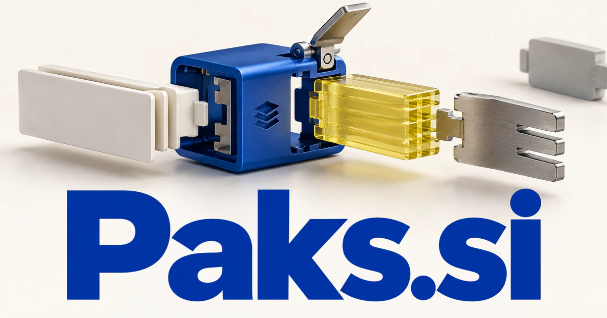

# Paks.si — Useful parts, assembled into a capability someone can use

Paks.si is a compact brand spelling that evokes packs and packages, with an additional technical connection to .pak content archives. Agent skill collections and developer kits are plausible first products: assemble compatible parts, explain the dependencies and help a user reach a working result. Game assets, learning projects and physical travel kits take the same packaging idea into different markets.

## Name roots and associations

Paks is a compact brand spelling that can evoke packs and packages without being their standard English spelling. It also has a concrete technical association: game-distribution documentation describes .pak archive files used to package project content, including [Epic's packaging guide](https://dev.epicgames.com/documentation/unreal-engine/packaging-your-project). The shared idea is a usable collection of parts. Paks can therefore support digital resources, agent skills, software delivery, physical kits, travel equipment, and logistics. A buyer can choose a deliberately playful consumer identity or a precise tool-oriented brand.

## Ten directions a buyer could build

### 1. Agent skill collections

A skill-pack assembly tool could match a user's goal with compatible tools, instructions and knowledge modules, test their combined behavior and explain required permissions. Teams would acquire a working capability with a reviewable purpose rather than a disconnected bundle of prompts. Subscription access or individual purchases could serve teams that want an understandable capability pack with setup guidance and clearly documented permissions.

### 2. Game assets and mod resources

A game-resource selection assistant could connect an asset's technical requirements, style and intended game role, identify compatibility gaps and propose a coherent bundle. Developers would evaluate how resources work together in a project instead of purchase visually attractive pieces that cannot be integrated easily. Commercial options include selling original materials, sound effects, environments, and supported packaging tools for game creators. Marketplace commissions or studio licenses could connect each asset pack with usage rights, technical requirements, examples, and maintained version information.

### 3. Developer package management

A dependency planning assistant could compare package requirements, version constraints, project goals and documented changes, proposing a tested update plan. Engineering teams would understand the trade-offs and recovery path behind a dependency decision rather than blindly apply a list of available upgrades. Team subscriptions could connect a package’s origin and intended use with review decisions before it enters a project.

### 4. Creator resource bundles

A creative bundle curator could translate a creator's production brief into a coordinated selection of templates, type, images and motion assets. Buyers would receive a coherent visual system with usable adaptation guidance rather than an oversized archive of unrelated resources. Direct sales and memberships could help customers complete a specific creative job rather than download an unstructured collection of files they never use.

### 5. Model deployment kits

A model deployment planner could connect a model's intended task, runtime constraints, evaluation results and configuration requirements, assembling a reproducible deployment package. Developers would inspect the assumptions and validation steps before moving a promising experiment into an operating service. Professional plans could support repeatable setup and human review of permissions, while keeping performance claims tied to the actual documented evaluation.

### 6. Logistics and packing workflows

A packing workflow assistant could compare order contents, item dimensions, available materials and carrier constraints, generating a reviewable packing sequence. Fulfillment teams would reduce avoidable repacking and missing accessories while retaining clear handling instructions for unusual orders. Per-location software fees could connect the physical package with the correct order details and make recurring mistakes easier to investigate.

### 7. Travel and outdoor organization

A travel kit planner could connect a trip's activities, weather information, traveler preferences and equipment inventory, proposing adaptable packing lists. Customers would see why an item is needed and where a shared or reusable alternative can replace an unnecessary purchase. Product margins and optional planning content could connect attractive physical goods with practical guidance for the customer’s chosen activity.

### 8. Subscription discovery boxes

A subscription box curator could reconcile customer preferences, previous deliveries, stock and supplier lead times, composing meaningful themed boxes. Operators would explain the curation and coordinate substitutions rather than personalize only the label on an otherwise identical package. Retail subscriptions could include useful instructions and a path to reorder favorites, making the pack a coherent introduction rather than a random assortment.

### 9. Learning project kits

A project-kit learning guide could match a learner's interests and existing skills with a buildable project, assemble the required materials and adapt instructions to their questions. Educators would connect a physical or digital kit with explicit opportunities for reasoning and experimentation. Course sales and school licenses could give learners a complete route from preparation to a finished result.

### 10. Team onboarding packs

A team onboarding assistant could connect a new employee's role with relevant decisions, procedures and example work, assembling a focused onboarding pack. Managers would review a coherent explanation of how the team operates rather than direct newcomers to an unfiltered document repository. Business subscriptions could maintain packs as a role changes and show which preparation steps need a manager’s approval.

## A Super Intelligence product story

Paks.si could frame Super Intelligence as capabilities delivered in understandable modules. A business chooses a research pack or customer-support pack, inspects the included tools and permissions, and approves its configuration. Agents then work within that defined scope, with outputs and exceptions visible to the team responsible for the result.

## Why this name can carry a business

Four letters make a compact wordmark, while the pack association works naturally with modular visuals and tiered product collections. The identity can connect a small initial utility with a larger marketplace or platform. Its usefulness lies in making a collection feel complete, purposeful, and easy to deploy.

## Related names to compare

- [PeerBot.si](peerbot-si.md) for the interaction and critique between working agents.
- [OneNode.si](onenode-si.md) for the infrastructure that runs connected capabilities.
- [TravelBox.si](travelbox-si.md) for journeys and organized travel experiences rather than the kit alone.

## Explore Paks.si

For acquisition enquiries about **Paks.si**, contact [hedge.pike02@icloud.com](mailto:hedge.pike02@icloud.com?subject=Domain%20enquiry%3A%20paks.si). Direct enquiries can discuss a preferential offer or a portfolio arrangement.

[View the marketplace listing](https://www.dynadot.com/market/user-listings/paks.si) · [Marketplace and Escrow.com transaction options](../guides/how-to-buy.md) · [Browse all domains](../README.md)

## Research references

- [Epic Developer Community: packaging projects and .pak files](https://dev.epicgames.com/documentation/unreal-engine/packaging-your-project)

[Browse all domains](../README.md)
