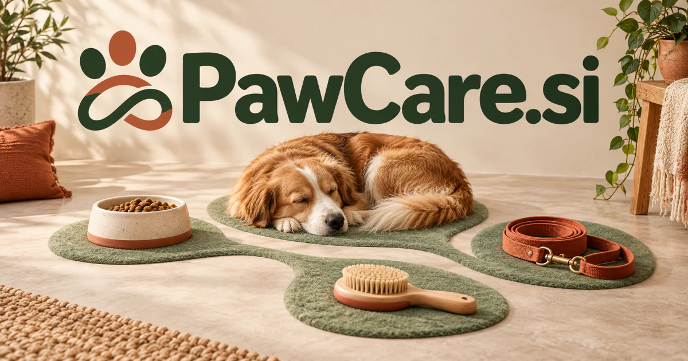

# PawCare.si — Keep an animal's care connected across people and services

PawCare.si pairs a recognizable animal image with a broad promise of attention and support. A shared routine planner could connect an owner's instructions, professional records and service updates so information survives a handover. Sitters, shelters, groomers and households each need different parts of that continuity. Product discovery and travel preparation broaden the service territory while keeping the animal's actual needs central.

## Name roots and associations

PawCare combines a concrete animal image with a broad service promise. A paw immediately suggests companion animals; care can cover daily routines, attention, professional services, reliable records, and considerate product design. The pairing is direct enough for a consumer to understand, yet broad enough for several complementary businesses. A buyer could build for owners, sitters, shelters, retailers, or professionals who need better information handoffs. The commercial opportunity is in useful coordination and a reassuring experience, rather than in treating every pet concern as a software diagnosis.

## Ten directions a buyer could build

### 1. A shared pet routine planner

A household pet-care planner could connect a pet's established routine, professional instructions and family members' schedules, proposing a coordinated daily plan. Households would track what has actually been done and prepare clearer questions when a care observation changes. Help families coordinate feeding, walks, grooming, appointments, and recurring purchases. A household subscription could show who completed each task, preserve instructions for temporary carers, and connect reminders with the relevant records rather than repeated group messages.

### 2. Professional sitter software

A sitter workflow assistant could turn an owner's instructions, visit expectations and animal-specific preferences into a clear service plan, then organize updates by meaningful exceptions. Professional sitters would maintain consistent communication without reducing every individual animal to the same checklist. Per-business plans could connect a service agreement with each animal’s particular routine and make handovers between staff easier to follow.

### 3. Shelter and foster handovers

A foster transition coordinator could compare shelter records, foster observations and the receiving household's questions, building a tailored handover and follow-up plan. Coordinators would preserve useful context through transitions instead of repeatedly reconstruct an animal's history from informal messages. Organization subscriptions could support volunteers and foster families with a clear history of responsibility as an animal moves between temporary and permanent homes.

### 4. A pet document wallet

A pet document organizer could organize authorized veterinary documents, service records and owner notes, assembling relevant information for a particular appointment or application. Owners would distinguish a documented instruction from an unverified observation and know which source to bring to a professional discussion. Consumer or partner subscriptions could offer time-limited sharing with a sitter or professional, with the owner controlling what is included.

### 5. Grooming business operations

A grooming operations planner could reconcile appointment duration, animal preferences, previous service notes and staff availability, preparing a workable schedule and customer brief. Groomers would anticipate practical needs and explain proposed service choices before the animal arrives. Subscription software could preserve useful care notes and approval records while connecting each appointment with the right duration, equipment, and staff member.

### 6. A pet-care product shop

A pet product guide could compare an animal's size, routines, household setting and owner priorities with product attributes, explaining several options. Retailers would help customers build a purposeful care setup rather than market the same fashionable item to every pet owner. Retail margins and replenishment plans could serve households looking for practical choices tailored to their animal and living space.

### 7. Pet-friendly travel preparation

A pet travel preparation assistant could connect journey details, provider rules, documented care needs and required records, preparing a reviewed travel checklist. Owners would identify unanswered questions early and coordinate the practical arrangements with the appropriate service providers. Advisors could sell planning services, while accommodation providers license preparation guides that explain their actual facilities and policies.

### 8. Care education and training

A care-learning companion could adapt lessons on routines, handling and observation to an owner's questions and approved professional material. Educators would help people understand why a practice matters and when individualized veterinary or behavioral advice is needed. Course purchases and organization licenses could support practical learning without presenting automated material as a substitute for an animal professional’s individual assessment.

### 9. A service discovery marketplace

A pet service matching tool could compare an owner's requested service, location, schedule and animal-specific needs with providers' documented capabilities. A marketplace would explain the proposed fit and surface questions before booking rather than imply that a high generic rating guarantees suitability. Booking commissions or provider subscriptions could fund a platform that retains clear communication and a useful record of agreed responsibilities.

### 10. Connected household reminders

A household care coordinator could connect household calendars, permitted devices and confirmed care tasks, identify missed handoffs and ask before changing routines. Families would coordinate responsibility around the pet's actual needs instead of accumulate reminders that nobody knows have been completed. Device or household subscriptions could organize alerts and review routines, while the product explains the limits of each data source and avoids unsupported health conclusions.

## A Super Intelligence product story

PawCare.si could express Super Intelligence as a dependable coordination layer around an animal’s daily life. A permissioned agent prepares a sitter brief, checks an owner-maintained supply inventory, drafts a reorder, and organizes questions before an appointment. The owner stays responsible for approvals and decisions, while the system reduces fragmented administration.

## Why this name can carry a business

The compound conveys both audience and intention without narrowing the business to a single service. It works on an app icon, service van, product package, or professional dashboard. That coherence makes it suitable for a focused launch that could grow into a connected ecosystem of care information, services, and products.

## Related names to compare

- [MaoMi.si](maomi-si.md) for a cat-specific identity and expressive companion character.
- [HomeGuide.si](homeguide-si.md) for household knowledge and the wider home environment.
- [ServiceCall.si](servicecall-si.md) for appointments and professional-service coordination.

## Explore PawCare.si

For acquisition enquiries about **PawCare.si**, contact [hedge.pike02@icloud.com](mailto:hedge.pike02@icloud.com?subject=Domain%20enquiry%3A%20pawcare.si). Direct enquiries can discuss a preferential offer or a portfolio arrangement.

[View the marketplace listing](https://www.dynadot.com/market/user-listings/pawcare.si) · [Marketplace and Escrow.com transaction options](../guides/how-to-buy.md) · [Browse all domains](../README.md)

## Research references

- [Cambridge Dictionary: paw](https://dictionary.cambridge.org/dictionary/english/paw)
- [Cambridge Dictionary: care](https://dictionary.cambridge.org/dictionary/english/care)

[Browse all domains](../README.md)
