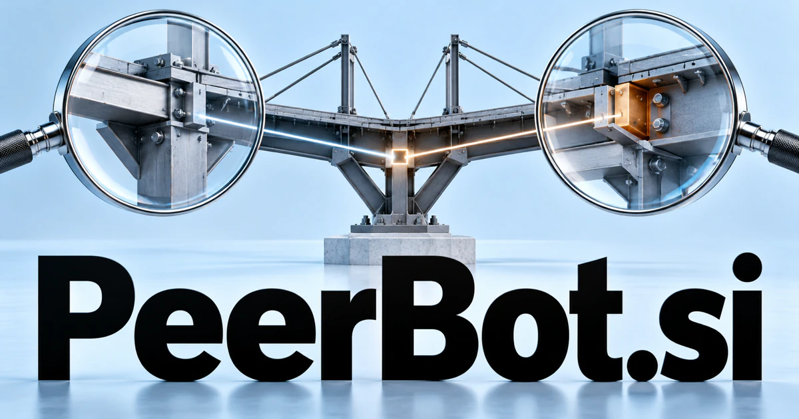

# PeerBot.si — A thinking partner that contributes more than another answer

PeerBot.si combines the idea of a peer with a software actor. A review partner could ask what supports a proposal, compare alternatives and help someone improve their own reasoning. Engineering, learning and creative work offer different starting audiences. Multi-agent collaboration gives the name a technical extension, while language practice and mentoring bring the same partnership idea into more personal products.

## Meaning and naming depth

Peer has two particularly productive senses: someone of comparable standing and the act of looking closely. A peer can be a collaborator, a reviewer, a fellow learner, or a participant in a network. Bot introduces automated software. Together the words suggest both “a bot that works alongside you” and “a bot that takes a closer look.”

The peer idea offers a distinctive interaction style: ask questions, examine assumptions, compare alternatives, and help the user make progress. In networking, peer-to-peer relationships also open a more technical product territory.

## Business opportunities

### 1. Engineering review partner

An engineering review partner could inspect a proposed change against its requirements, compare alternative implementations and ask for evidence where a design assumption is weak. Developers would gain a persistent review partner that contributes reasoned questions rather than simply approve plausible-looking work. Commercial options include selling developer subscriptions, organizational workspaces, and integration packages for existing engineering processes.

### 2. A study and practice companion

A study companion could attempt a problem alongside a learner, invite the learner to challenge its reasoning and adapt the next exercise to the discussion. Tutors would support explanation and self-correction rather than turn every interaction into answer delivery. Course providers could buy classroom licenses, while individual learners subscribe to subject-specific practice tracks.

### 3. Research debate and argument mapping

A research debate workbench could assign competing interpretations to distinct agents, trace each claim to sources and identify the evidence that would resolve a disagreement. Researchers would inspect a structured argument map rather than receive a single confident synthesis with hidden alternatives. Commercial options include selling shared workspaces to research teams and consultants, with templates for literature reviews and analytical briefings.

### 4. Team retrospectives and facilitation

A team reflection facilitator could connect project events, individual observations and agreed goals, proposing neutral questions that reveal conflicting interpretations. Facilitators would turn a retrospective into a shared understanding and a testable improvement rather than a collection of unconnected complaints. Revenue could come from team subscriptions, facilitator workspaces, and structured workshop programs.

### 5. Language conversation exchange

A conversation practice partner could adopt a conversational role, adjust its vocabulary to the learner's responses and explain how a phrasing changes the interaction. Learners would rehearse an actual communicative purpose while receiving feedback appropriate to the context. Commercial options include selling language packs, guided courses, and organizational programs for employees working across languages.

### 6. Community moderation assistance

A moderation assistance tool could connect a disputed exchange with community rules and conversational context, proposing proportionate responses and questions for moderators. Communities would preserve a useful explanation of a decision instead of equate keyword detection with understanding an interaction. Commercial options include selling hosted community tools, integration subscriptions, and paid configuration services for member organizations.

### 7. A peer-to-peer agent framework

Specialist agents could negotiate responsibilities, share approved evidence and compare intermediate results across a distributed task. Developers would inspect the protocol for disagreement, resource use and recovery instead of assume a larger collection of bots automatically forms a competent team. PeerBot would then describe a network relationship as well as a helpful interface.

### 8. Creative critique and rehearsal

A creative critique companion could compare a creator's intended effect with a draft, propose alternative directions and rehearse the audience's likely questions. Writers, performers and designers would gain a partner that explains a critique through the work's own goals. Subscriptions, studio workspaces, and tailored critique sessions offer different commercial paths.

### 9. Professional mentoring communities

A mentoring network assistant could connect a participant's goals, prior work and questions with relevant mentor experience, preparing a focused agenda and follow-up plan. Professional communities would turn a possible introduction into a relationship with a useful shared purpose. Commercial options include selling program administration, matching tools, and facilitator support for running a useful mentoring relationship.

### 10. Collaborative game characters

A collaborative character system could give game characters goals, shared knowledge and reasons to cooperate or disagree, adapting their plans to player choices. Designers would test meaningful social behavior within world rules instead of merely generate interchangeable conversational responses. Commercial options include selling development tools, character packs, or a consumer game with a cooperative partner at its center.

## A Super Intelligence brand

PeerBot.si can make Super Intelligence a collaborative proposition: wider capability expressed through better questions, thoughtful review, and coordinated action. A possible platform could maintain several specialist peers that examine one project from different angles, then show the user where their conclusions agree or diverge. The brand’s strength is the quality of collaboration it invites.

## Why the name works

Peer is warm enough for education and precise enough for technical audiences. Bot immediately establishes the software context. **“Think it through, together.”** gives the name a simple emotional benefit, while PeerBot Review, Study, and Teams could organize distinct products without losing the shared relationship.

## Related names to compare

- [NineFold.si](ninefold-si.md) for orchestration of several specialist perspectives.
- [MatchUps.si](matchups-si.md) for selecting a useful pairing before collaboration begins.
- [GuideX.si](guidex-si.md) for guidance through a task rather than peer critique.

## Explore PeerBot.si

For acquisition enquiries about **PeerBot.si**, contact [hedge.pike02@icloud.com](mailto:hedge.pike02@icloud.com?subject=Domain%20enquiry%3A%20peerbot.si). Direct enquiries can discuss a preferential offer or a portfolio arrangement.

[View the marketplace listing](https://www.dynadot.com/market/user-listings/peerbot.si) · [Marketplace and Escrow.com transaction options](../guides/how-to-buy.md) · [Browse all domains](../README.md)

## Sources and further reading

- [Merriam-Webster: peer](https://www.merriam-webster.com/dictionary/peer) — Equal standing and close-looking senses that support the naming analysis.
- [IETF: OAuth 2.0 Token Exchange](https://www.rfc-editor.org/rfc/rfc8693) — A technical reference for delegated interaction between software actors.
