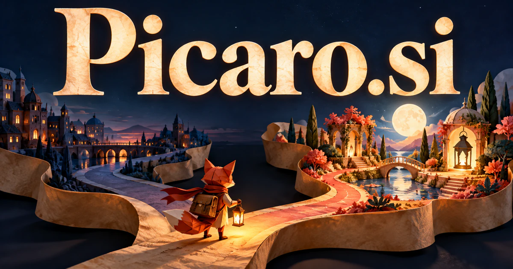

# Picaro.si — A resourceful character for adventures shaped by choices

Picaro.si evokes Spanish pícaro and the resourceful or roguish figure associated with picaresque stories. Interactive narrative is a strong starting point: preserve character motives and let a player's choices have understandable consequences. A curious travel guide or inventive assistant can borrow the same personality. These are creative interpretations of a real linguistic and literary foundation, rather than claims of a single prescribed product.

## Name roots and associations

Picaro evokes Spanish pícaro: a clever or roguish figure and, in literature, the protagonist associated with picaresque narratives. The [Royal Spanish Academy dictionary](https://dle.rae.es/p%C3%ADcaro) records both the character traits and the literary role. The domain omits the accent for a straightforward Latin-letter spelling. A buyer could emphasize resourcefulness, humor, curiosity, and experiences shaped by choices. That supports games and storytelling, but also travel discovery, creative tools, educational adventures, and a lively personal assistant.

## Ten directions a buyer could build

### 1. Interactive story adventures

An interactive story director could maintain character motives, world state and consequences while adapting a story to the player's decisions. Writers would develop meaningful branches that remain coherent rather than expand the experience through endlessly generated but inconsequential dialogue. Commercial options include selling episodic narratives in which choices affect relationships, routes, and discoveries. Game purchases or memberships could support original characters and replayable scenarios, with a consistent editorial voice making the experience more than an unrestricted text generator.

### 2. Tabletop campaign workspaces

A campaign planning companion could connect a game master's world notes, player choices and unresolved story threads, proposing encounters and consequences that fit the campaign. Groups would preserve the logic of a shared adventure while leaving the table's creative decisions with the players. Creator subscriptions and adventure-module sales could support a living campaign record that is easy to revise between sessions and reference at the table.

### 3. A resourceful personal assistant

A resourceful personal assistant could turn an unfamiliar request into a small investigation, compare workable approaches and coordinate approved tools when the obvious route fails. The brand could embody practical ingenuity, showing the user how a result was reached and what remains uncertain. Consumer subscriptions could combine an engaging personality with transparent permissions and approval steps, making competence visible through completed work rather than theatrical dialogue alone.

### 4. Curiosity-led city discovery

A curiosity-led city guide could connect a traveler's questions with local stories, places and practical route constraints, adapting the exploration as interests change. A city guide would deliver a coherent adventure around curiosity rather than simply optimize a checklist of popular stops. Paid guide collections or planning services could connect exploration with practical opening times, transport notes, and the ability to revise a day.

### 5. Creative writing education

A writing practice collaborator could challenge a writer with character conflicts, compare plot alternatives and ask why a proposed event changes the story. Educators would teach narrative reasoning and revision through creative decisions rather than provide complete stories for passive consumption. Course purchases and classroom licenses could help learners develop their own voices through projects, feedback, and revision.

### 6. Digital character production

A character production tool could connect an original persona's background, visual identity, speech patterns and interaction rules, testing consistency across scenes. Studios would create a distinctive character that can develop across media while retaining an intelligible point of view. Studio subscriptions or asset sales could connect a character’s visual style with consistent behavior across a game, video series, or interactive experience.

### 7. Improvisation and performance games

An improvisation practice partner could play changing scene partners, introduce constraints and adapt prompts to the group's choices, then support reflection on what happened. Facilitators would rehearse listening, collaboration and narrative invention through responsive practice rather than a static prompt deck. Workshop packs and event services could make the brand a home for enjoyable group activities with clear instructions and adaptable difficulty.

### 8. Adventure learning for children

An adventure learning companion could connect a child's questions with a story world, age-appropriate evidence and practical challenges, adapting when an explanation reveals confusion. Educators would make exploration purposeful while adults choose the learning scope and review the interaction. Family memberships and school licenses could combine narrative motivation with learning goals, adult controls, and useful offline materials.

### 9. Creator publishing collections

A creator publishing assistant could connect serialized stories, reader questions and editorial plans, identifying promising extensions and continuity problems. Independent publishers would develop an understandable creative universe rather than rely on a constant stream of unrelated installments. Memberships and individual purchases could support editorial curation, release schedules, and direct relationships between creators and readers.

### 10. Agent exploration sandboxes

An agent experimentation workbench could generate environments that test planning, cooperation and recovery, then compare why an agent's strategy succeeds or fails. Researchers would obtain reproducible evidence about resourceful behavior rather than infer broad competence from one entertaining demonstration. Research plans could preserve task definitions, interaction records, and evaluation methods while keeping the playful identity separate from unproven capability claims.

## A Super Intelligence product story

Picaro.si could tell a Super Intelligence story through an inventive assistant navigating unfamiliar situations. A user sets a goal; specialist agents explore options, explain obstacles, and suggest an adaptable plan. The personality makes the interaction memorable, while approvals, sources, and visible progress keep the product grounded in useful work.

## Why this name can carry a business

Six letters and three rhythmic syllables support a distinctive spoken identity. The literary foundation offers a rich narrative world without confining the business to books. Picaro can feel playful in a consumer application and imaginative in a creative toolkit, with room for an original cast and recognizable visual language.

## Related names to compare

- [Rapt.si](rapt-si.md) for immersion and sustained audience attention.
- [MaoMi.si](maomi-si.md) for a gentler cat-inspired character identity.
- [TravelBox.si](travelbox-si.md) for travel organization and packaged experiences.

## Explore Picaro.si

For acquisition enquiries about **Picaro.si**, contact [hedge.pike02@icloud.com](mailto:hedge.pike02@icloud.com?subject=Domain%20enquiry%3A%20picaro.si). Direct enquiries can discuss a preferential offer or a portfolio arrangement.

[View the marketplace listing](https://www.dynadot.com/market/user-listings/picaro.si) · [Marketplace and Escrow.com transaction options](../guides/how-to-buy.md) · [Browse all domains](../README.md)

## Research references

- [Royal Spanish Academy: pícaro](https://dle.rae.es/p%C3%ADcaro)

[Browse all domains](../README.md)
