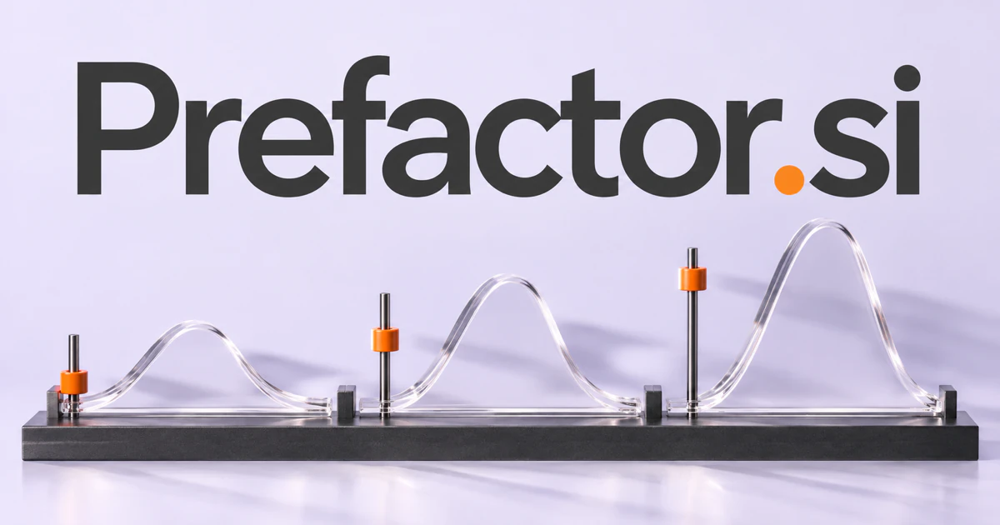

# Prefactor.si — Show which assumption changes the result

Prefactor.si comes from a mathematical term for a multiplying coefficient, giving the name an immediate scientific character. A calculation workspace could connect formulas, units and assumptions so a team understands why a result changes. Engineering sensitivity, calibration and reproducibility are direct uses. Scenario planning and prototype discovery take the broader idea of determining factors into business decisions.

## Meaning and naming depth

A prefactor is a coefficient multiplying a quantity of interest in a mathematical expression. It can influence the scale of an expression while another part describes a relationship or trend. This is a real technical term, not simply a new spelling of “pre-factor.”

The naming story extends naturally into parameters, calibration, assumptions, and model sensitivity. A founder could also use the “before the outcome” association metaphorically for preparation and analysis, provided that is presented as a brand interpretation rather than the mathematical definition. The valuable common thread is understanding what changes the result before relying on it.

## Business opportunities

### 1. Scientific calculation notebooks

A scientific calculation assistant could connect formulas, units, parameter sources and intermediate calculations, checking consistency and proposing alternative derivations. Researchers would inspect what determines a result rather than receive a confident number detached from its assumptions. Commercial options include selling institutional licenses, team collaboration, and specialist templates for recurring scientific calculations.

### 2. Engineering sensitivity analysis

A sensitivity investigation tool could identify influential model assumptions, design parameter comparisons and explain how uncertainty changes the engineering decision. Teams would choose the next useful measurement from its expected effect on the choice, rather than simply generate a larger sensitivity chart. Commercial options include selling technical software, configured workspaces, and consulting projects based on the customer’s actual engineering model.

### 3. Laboratory calibration workflows

A calibration workflow reviewer could connect reference records, processing choices, instrument conditions and observed deviations, generating hypotheses for a calibration review. Laboratories would preserve a traceable explanation of a result and identify what needs another measurement before changing a procedure. Commercial options include selling laboratory licenses, instrument integrations, and workflow development for specialized measurement environments.

### 4. Model evaluation and reproducibility

A reproducibility investigator could compare datasets, code versions, configuration and evaluation definitions, reconstructing why two reported results differ. Analytical teams would obtain concrete checks and missing artifacts rather than settle a disagreement by choosing the more impressive metric. Commercial options include selling experiment workspaces, private deployments, and methodological support to research groups and software organizations.

### 5. Mathematics and physics education

A scientific learning companion could vary a coefficient, show the modeled consequence and ask the learner to explain the relationship before offering another example. Teachers would connect algebraic form with physical interpretation through reasoning rather than rote substitution. Commercial options include selling course materials, classroom access, and technical training workshops.

### 6. Industrial process modeling

A process-model analyst could compare operating observations with a documented process model, propose competing explanations for divergence and plan targeted trials. Manufacturers would investigate the mechanism behind a change instead of blindly follow an optimization suggestion outside its tested conditions. Revenue could come from specialist software, implementation projects, and continuing analytical services for defined production problems.

### 7. A scientific software consultancy

A scientific software studio could translate a client's scientific question into computational requirements, compare methods and prepare reproducible calculation workflows. Consultants would deliver both working tools and an explanation of what their outputs can and cannot establish. Project work could produce reusable products sold as maintained libraries or applications.

### 8. Research literature and formula discovery

A formula research assistant could retrieve equations from approved sources, reconcile notation and compare the assumptions behind superficially similar expressions. Researchers would understand when a formula applies to their problem rather than adopt the first familiar-looking mathematical result. Commercial options include selling research workspaces, institutional subscriptions, and specialist curation services.

### 9. Business scenario planning

A business scenario planner could connect a forecast's drivers, source evidence and operational dependencies, construct alternative scenarios and identify early indicators. Planning teams would understand which assumption changes the decision rather than treat a single numerical forecast as a promised future. Commercial options include selling planning software and facilitated analytical workshops without presenting a scenario as a guaranteed prediction.

### 10. Preparation and prototyping services

A prototype prioritization tool could compare customer evidence, technical unknowns and proposed experiments, identifying the smallest prototype that tests the decisive assumption. Founders would spend development effort on learning that changes a decision rather than demonstrate an already plausible feature. Commercial options include selling scoped research programs, proof-of-concept projects, and long-term product development support.

## A Super Intelligence brand

Prefactor.si could frame Super Intelligence around grounded scientific reasoning: gather relevant evidence, make parameters explicit, perform calculations, and explain how assumptions affect a conclusion. A potential agent platform might connect a literature notebook, a computation environment, and a reviewable report. The name gives that ambition a precise scientific anchor in parameters, models, and scientific method.

## Why the name works

The word is distinctive, pronounceable, and meaningful to technical audiences. It suits Prefactor Lab, Prefactor Models, and Prefactor Studio without confining the owner to one calculation method. **“Understand what changes the outcome.”** gives a specialist term an understandable commercial benefit.

## Related names to compare

- [LQG.si](lqg-si.md) for control models, estimation and engineering experiments.
- [Gimel.si](gimel-si.md) for symbolic reasoning and connected research concepts.
- [Prelims.si](prelims-si.md) for preparation before committing to a larger study or project.

## Explore Prefactor.si

For acquisition enquiries about **Prefactor.si**, contact [hedge.pike02@icloud.com](mailto:hedge.pike02@icloud.com?subject=Domain%20enquiry%3A%20prefactor.si). Direct enquiries can discuss a preferential offer or a portfolio arrangement.

[View the marketplace listing](https://www.dynadot.com/market/user-listings/prefactor.si) · [Marketplace and Escrow.com transaction options](../guides/how-to-buy.md) · [Browse all domains](../README.md)

## Sources and further reading

- [WordWeb: prefactor](https://www.wordwebonline.com/en/PREFACTOR) — The established mathematical meaning of a multiplying coefficient.
- [W3C: MathML](https://www.w3.org/TR/MathML3/) — A primary standard for representing mathematical notation and content.
- [W3C: PROV Overview](https://www.w3.org/TR/prov-overview/) — A reference for representing provenance behind data and results.
