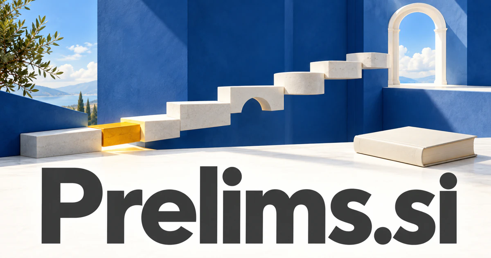

# Prelims.si — Prepare for the next stage with evidence of what is ready

Prelims.si is a familiar shortened form connected with preliminary examinations, rounds and preparatory work; publishing also uses prelims for a book's opening material. An examination practice service is a clear first direction, especially one that diagnoses understanding before assigning more work. Research proposals, auditions and project discovery use the same preparation theme while addressing different customer decisions.

## What the name opens up

Prelims is the familiar plural form of prelim, short for preliminary. A [prelim](https://www.merriam-webster.com/dictionary/prelim) can be a preliminary examination or event; the broader preliminary idea concerns what comes before the main undertaking. The plural also occurs in publishing for a book's [preliminary pages](https://academic.oup.com/pages/for-authors/books/the-book-publishing-process/writing-and-content-preparation/front-and-end-matter). These meanings provide a useful bridge from education and qualification to project preparation, competition, and editorial production. A brand could make the early stage feel purposeful: establish the foundations, test assumptions, and enter the next phase better prepared.

## Business opportunities

### 1. Exam preparation

An examination preparation tutor could compare a learner's attempted solutions, explanation patterns and the examination's actual requirements, designing targeted practice. Tutors would diagnose what needs understanding before assign another paper, rather than equate time spent studying with readiness. Course subscriptions and training-center licenses would support a focused preparation business.

### 2. Course readiness

A prerequisite learning guide could connect a forthcoming course's concepts with a student's demonstrated knowledge, identify missing dependencies and sequence bridging exercises. Institutions would provide an explainable preparation path that responds to evidence instead of assign the same remedial material to everyone. Institutional licenses or bridging-course fees would support a clearer transition into demanding academic or vocational study.

### 3. Competition practice

A competition rehearsal tool could vary preliminary-round questions, simulate constraints and analyze how a team reaches an answer. Organizers would build practice that develops reasoning under the actual format rather than merely provide a larger archive of isolated questions. Event packages or question-library subscriptions would turn a distinct early-stage need into a practical education-and-entertainment product.

### 4. Book front-matter tools

A front-matter publishing assistant could connect a manuscript's structure, edition format and publisher requirements, preparing consistent contents, introductory material and cross-references. Authors would review the opening architecture of a book as part of the reading experience rather than a final clerical chore. Project fees or publisher subscriptions would exploit a genuine publishing use of prelims.

### 5. Project discovery studios

A project discovery workspace could organize client interviews, competing requirements and tentative sketches, identify assumptions and propose focused discovery experiments. Consultants would make preliminary thinking a concrete decision aid before the project commits to an implementation path. A consulting service or workspace subscription could make preliminary work a visible, valuable deliverable.

### 6. Research proposal preparation

A research proposal assistant could connect a proposed question with prior literature, methodological choices and available evidence, exposing gaps in the argument. Students and supervisors would compare study designs and unresolved questions before turning an attractive topic into a larger research commitment. University licenses or guided cohorts would serve the work of preparation without claiming to replace academic judgment.

### 7. Sports qualifying rounds

A qualifying-round planner could reconcile entry lists, venue constraints, advancement rules and timing, comparing possible preliminary structures. Clubs would understand how a schedule change affects participants and the final stages before publishing the competition plan. Per-event pricing would support competitions where the early rounds must be as clearly organized as the final.

### 8. Audition rehearsal

An audition rehearsal coach could compare a performer's intended interpretation, selected material and recording, proposing specific rehearsal experiments. Teachers would connect feedback with an observable artistic choice rather than offer an unexplained score for the overall performance. Subscription studios or paid rehearsal packages could give the name a strong creative preparation territory.

### 9. Business due-diligence packets

A preliminary evidence reviewer could map a potential partnership's claims to requested documents, identify contradictory records and prepare questions for specialist advisers. Teams would enter substantive due diligence with an organized picture of what is known, assumed and missing. Professional subscriptions could support the administrative collection stage while specialist advisers conduct substantive evaluation.

### 10. Preparatory course publishing

A preparatory course guide could connect instructors' prerequisite maps with learner attempts, select modules and explain why a particular exercise comes next. Publishers would offer a route into advanced material that adapts to demonstrated understanding rather than a fixed sequence for every learner. Course sales, institutional licenses, and tutoring add-ons would build a natural education business around the word's first-stage meaning.

## A Super Intelligence product vision

A Prelims SI workspace could prepare a learner for an upcoming qualifying assessment by comparing the stated syllabus with actual attempts. It could generate targeted practice, explain errors through worked steps, and propose the next session. A tutor would be able to edit the plan and inspect evidence of understanding. The same architecture could support an organization's project readiness review: goals, prerequisites, examples, and unresolved questions. The brand centers on intelligent preparation, with a concrete initial product and room to add specialized tracks as the product grows.

## Related names to compare

- [JobReady.si](jobready-si.md) for readiness for a practical role and workplace tasks.
- [Prefactor.si](prefactor-si.md) for the analytical assumptions a proposal should test.
- [Rapt.si](rapt-si.md) for focused engagement during study and rehearsal.

## Explore Prelims.si

For acquisition enquiries about **Prelims.si**, contact [hedge.pike02@icloud.com](mailto:hedge.pike02@icloud.com?subject=Domain%20enquiry%3A%20prelims.si). Direct enquiries can discuss a preferential offer or a portfolio arrangement.

[View the marketplace listing](https://www.dynadot.com/market/user-listings/prelims.si) · [Marketplace and Escrow.com transaction options](../guides/how-to-buy.md) · [Browse all domains](../README.md)

## Sources and further reading

- [Prelim — Merriam-Webster](https://www.merriam-webster.com/dictionary/prelim) — Established preliminary examination and event meanings.

- [Front and end matter — Oxford University Press](https://academic.oup.com/pages/for-authors/books/the-book-publishing-process/writing-and-content-preparation/front-and-end-matter) — Publisher guidance explicitly using prelims for book front matter.
