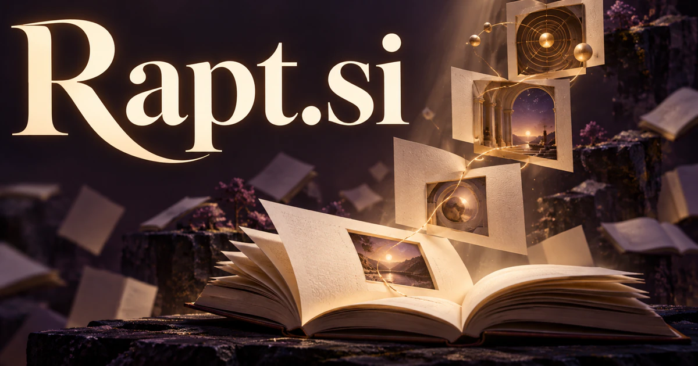

# Rapt.si — Help people stay absorbed in something worth understanding

Rapt.si uses a real English word for deep absorption and attention. A reading or learning workspace could help someone retain the thread of a difficult idea, ask better questions and return with context intact. Interactive stories, listening experiences and presentation coaching apply the same attention-centered identity differently. Creative retreats and communities provide a service-oriented interpretation beyond a standalone application.

## What the name opens up

[Rapt](https://www.merriam-webster.com/dictionary/rapt) can describe being deeply absorbed or carried away by emotion. It is a real four-letter word, with a crisp single-syllable sound and an unusually strong experiential promise. A buyer could explore concentrated work, immersive storytelling, music, visual experiences, or learning. The audible resemblance to wrapped can inspire a presentation metaphor, but it is a separate spelling and should not replace the established meaning. The central territory is valuable attention: an experience compelling enough that someone wants to stay with it.

## Business opportunities

### 1. Focused reading

A deep-reading companion could connect a reader's questions, difficult passages and earlier notes, explain competing interpretations and preserve the thread between sessions. Readers would sustain an investigation into a demanding text rather than replace the experience with a generic summary. Personal subscriptions or reading-group editions would support sustained engagement with demanding books, reports, and ideas.

### 2. Writing sessions

A writing-session collaborator could compare the writer's intended argument, current draft and unresolved research, proposing one useful next objective. Authors would use focused sessions to advance a coherent work rather than generate more paragraphs without resolving the structural problem. Memberships or guided writing programs would turn the attention-centered brand into a practical creative routine.

### 3. Immersive lessons

An immersive lesson designer could connect narrative choices, learner explanations and a specific objective, adapting the lesson when a response reveals a misconception. Teachers would make attention serve understanding instead of treat engagement alone as evidence that learning occurred. School licenses or professional training subscriptions would connect compelling presentation with demonstrable understanding.

### 4. Immersive story studios

An interactive narrative director could maintain narrative stakes, character memory and consequences as an audience makes choices, testing alternative branches for coherence. Writers would develop an absorbing experience where interaction changes something meaningful rather than merely varies the wording of the next scene. Writers could sell story worlds and extensions.

### 5. Music discovery rooms

An attentive listening guide could connect a listener's questions with musical examples, production details and a curator's commentary, proposing a guided comparison. Music services would support active appreciation and discovery beyond repeatedly supplying tracks similar to the last selection. Memberships, curator editions, or paid listening events could support a music business centered on concentrated appreciation.

### 6. Creative retreat services

A creative retreat planner could reconcile participants' projects, preferred working rhythms and available mentoring, proposing a focused schedule and preparation plan. Retreat hosts would support a meaningful creative outcome instead of offer protected time without help clarifying how to use it. Event fees or memberships would turn the attention promise into a concrete service and community.

### 7. Knowledge exploration maps

An inquiry-path assistant could map a question into supporting sources, counterarguments and possible next investigations, preserving the reader's chosen trail. Knowledge tools would help users understand why an idea connects to another rather than encourage endless browsing through unrelated recommendations. Consumer subscriptions or research-team seats could support a distinctive tool for deep exploration.

### 8. Presentation rehearsal

A presentation rehearsal coach could compare a presentation's intended message, audience assumptions and recorded delivery, identifying where the argument loses its thread. Speakers would test revisions against a specific communication goal instead of optimize pace or emphasis without regard to meaning. Individual subscriptions or training services could attach the name to making communication more engaging.

### 9. Visual experience production

An immersive experience studio could connect a visitor journey, interpretive goals, spatial constraints and interactive assets, comparing coherent experience concepts. Museums and event studios would explain how attention and movement support the story before committing to an impressive but disconnected installation. The word's emotional meaning supports a premium experience identity without specifying one technical medium.

### 10. Study-session communities

A study community coordinator could connect members' learning goals, available sessions and reflections on earlier work, proposing useful groups and next exercises. Communities would support sustained progress through shared purpose rather than equate a busy room or running timer with effective study. Quiet rooms, optional timers, and peer check-ins could support memberships.

## A Super Intelligence product vision

A Rapt SI companion could help a researcher or writer enter a demanding task with the right material already arranged. It might build a reading route from selected sources, keep unresolved questions nearby, and resume the session with the exact context that matters. It would respond when invited and surface a small number of useful connections. A subscription could begin with serious readers or creators. The long-term vision is intelligent immersion: software that supports sustained engagement and meaningful progress.

## Related names to compare

- [ReadOn.si](readon-si.md) for continuing reading and building understanding.
- [HearMe.si](hearme-si.md) for spoken intention, listening and expression.
- [Oazis.si](oazis-si.md) for quiet context and relief from information overload.

## Explore Rapt.si

For acquisition enquiries about **Rapt.si**, contact [hedge.pike02@icloud.com](mailto:hedge.pike02@icloud.com?subject=Domain%20enquiry%3A%20rapt.si). Direct enquiries can discuss a preferential offer or a portfolio arrangement.

[View the marketplace listing](https://www.dynadot.com/market/user-listings/rapt.si) · [Marketplace and Escrow.com transaction options](../guides/how-to-buy.md) · [Browse all domains](../README.md)

## Sources and further reading

- [Rapt — Merriam-Webster](https://www.merriam-webster.com/dictionary/rapt) — Established senses of absorption and emotion behind the naming analysis.
