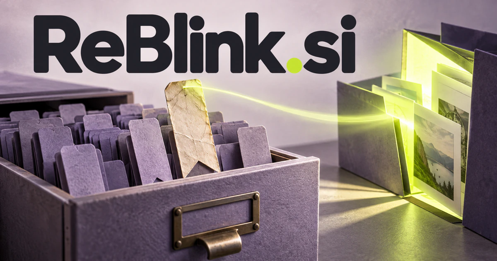

# ReBlink.si — Look again. Recover what matters.

**ReBlink.si** combines the idea of returning with the quick visual cue of a blink. It could help researchers, photographers, or everyday knowledge workers revisit something with a fresh question—recovering an old link, understanding a revision, or noticing a meaningful change that was easy to miss.

## Meaning and naming depth

ReBlink can be read as the prefix **re-**, suggesting repetition or return, plus **blink**, the brief closing and opening of the eyes or an intermittent light. The combined word is a creative brand construction; it does not have to be assigned a fabricated dictionary definition.

That composition gives the name several coherent territories. A second blink can become a metaphor for taking another look. A blinking signal can suggest a reminder or an event worth noticing. The visual association also supports photography, short-form motion, display tools, and interactive experiences. A future owner can choose a product story without losing the name’s shared idea of renewed attention.

## Business opportunities

### 1. Saved-link rediscovery

A bookmark rediscovery tool could connect an old saved link with a current project, recover why it originally mattered, and explain whether new evidence has made it more useful or less trustworthy. The product could connect a current question to something saved months earlier. Commercial routes include individual subscriptions, team collections, and specialist research workspaces built around useful retrieval rather than passive storage.

### 2. Document revision review

A revision-review workspace could trace a changed paragraph through linked requirements and decisions, distinguish a wording edit from a substantive shift, and direct each reviewer to the consequences in their own area. A reviewer could inspect the relevant passage without rereading everything. The business could offer team licenses and client review portals to agencies and consultancies.

### 3. Learning and recall sessions

A recall companion could compare a learner’s explanation with the source concept, identify the particular connection that has faded, and schedule a new retrieval exercise around that misunderstanding rather than elapsed time alone. Teachers could assign revision paths and learners could revisit difficult concepts. Customers could buy learning subscriptions, course workspaces, and instructor tools under a name that naturally suggests looking again.

### 4. Photo selection and visual comparison

A photographer’s selection workspace could compare photographs against a creator’s intended story, detect meaningful differences in expression or composition, and help build a coherent selection without treating technical sharpness as the only criterion. AI could suggest groups while the photographer makes aesthetic choices. The commercial offer could combine studio subscriptions, client delivery tools, and focused desktop utilities for recurring image workflows.

### 5. Visual change monitoring

A visual change monitor could connect a visual change with surrounding text, previous versions, and business relevance, then explain whether it suggests a new risk, opportunity, or harmless cosmetic update. Product teams could connect changes to a release or a client request. Commercial routes include monitoring plans, collaborative workspaces, and specialist implementation services for visual quality processes.

### 6. A short-form animation studio

A motion-design studio could reason across a client brief, motion references, timing, and production constraints, propose alternative animation treatments, and maintain continuity as a team revises the concept. The blink association supports a memorable film ident and a compact visual language. The business could offer commissioned work, motion templates, and original asset collections to brands and creative teams.

### 7. A reminder and attention application

A considered reminder service could relate reminders to personal goals, dependencies, and current workload, recognize when a task needs renegotiation, and propose a useful intervention instead of another identical notification. Users could build routines around unfinished creative work or personal commitments. Customers could buy individual plans, planning templates, and optional coaching programs focused on considered follow-through.

### 8. A personal memory notebook

A personal memory notebook could reconnect a note, photograph, and past conversation with a current question, distinguish direct records from later interpretations, and help the user recover the relevant personal context. A user could revisit an event through several types of material. Consumer subscriptions, printed journals, and family sharing features would give the renewed-attention story an emotional application.

### 9. Research reappraisal and evidence review

A research review workspace could revisit a research conclusion when new material arrives, compare competing explanations, and show which earlier assumptions now deserve another look before a decision is reused. A workspace could compare the previous evidence, changed assumptions, and open questions. Commercial routes include research tools and facilitated review services to professional teams whose understanding develops over time.

### 10. Interactive art and display tools

An interactive display system could interpret audience interaction alongside an installation’s creative rules, coordinate visual responses across displays, and help artists explore variations that preserve a recognizable creative intent. Artists and makers could create installations or desktop objects. The business could offer device kits, creative software, and commissioned experiences that express the blink component literally.

## A Super Intelligence brand

ReBlink.si can position Super Intelligence around contextual memory: retrieve what matters from prior information and reconsider it in light of a new goal. A possible assistant could notice that an old note, image, or decision has become relevant and explain the connection. The brand turns a broad intelligence capability into an intuitive experience of seeing something again with fresh understanding.

## Why the name works

The name is compact, active, and visually suggestive. It can support a playful consumer product or a calm professional review tool. **“Look again. Find more.”** communicates the central benefit, while ReBlink Notes, ReBlink Review, and ReBlink Studio remain recognizable members of one family.

## Related names, different purposes

[EasySearch.si](easysearch-si.md) offers a broader discovery promise, while ReBlink emphasizes returning to material already seen. [Cues.si](cues-si.md) centers on timely prompts; [TruthCheck.si](truthcheck-si.md) centers on the evidence needed to evaluate a claim.

## Explore ReBlink.si

Interested in **ReBlink.si** for one of the opportunities above? Contact [hedge.pike02@icloud.com](mailto:hedge.pike02@icloud.com?subject=Domain%20enquiry%3A%20reblink.si) to discuss availability, a direct-purchase offer, a possible discount, or a portfolio combination. These are envisioned products and services for a future owner to build.

[View the Dynadot listing](https://www.dynadot.com/market/user-listings/reblink.si) · [Marketplaces and Escrow.com](../guides/how-to-buy.md) · [Browse all domains](../README.md)

## Sources and further reading

- [Merriam-Webster: blink](https://www.merriam-webster.com/dictionary/blink) — Eye movement and intermittent-light senses behind the compound.
- [W3C: PROV Overview](https://www.w3.org/TR/prov-overview/) — A primary reference for keeping the origins and changes of information understandable.
