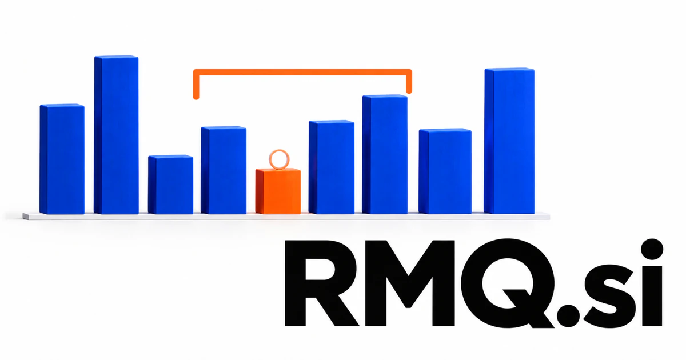

# RMQ.si — Better questions, organized work, explainable answers

**RMQ.si** has a genuine computing foundation in range minimum queries, with creative room for a research or messaging brand. It could serve developers investigating query behavior, teams managing research questions, or operators who need to understand why queued work is not moving as expected.

## Meaning and naming depth

A **range minimum query** asks for a minimum within a specified interval of a sequence. Related range-query problems ask for other aggregates, such as a maximum. The central ideas are structured data, preprocessing, indexing, and efficient answers to repeated questions.

A new owner could choose creative readings such as **Reliable Message Queue**, **Research Management and Queries**, or **Retrieval, Memory, and Questions**. Those are proposed brand expansions here, not alternative definitions of the algorithmic abbreviation. They share a useful commercial theme: make repeated information requests organized and dependable. The strongest direction would pair a clearly defined workload with tools that let customers inspect the result.

## Business opportunities

### 1. An interactive algorithms school

An algorithms tutor could infer how a learner misunderstands a range query, compare alternative solution strategies, and generate a worked counterexample that connects the implementation to the underlying invariant. Learners could compare preprocessing and query behavior on different inputs. Commercial routes include classroom licenses, interview-practice courses, and workshops to educators and technical training organizations.

### 2. Indexing and query benchmarks

A query benchmark workbench could relate benchmark results to data distributions, memory constraints, and update patterns, then explain which indexing trade-offs are likely to matter in the customer’s actual workload. Reports could retain data characteristics, configuration, runtime, and memory observations. The business could offer team workspaces, benchmark services, and specialist investigations for software teams working on performance-sensitive systems.

### 3. Query engineering consultancy

A query-engineering service could follow a slow query through application intent, storage choices, and operational constraints, formulate competing remedies, and prepare experiments that make the trade-offs measurable. A paid engagement could leave behind experiments the customer can rerun. The three-letter technical identity can support services first and reusable developer tools later.

### 4. A message-queue operations console

A message-queue console could connect queue depth, consumer behavior, retries, and business deadlines, diagnose likely bottlenecks, and propose a reviewed recovery sequence that accounts for duplicate-processing consequences. Operators could follow a message through its lifecycle. The commercial offer could combine monitoring workspaces, private deployments, and integration services to application infrastructure teams.

### 5. Research question management

A research-question workspace could maintain the relationships among open questions, supporting evidence, and project dependencies, then allocate follow-up investigations where resolving uncertainty would change the team’s decision. A consulting team could see which questions are answered and which depend on missing sources. Commercial routes include shared workspaces, research templates, and facilitated methodology programs for professional organizations.

### 6. Retrieval testing for AI applications

A retrieval testing tool could connect failed answers with missed sources, ambiguous questions, and ranking behavior, then design targeted tests that separate retrieval failures from reasoning failures. Reviewers could retain why a result was useful or misleading. The business could offer evaluation tools, maintained test collections, and specialist retrieval improvement services.

### 7. Time-series range analysis

A time-series investigation tool could compare unusually low or high readings across selected intervals, relate them to operational events, and explain whether a pattern warrants a deeper investigation before an alert is escalated. Engineers or analysts could inspect the underlying records behind an aggregate. Customers could buy analytical applications and integration packages for operational measurements, equipment data, or other customer-owned sequences.

### 8. A distributed-work execution queue

A distributed-work scheduler could reason about task dependencies, worker capabilities, and delivery commitments, reorganize a distributed queue as conditions change, and preserve a clear explanation of the new execution order. An assistant could prepare task context before assignment. The commercial offer could combine workspace subscriptions and configured workflows for organizations coordinating recurring research, processing, or production work.

### 9. A queryable knowledge memory

A queryable knowledge notebook could retrieve an earlier decision with its assumptions and unresolved questions, compare it with present evidence, and help teams reuse reasoning without blindly reusing an outdated conclusion. A professional could revisit earlier work with its original context intact. Commercial routes include individual subscriptions and team knowledge workspaces for research-heavy businesses.

### 10. Technical publications and developer utilities

A technical learning service could connect documentation, reproducible examples, and reader questions, recognize recurring conceptual gaps, and shape a sequence of technical explanations around actual implementation obstacles. A small technical publisher could sell books, courses, premium utilities, and consulting. The name’s authentic computing connection provides a coherent center for several complementary products.

## A Super Intelligence brand

RMQ.si can position Super Intelligence around disciplined retrieval: ask an explicit question, select the relevant information, and make the answering process inspectable. A possible product would connect indexed knowledge, saved research questions, and evaluation records. The algorithmic reference gives the brand precision, while the broader intelligence story can grow toward coordinated reasoning over structured information.

## Why the name works

Three letters work well in developer interfaces, technical publications, and enterprise product names. The established acronym provides a real point of recognition, and deliberate expansions can support other coherent markets. **“Better questions. Better retrieval.”** expresses the shared value without claiming that a particular data structure solves every search problem.

## Related names, different purposes

[LVQ.si](lvq-si.md) points toward classification and vector reasoning; RMQ’s established algorithmic hook is querying intervals. [OneNode.si](onenode-si.md) emphasizes connected computing infrastructure, while [Topoi.si](topoi-si.md) offers a more conceptual identity for organizing research knowledge.

## Explore RMQ.si

Interested in **RMQ.si** for one of the opportunities above? Contact [hedge.pike02@icloud.com](mailto:hedge.pike02@icloud.com?subject=Domain%20enquiry%3A%20rmq.si) to discuss availability, a direct-purchase offer, a possible discount, or a portfolio combination. These are envisioned products and services for a future owner to build.

[View the Dynadot listing](https://www.dynadot.com/market/user-listings/rmq.si) · [Marketplaces and Escrow.com](../guides/how-to-buy.md) · [Browse all domains](../README.md)

## Sources and further reading

- [FL-RMQ: A Learned Approach to Range Minimum Queries](https://drops.dagstuhl.de/entities/document/10.4230/LIPIcs.CPM.2025.7) — Primary research on the established computing problem and query structures.
- [OpenAPI Specification](https://spec.openapis.org/oas/latest.html) — A reference for making software query capabilities explicit through documented interfaces.
