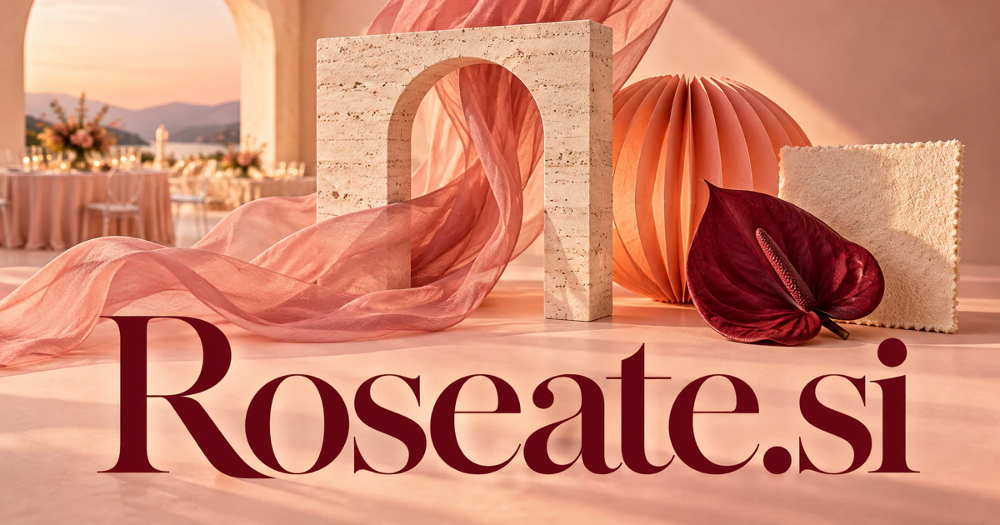

# Roseate.si — A thoughtful identity for color, atmosphere, and optimism

Roseate means rose-colored or optimistic, giving **Roseate.si** a vivid starting point for a design studio, hospitality concept, or personal creative companion. The business could translate a desired feeling into coherent choices across color, materials, imagery, and the small moments that make an experience memorable.

## What the name opens up

[Roseate](https://www.merriam-webster.com/dictionary/roseate) can describe a rose-like color and an optimistic or favorably viewed outlook. Its origin and literary use contribute to a distinctive naming story. The word can support beauty, design, hospitality, creative publishing, and hopeful personal experiences. Its optimism also has a useful nuance: roseate can imply an excessively favorable outlook, so a thoughtful product should pair its inviting presentation with grounded information. The seven-letter form offers an elegant, expressive identity for businesses that want to feel warm and imaginative.

## Business opportunities

### 1. Event moodboards

An event-design workspace could connect an event’s emotional brief with venue conditions, material choices, and guest needs, then coordinate coherent moodboard alternatives that remain practical to produce. Clients could approve a coherent direction before detailed ordering begins. Professional subscriptions or complete planning packages would connect the warm name with an actual creative workflow.

### 2. Beauty campaign studio

A beauty campaign studio could reason across product characteristics, audience expectations, visual language, and release channels, generate distinct creative routes, and explain how each route supports the intended brand impression. Reviewers could compare versions in context. Agency services or brand workspaces would make Roseate a practical studio identity across seasonal launches and ongoing content production.

### 3. Creative resource shop

A curated creative-resource service could connect a buyer’s project brief with compatible visual resources, identify gaps in a collection, and assemble an adaptable creative kit rather than an indiscriminate bundle. Customers could select a complete visual family. Resource purchases, memberships, or print fulfillment would turn Roseate's color-and-mood association into a focused creative commerce business.

### 4. Boutique hospitality design

A hospitality design practice could relate a property’s atmosphere to guest journeys, local operations, lighting, and maintenance constraints, then coordinate design options across rooms, communications, and service moments. A workspace could collect references, purchasing decisions, and operational notes. Consulting packages or property subscriptions would connect the name's inviting mood with a concrete guest-experience business.

### 5. Personal visual journals

A visual journal could connect recurring colors, photographs, and personal notes with the user’s expressed intentions, offer creative prompts, and help a journal develop a meaningful visual narrative over time. Collections could become printable keepsakes or project boards. Consumer subscriptions and print products would give the optimism reading a personal, creative application.

### 6. Floral commerce and planning

A floral planning service could combine a client’s mood, venue layout, seasonal inventory, and delivery constraints, draft arrangements and substitutions, and keep the proposal coherent when availability changes. Customers could review a coherent visual plan before confirming the work. A florist subscription or directly operated studio could link the rosy image to an actual creative trade.

### 7. Skincare presentation tools

A skincare communication workspace could connect approved ingredient information, customer questions, packaging, and visual presentation, then help a team build clear explanations without inventing unsupported skin benefits. Teams could keep claims tied to approved source information while developing a warm visual identity. Agency services or content subscriptions could support a specialized creative business.

### 8. Wedding stationery collections

A wedding stationery studio could reconcile names, guest groups, event stages, and a chosen design language, then coordinate a consistent stationery family and detect inconsistencies before the files are approved. Customers could select a visual direction and preview the complete set. Product sales, designer collaborations, and print fulfillment would make Roseate a natural commerce brand.

### 9. Optimistic planning notebooks

A reflective planning notebook could compare an optimistic goal with available time, resources, and previous attempts, build realistic alternative paths, and help the user revise the plan when circumstances change. Templates and optional coaching could support progress. Consumer subscriptions or physical journals would use the hopeful meaning without making promises about outcomes.

### 10. Art direction education

An art-direction learning tool could connect a student’s visual choices with the intended audience and brief, compare alternative compositions, and explain why a revision changes the emotional effect of the work. Learners could assemble reference boards and receive critique on actual projects. Paid courses, studio workshops, or a resource membership could turn the elegant name into a focused creative-learning destination.

## A Super Intelligence product vision

A Roseate SI creative studio could translate a customer's desired atmosphere into several visual routes, then organize the actual decisions needed to realize one. For an event, that might mean colors, flowers, materials, stationery, and supplier briefs. A planner would compare practical availability with the proposed mood and approve the final selections. A subscription could start with professional planning teams; a service business could sell complete concepts. The intelligence story is coordinated taste: connecting imagery, constraints, and execution while keeping the human client's preferences central.

## Related names, different purposes

[Hues.si](hues-si.md) is more direct for color selection and visual systems. [ELuxe.si](eluxe-si.md) emphasizes premium curation, whereas [Drap.si](drap-si.md) anchors a design brand in textiles and the practical realities of fabric.

## Explore Roseate.si

Interested in **Roseate.si** for one of the opportunities above? Contact [hedge.pike02@icloud.com](mailto:hedge.pike02@icloud.com?subject=Domain%20enquiry%3A%20roseate.si) to discuss availability, a direct-purchase offer, a possible discount, or a portfolio combination. These are envisioned products and services for a future owner to build.

[View the Dynadot listing](https://www.dynadot.com/market/user-listings/roseate.si) · [Marketplaces and Escrow.com](../guides/how-to-buy.md) · [Browse all domains](../README.md)

## Sources and further reading

- [Roseate — Merriam-Webster](https://www.merriam-webster.com/dictionary/roseate) — Rose-colored and figurative optimism meanings, including their nuance.
