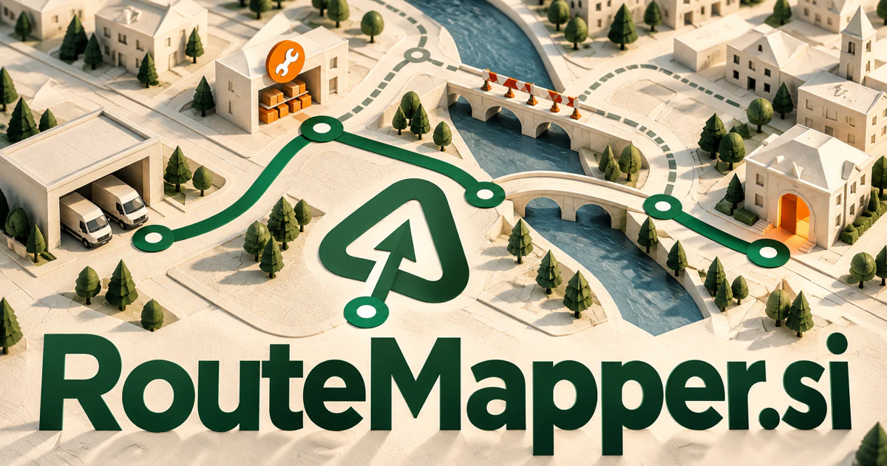

# RouteMapper.si — Find a workable path through changing constraints

**RouteMapper.si** describes both a literal route and the plan that connects one stage to another. It could help dispatchers, travelers, software teams, or learning services compare possible paths, understand their dependencies, and recover when a delay or changed requirement makes the original plan unworkable.

## Meaning and context

RouteMapper brings together a path and the act of describing it. The obvious interpretation is geographical, but routes also run through software networks, customer journeys, approval processes, learning programs, and agent teams. A map makes those paths inspectable before anyone follows them. There is a genuine technical foundation for the travel direction: [Google's Route Optimization documentation](https://developers.google.com/maps/documentation/route-optimization/overview) describes assigning tasks and routes while respecting operational constraints. A broader brand could apply that same clarity to the route from a request to an outcome.

## Ten directions a buyer could build

The following are proposed business opportunities. They show different ways to develop the name, with concrete audiences, workflows, and potential commercial models.

### 1. Field-service dispatch

A field-service dispatcher could combine technician skills, parts availability, travel time, and customer commitments, model the consequences of disruptions, and propose a revised route that preserves the most important service outcomes. A dispatcher reviews proposed schedules and exceptions before release. Per-team subscriptions could connect route preparation with daily handovers and subsequent service records.

### 2. Editable travel itineraries

An itinerary planning service could connect traveler preferences, opening times, transport options, and group constraints, explain competing itineraries, and rebuild the day coherently when a reservation or connection changes. Planning fees or agency subscriptions could support alternatives when a booking changes, with a clear explanation of the tradeoffs between routes.

### 3. Multi-agent workflow maps

An agent-workflow planner could map which specialist agent has the evidence and authority needed for each step, detect circular dependencies, and plan a recoverable route from the user’s intent to a reviewed result. Business subscriptions could make an automation understandable before it runs, then connect the visible map with actual execution records and unresolved steps.

### 4. Delivery planning for local businesses

A local delivery planner could compare vehicle capacity, customer windows, order preparation, and local conditions, then recommend a feasible delivery sequence with clear alternatives when the original route breaks. A subscription could support vehicle capacity, customer notes, and driver instructions, while retaining manual adjustments for the local knowledge a dispatcher brings.

### 5. API and service routing

A service-routing workbench could connect request intent, service health, latency, and policy constraints, compare possible routing paths, and prepare bounded changes with an explanation of their operational consequences. Developer plans could connect architecture maps with traces, ownership information, and proposed changes before a team alters production routing.

### 6. Customer journey design

A customer-journey workspace could reconcile interviews, behavioral evidence, and internal process maps, locate the friction behind an abandoned task, and propose a testable route to a better service experience. Team subscriptions could connect customer research and analytics to concrete experiments, making the proposed journey more than a polished presentation.

### 7. Learning and career pathways

A learning-path companion could connect current capabilities, desired roles, and real learning opportunities, distinguish prerequisites from optional detours, and revise a development path using evidence from completed work. Education providers could license pathway tools, while individual users purchase guided programs that change as completed work reveals new strengths and gaps.

### 8. Accessible journey preparation

An accessible journey planner could reason across a traveler’s stated access needs, route details, venue information, and uncertainty, then prepare alternatives and practical questions before the journey begins. Paid advisory services could produce detailed, editable plans with source dates and practical questions to confirm before departure.

### 9. Process and approval navigation

A process-navigation service could connect a request with the policies, approvers, and evidence it needs, anticipate a blocked handoff, and guide staff through an auditable route to resolution. Enterprise subscriptions could expose required documents, responsible people, and the current state of a request without forcing users through scattered policy pages.

### 10. Outdoor discovery collections

An outdoor discovery guide could connect outdoor interests with terrain, time, available route information, and group preferences, create suitable discovery paths, and make missing information visible before people set out. Memberships and guide sales could serve clubs, local tourism teams, and independent creators building a carefully maintained collection of journeys.

## A Super Intelligence product story

RouteMapper.si could stand for Super Intelligence with a visible plan. A user asks for a week of service visits; agents interpret the brief, retrieve agreed constraints, and prepare candidate schedules. A routing solver handles optimization, while the interface explains exceptions and requests human approval. The same architecture could map a business workflow.

## Why this name can carry a business

The name is descriptive without being confined to a single industry. Its important promise is legibility: understand the options, see the connections, and choose a route. A buyer can start with geographical planning and expand into operational or digital pathways while retaining that consistent idea.

## Related names, different purposes

[TravelBox.si](travelbox-si.md) suits a complete travel experience rather than routing alone. [ServiceCall.si](servicecall-si.md) centers on delivering a customer service request; [TZP.si](tzp-si.md) gives time zones, scheduling, and prioritization a concise technical identity.

## Explore RouteMapper.si

Interested in **RouteMapper.si** for one of the opportunities above? Contact [hedge.pike02@icloud.com](mailto:hedge.pike02@icloud.com?subject=Domain%20enquiry%3A%20routemapper.si) to discuss availability, a direct-purchase offer, a possible discount, or a portfolio combination. These are envisioned products and services for a future owner to build.

[View the Dynadot listing](https://www.dynadot.com/market/user-listings/routemapper.si) · [Marketplaces and Escrow.com](../guides/how-to-buy.md) · [Browse all domains](../README.md)

## Research references

- [Google Maps: Route Optimization overview](https://developers.google.com/maps/documentation/route-optimization/overview)
- [Google OR-Tools: vehicle routing with time windows](https://developers.google.com/optimization/routing/vrptw)

[Browse all domains](../README.md)
