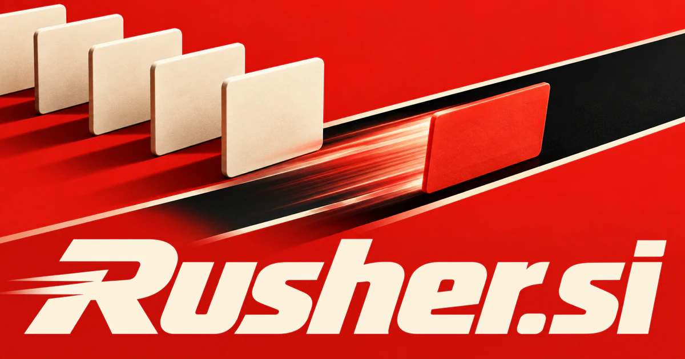

# Rusher.si — Choose the next move when time is short

A rusher moves quickly; the useful brand promise is knowing where speed matters. **Rusher.si** could serve incident teams, delivery operators, creative desks, or busy individuals by connecting urgency with dependencies and helping people complete a feasible next action instead of reacting to every request at once.

## Meaning and naming depth

A rusher is someone or something that rushes, with a recognized sporting use for a ballcarrier. The root suggests moving quickly, pressing forward, or acting under time pressure. That creates two productive brand territories: rapid practical service and active competitive performance.

A strong interpretation is prioritized movement: know what needs attention, prepare the next action, and keep handoffs clear. The *-er* ending also makes the name character-like, suitable for a mascot, an assistant, an athlete-focused brand, or a protagonist in an interactive world.

## Business opportunities

### 1. Priority execution for busy teams

A team execution assistant could compare competing deadlines with dependencies and team capacity, identify the next consequential action, and coordinate a short delivery plan that explains what should wait and why. An assistant could prepare responses and track completion across connected tools. Commercial routes include team subscriptions to agencies, sales organizations, and operations businesses dealing with frequent short-notice requests.

### 2. Same-day service coordination

An urgent service dispatcher could reconcile urgent customer needs with worker skills, travel, equipment, and commitments, then propose a feasible dispatch plan instead of treating every incoming job as equally urgent. Customers could see available capacity and receive clear status updates. Software licensing, managed dispatch services, and a focused local marketplace would be different ways to commercialize the same urgency theme.

### 3. A rapid creative production desk

A rapid creative desk could translate a compressed creative brief into parallel writing, design, and review tasks, maintain consistency between outputs, and surface the decisions that would otherwise cause last-minute rework. AI could help prepare drafts and organize assets while specialists deliver the work. Customers could buy packages, retainers, and priority service plans to clients needing dependable short-cycle production.

### 4. Incident and exception management

An incident coordination workspace could combine logs, customer impact, recent changes, and responder expertise, build competing explanations, and coordinate reviewed containment steps while preserving the evidence needed for later investigation. The product could collect relevant system evidence before the next person takes over. The commercial offer could combine operational workspaces and managed setup services to companies whose customers depend on timely responses.

### 5. Sports coaching and performance review

A sports coaching tool could connect match footage, training goals, and the athlete’s role, distinguish a rushed decision from an effective burst of speed, and turn those observations into focused practice. Coaches could assemble clips and assign practice tasks. Team licenses, individual training programs, and specialist content subscriptions would give the sporting sense of rusher a direct commercial use.

### 6. An action or racing game

An adaptive action game could adapt opponent behavior, challenge pacing, and feedback to the player’s demonstrated strategies, creating a fast experience that rewards situational reasoning rather than reflex repetition alone. Rusher could be the title, the player character, or a family of challenges. Premium game sales, expansions, and merchandise offer possibilities separate from enterprise software while using the same energetic identity.

### 7. Product launch coordination

A launch coordination service could connect product readiness, dependencies, channel plans, and support capacity, simulate likely bottlenecks, and keep a release team aligned around the next launch-critical decision. The system could show dependencies and outstanding decisions. Customers could buy project templates, team software, and launch-management services to founders and agencies.

### 8. Personal productivity sprints

A focused sprint companion could connect an urgent goal with calendar realities, unfinished work, and energy preferences, propose a bounded sprint, and renegotiate the remaining plan after the sprint’s actual outcome. A character-led interface could make routine progress feel engaging. The commercial offer could combine subscriptions, planning templates, and facilitated group sessions for students, freelancers, and remote workers.

### 9. Last-minute travel and activity planning

A last-minute trip planner could reconcile late availability, connection times, traveler preferences, and cancellation constraints, assemble realistic alternatives, and show which missing decision is preventing the booking from moving forward. The service could compare feasible options against time constraints. Planning fees, memberships, and curated experiences would support a consumer-facing Rusher brand.

### 10. A delivery and operations toolkit

A delivery operations workspace could reason across incoming orders, preparation status, delivery capacity, and exceptions, coordinate approved handoffs, and provide a shared explanation of what must happen next. The product could combine a driver application with an office dashboard. Device-based subscriptions and onboarding services would make the brand useful beyond a consumer courier marketplace.

## A Super Intelligence brand

Rusher.si can position Super Intelligence around shortening the distance between recognizing a need and taking the next useful action. A possible assistant could collect context, order tasks by urgency, prepare the required materials, and coordinate tools or people. The stronger product story is controlled momentum: making time-sensitive work understandable and executable.

## Why the name works

The name has a clear rhythm, a familiar root, and the characterful ending of an active participant. It works on a software button, a sports jersey, a game title, or a delivery vehicle. **“Move the important work forward.”** provides a serious business interpretation of its energy.

## Related names, different purposes

[Jiff.si](jiff-si.md) leans toward small, quick everyday tasks. [RouteMapper.si](routemapper-si.md) emphasizes paths and dependencies, while [LeadOff.si](leadoff-si.md) is better suited to launches, opening moves, and getting a venture started.

## Explore Rusher.si

Interested in **Rusher.si** for one of the opportunities above? Contact [hedge.pike02@icloud.com](mailto:hedge.pike02@icloud.com?subject=Domain%20enquiry%3A%20rusher.si) to discuss availability, a direct-purchase offer, a possible discount, or a portfolio combination. These are envisioned products and services for a future owner to build.

[View the Dynadot listing](https://www.dynadot.com/market/user-listings/rusher.si) · [Marketplaces and Escrow.com](../guides/how-to-buy.md) · [Browse all domains](../README.md)

## Sources and further reading

- [Merriam-Webster: rusher](https://www.merriam-webster.com/dictionary/rusher) — The established general and sporting senses.
- [OMG: Business Process Model and Notation](https://www.omg.org/spec/BPMN/2.0.2/About-BPMN) — Process structure relevant to coordinated task execution.
