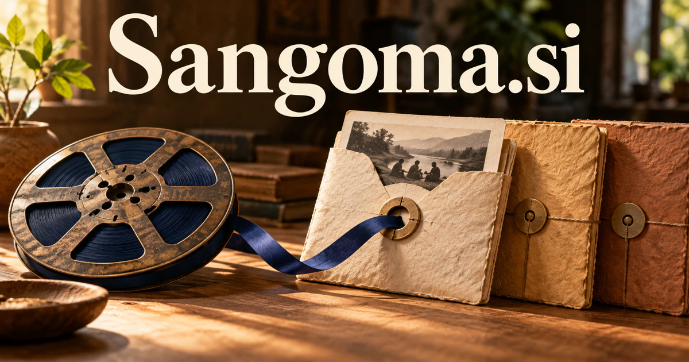

# Sangoma.si — Knowledge with a voice, a source, and a context

Sangoma is a culturally rooted word associated with a traditional healer or diviner. **Sangoma.si** could support an interpretive archive, oral-history publisher, or community learning service in which contributors’ context and authority remain visible. Its distinctive spoken identity also leaves room for language, storytelling, and reflective creative tools.

## What the name opens up

Sangoma is a real word with substantial cultural depth. The [Dictionary of South African English](https://dsae.co.za/entry/sangoma/e06230) traces it to isiZulu and describes a traditional healer or diviner; its linguistic background also connects with sacred song. A thoughtful brand could work with knowledge interpretation, oral expression, cultural collections, and communication. The three-syllable rhythm and repeating open vowels can also give an independent creative or software brand a distinctive spoken identity.

## Business opportunities

### 1. Consent-led cultural archive

A community-governed archive could connect a collection item with contributor permissions, contextual explanations, and related records, helping community editors answer questions while keeping cultural authority with the people who provide the knowledge. Curators could decide how each item is presented. Institutional licenses or commissioned archive projects would connect careful preservation with a useful, navigable public or private collection.

### 2. Educational publishing

An educational publishing service could connect source material, age-appropriate explanation, and learning goals, prepare alternative lesson narratives, and invite knowledgeable contributors to review interpretations before publication. Reviewers could preserve distinctions between sources and interpretations. Course sales or institutional publishing services would serve museums, schools, and adults seeking deeper cultural understanding.

### 3. Cited collection discovery

A cited collection guide could trace a visitor’s question across an approved collection, compare descriptions and provenance, and return an explanation that preserves the distinctions between source testimony and editorial interpretation. Users could ask a question and inspect the source passages or audio behind the response. Institutional subscriptions would support a practical research tool grounded in an identifiable collection.

### 4. Voice collaboration spaces

A voice collaboration workspace could coordinate authorized transcripts, language support, and discussion themes, help participants recover relevant context, and preserve attribution when a conversation becomes a shared learning resource. Audio messages could remain connected to projects, questions, and decisions. Team subscriptions could support a product that values vocal nuance while making important information easier to retrieve later.

### 5. Story-led museum experiences

An interpretive museum guide could connect an object’s documented history with a visitor’s questions and the curator’s narrative, offer different interpretive paths, and keep every deeper explanation anchored to the approved collection. Visitors could choose a route through the collection and save questions. Museum licenses or commissioned experiences would give the name a practical cultural interpretation business.

### 6. Independent audio publishing

An audio publishing studio could connect a storyteller’s intended narrative with recordings, transcripts, and production constraints, suggest a coherent listening sequence, and help creators retain context through editing and distribution. Creator subscriptions or production services could support an audio-first business. The domain's spoken rhythm can reinforce a recognizable identity across episodes and collections.

### 7. Community knowledge circles

A community learning workspace could compare questions raised across learning circles, locate relevant shared knowledge, and help facilitators plan the next discussion without presenting one contributor’s account as universal. Members could revisit what was discussed without losing individual attribution. Memberships or organization subscriptions could connect a human community with intelligent organization of its accumulated knowledge.

### 8. Language and pronunciation studios

A pronunciation practice tool could relate a learner’s pronunciation attempts to permitted recordings and contextual examples, propose a focused practice sequence, and direct unresolved interpretation questions back to qualified contributors. Learners could compare their own attempts with the teaching material and collect questions for an instructor. Course sales and school licenses could serve a distinct language-learning business.

### 9. Reflection and journaling tools

A private reflection companion could connect a user’s own journal entries with chosen themes, ask context-sensitive questions, and help organize observations over time without claiming spiritual authority or making unsupported therapeutic promises. Optional prompts could help people reflect and revisit a question from another perspective. Consumer subscriptions or guided creative programs would suit the name's interpretive character.

### 10. Research interpretation services

A research interpretation service could compare historical context, source provenance, and alternative readings, prepare a traceable research brief, and make contested interpretations explicit for a knowledgeable human reviewer. Clients could inspect the route from evidence to interpretation. Project fees and professional workspace subscriptions could support publishers, researchers, and cultural organizations.

## A Super Intelligence product vision

An SI direction for Sangoma could be a conversational research guide for a carefully selected archive. It would answer from permitted material, distinguish the contributor's words from an editorial explanation, and invite users to inspect the underlying recording or document. Curators could decide which items may be searched and which require a different context. Institutional licenses and commissioned archive projects could support the first business. A separate communications product could interpret meeting recordings and route questions. In both cases, the coherent theme is making complex human knowledge more navigable without erasing its source.

## Related names, different purposes

[HearMe.si](hearme-si.md) speaks more directly to voice capture and understanding. [BalaBala.si](balabala-si.md) favors playful conversation; [Topoi.si](topoi-si.md) suits a more scholarly product about relationships between ideas and sources.

## Explore Sangoma.si

Interested in **Sangoma.si** for one of the opportunities above? Contact [hedge.pike02@icloud.com](mailto:hedge.pike02@icloud.com?subject=Domain%20enquiry%3A%20sangoma.si) to discuss availability, a direct-purchase offer, a possible discount, or a portfolio combination. These are envisioned products and services for a future owner to build.

[View the Dynadot listing](https://www.dynadot.com/market/user-listings/sangoma.si) · [Marketplaces and Escrow.com](../guides/how-to-buy.md) · [Browse all domains](../README.md)

## Sources and further reading

- [Sangoma — Dictionary of South African English](https://dsae.co.za/entry/sangoma/e06230) — Lexical meaning and isiZulu origin; product opportunities are independent proposals.
