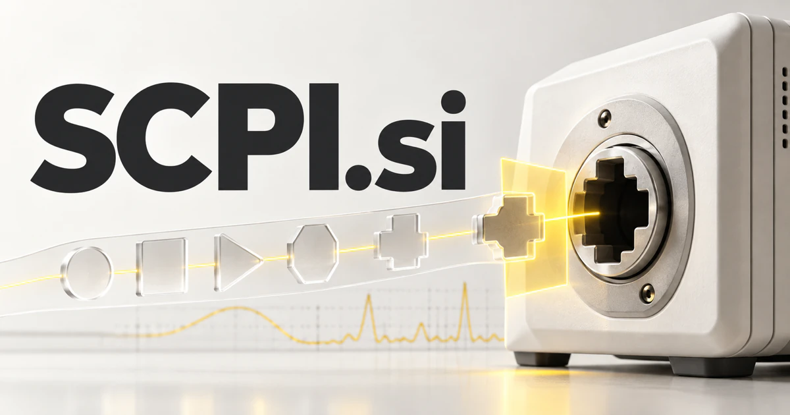

# SCPI.si — From measurement intent to a reviewable instrument workflow

**SCPI.si** directly names Standard Commands for Programmable Instruments, giving laboratory software a recognizable technical identity. A product could help engineers turn a measurement objective into a documented sequence, inspect instrument-specific assumptions, and preserve the commands and responses behind a result. The French property-investment meaning offers a separate information-business direction.

## Meaning and context

SCPI means Standard Commands for Programmable Instruments, an established command language used with test and measurement equipment. [Keysight's command comparison](https://www.keysight.com/zz/en/assets/7018-02044/white-papers-archived/5990-3515.pdf) explains the term and illustrates that supported commands can differ between instruments. That combination of standardization and device-specific detail creates a real software opportunity. The domain can support control tools, integration services, experiment records, education, and agents that help engineers prepare reviewed instrument interactions rather than guessing at undocumented behavior.

A separate established French meaning is **société civile de placement immobilier**, a form of property investment vehicle explained by the [French financial markets authority](https://www.amf-france.org/fr/scpi-societe-civile-de-placement-immobilier). That interpretation supports a different product audience: document organization, portfolio information, investor education, and professional reporting. It should be treated as an independent business direction rather than blended with instrument control.

## Eleven directions a buyer could build

The following are proposed business opportunities. They show different ways to develop the name, with concrete audiences, workflows, and potential commercial models.

### 1. An instrument command workbench

An instrument command workbench could translate an engineer’s measurement intent into candidate commands, reconcile instrument-specific documentation and operating limits, and present a traceable sequence for approval before any equipment action. Team subscriptions could connect every proposed command with the identified instrument model and the documentation used to prepare it.

### 2. Test-sequence authoring

A test-sequence authoring tool could connect a measurement hypothesis with setup dependencies, instrument capabilities, and expected observations, draft a reproducible sequence, and explain which missing assumption prevents reliable execution. Laboratory plans could preserve the exact sequence and settings behind a result, helping colleagues reproduce or investigate a test.

### 3. Instrument integration services

An instrument integration service could compare an instrument’s documented interface with the laboratory’s software conventions, generate adapter proposals, and use simulated responses to isolate compatibility questions before hardware validation. Professional service fees and maintained-component subscriptions could help laboratories adopt an integration without rebuilding the same documentation and error-handling work.

### 4. Remote teaching laboratories

A remote teaching laboratory could connect a student’s reasoning with an approved experiment and instrument state, select an instructive next measurement, and give the instructor a clear record of how the student reached a conclusion. Classroom licensing could make practical measurement education more flexible while instructors retain control over equipment capabilities and assessment.

### 5. A command documentation portal

A model-specific command portal could reconcile command examples across instrument models and firmware revisions, identify a misleading near-match, and return a model-specific explanation with the relevant reference attached. Vendor licensing could provide customers with clearer support materials and an explicit distinction between shared commands and device-specific features.

### 6. Experiment replay records

An experiment replay tool could reconstruct a measurement session from commands, timing, responses, and operator notes, compare it with a previous run, and isolate the changes that deserve investigation. Research subscriptions could support investigation of unusual results and help collaborators understand precisely what occurred during a particular acquisition session.

### 7. Calibration workflow preparation

A calibration preparation workspace could connect approved procedures with reference equipment, environmental records, and observations, identify missing evidence, and assemble a reviewable service report for the responsible qualified personnel. Professional plans could reduce administrative fragmentation while keeping technical judgments and calibration conclusions with the qualified personnel responsible for the work.

### 8. Hardware-in-the-loop orchestration

A hardware-in-the-loop planner could reason across simulated states, physical measurements, and test dependencies, anticipate unsafe or invalid transitions, and coordinate an operator-approved sequence with recoverable checkpoints. Engineering subscriptions could preserve dependencies and exception records across a complex experiment, allowing teams to inspect why a test paused or produced an unexpected output.

### 9. Instrument simulation tools

An instrument simulation workbench could infer useful mock scenarios from an integration’s requirements, generate plausible response variations, and help developers distinguish expected error handling from behavior that still needs hardware verification. Developer plans could support repeatable software tests while clearly distinguishing simulated behavior from validation on an actual instrument.

### 10. Agent-assisted laboratory planning

A laboratory planning assistant could compare a research objective with available instruments and documented methods, identify missing constraints, and propose alternative experimental routes with explicit evidence requirements for the engineer’s review. Team subscriptions could help prepare work for review without authorizing generated text to operate equipment independently.

### 11. Property information and document workflows

A property-information workspace could connect approved portfolio reports, building documents, and investor questions, compare scenarios and changed assumptions, and prepare source-linked explanations for investors and their qualified advisors. Professional subscriptions could support document comparisons and update tracking, with investment decisions remaining with the investor and their qualified advisors.

## A Super Intelligence product story

SCPI.si could become a Super Intelligence interface for an instrumented laboratory. A research agent retrieves the approved model reference, a planning agent drafts a sequence, and a validation layer checks defined constraints. A qualified operator reviews the procedure before execution and retains the command and response record afterward.

## Why this name can carry a business

The initials provide exact relevance to a technical audience and a compact identity for documentation, software, and services. The brand can expand from a command reference into a laboratory workflow platform while staying anchored in a genuine interface between digital reasoning and physical measurement.

## Related names, different purposes

[DAQ.si](daq-si.md) emphasizes collecting measurements, while [Readouts.si](readouts-si.md) emphasizes interpreting their results. [ZLP.si](zlp-si.md) opens a different technical route through USB communication, spectroscopy, and portable tools rather than instrument-command language.

## Explore SCPI.si

Interested in **SCPI.si** for one of the opportunities above? Contact [hedge.pike02@icloud.com](mailto:hedge.pike02@icloud.com?subject=Domain%20enquiry%3A%20scpi.si) to discuss availability, a direct-purchase offer, a possible discount, or a portfolio combination. These are envisioned products and services for a future owner to build.

[View the Dynadot listing](https://www.dynadot.com/market/user-listings/scpi.si) · [Marketplaces and Escrow.com](../guides/how-to-buy.md) · [Browse all domains](../README.md)

## Research references

- [Keysight: SCPI command comparison](https://www.keysight.com/zz/en/assets/7018-02044/white-papers-archived/5990-3515.pdf)

- [French financial markets authority: SCPI definition](https://www.amf-france.org/fr/scpi-societe-civile-de-placement-immobilier)

[Browse all domains](../README.md)
