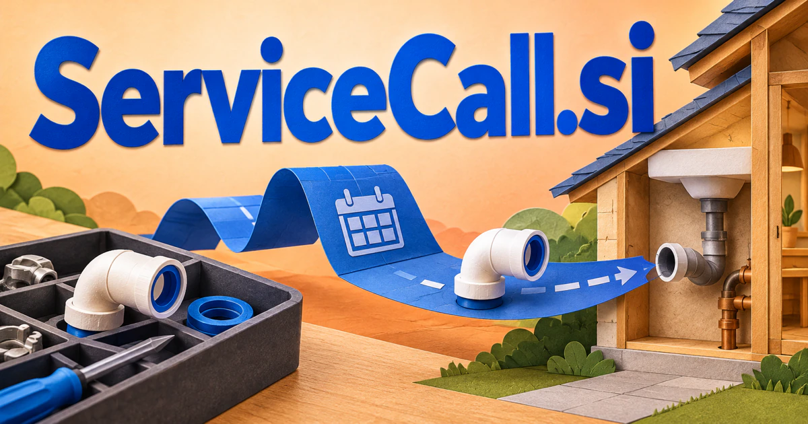

# ServiceCall.si — From the first request to a completed service

A service call connects a customer’s problem with somebody who can resolve it. **ServiceCall.si** could organize that journey for maintenance firms, property managers, workshops, or hospitality teams: understand the request, find the right skills and appointment, then carry the relevant context through dispatch and follow-up.

## What the name opens up

Service Call combines a broad activity, service, with an initiating event, call. A call can be a telephone conversation, an on-site visit, or a request sent between software systems. That gives the domain unusually concrete bridges between human help and technical execution. Its strongest consumer reading is arranging assistance; its developer reading can involve invoking a service. [Field-service documentation](https://learn.microsoft.com/en-us/dynamics365/field-service/overview) illustrates how work orders, scheduling, and mobile technicians connect in real software. A buyer could focus on one trade or use the phrase as a broader service-orchestration identity.

## Business opportunities

### 1. Field service scheduling

A field-service coordinator could connect a customer’s symptoms with technician expertise, parts, site access, and commitments, then coordinate a feasible appointment and prepare the worker with the evidence needed before arrival. Dispatchers could resolve incomplete information before sending someone out. Per-team subscriptions would serve repair firms that need a coherent thread from booking to completion.

### 2. Property maintenance

A property maintenance workspace could relate a tenant’s report to property history, equipment records, and contractor availability, distinguish a recurring issue from a new one, and coordinate a documented response for the property manager. Managers could keep separate records for each property and recurring issue. Per-property subscriptions would organize practical communication around both urgent repairs and planned improvement work.

### 3. Recurring equipment care

An equipment-care planner could compare equipment usage, service history, and manufacturer guidance, anticipate the next maintenance need, and assemble a customer-approved visit plan with the appropriate tools and records. Customers could see service history, upcoming work, and the contact for arranging a visit. A supplier subscription or maintenance-service business could build ongoing relationships around the actual equipment the customer owns.

### 4. Voice appointment reception

A voice appointment assistant could reason across a caller’s intent, previous interactions, available appointments, and service rules, resolve clarifying questions, and pass a structured request to the correct team. Businesses could review every booking and escalation. A per-location subscription could combine call handling with useful summaries and follow-up communication.

### 5. Home-service marketplaces

A home-service matching service could connect a household’s described problem with provider capabilities, availability, and service boundaries, explain the shortlist, and keep the request coherent through booking and follow-up. The platform could connect provider information with organized quotes and appointments. Revenue could come from provider subscriptions, qualified inquiry fees, or a managed coordination service.

### 6. Technical service invocation

A service-invocation planner could connect a business intent with service contracts, system state, and authorization boundaries, plan a sequence of reviewed invocations, and explain how failures should be handled or reversed. Developers could inspect requests, retries, latency, and failures across connected services. Usage pricing or team licenses would attach the brand to making software calls understandable and controllable.

### 7. Automotive service desks

An automotive service desk could connect a driver’s reported symptoms with prior work, service schedules, and workshop capacity, prepare questions for diagnosis, and organize a visit without presenting a generated guess as a confirmed repair. A workshop subscription could include reminder campaigns and service histories. The familiar phrase lends itself to a business where both telephone requests and physical service matter.

### 8. Hospitality guest requests

A guest-service coordination tool could connect a guest’s request with room context, staff responsibilities, and current service capacity, coordinate the relevant departments, and confirm completion through a shared operational record. Staff could route each request and preserve the latest update. A property subscription could replace disconnected calls with an organized service conversation.

### 9. Remote expert sessions

An expert-session workspace could relate a client’s question to submitted documents and the specialist’s expertise, prepare a focused session agenda, and turn approved conclusions into a practical follow-up plan. Customers could upload the issue beforehand and receive a session summary afterward. A session marketplace or branded expert-service business would broaden service calls beyond travel to a site.

### 10. Maintenance membership programs

A maintenance membership service could connect each customer’s covered equipment, service history, and changing needs, plan useful check-ins, and help the service team explain what is included before dispatching a visit. Customers could see included visits and request assistance from one portal. A software fee or directly operated membership business could build recurring relationships around practical service.

## A Super Intelligence product vision

Consider a ServiceCall SI assistant for an equipment-maintenance firm. A customer describes a problem by phone, shares a model number, and selects an available visit. The assistant could prepare a structured work order, surface relevant service history, and propose a technician and parts checklist. Dispatchers would confirm the plan, and the returning job notes would become a clear customer summary. The product could begin with one equipment category and charge per location or service team. Its coherent promise is a continuous thread from the initial call through the actual work performed.

## Related names, different purposes

[OpenSupport.si](opensupport-si.md) is broader for ongoing help and shared support knowledge. [SIPTrunk.si](siptrunk-si.md) names the voice-connectivity infrastructure; [RouteMapper.si](routemapper-si.md) is more specific to dispatch paths and constrained planning.

## Explore ServiceCall.si

Interested in **ServiceCall.si** for one of the opportunities above? Contact [hedge.pike02@icloud.com](mailto:hedge.pike02@icloud.com?subject=Domain%20enquiry%3A%20servicecall.si) to discuss availability, a direct-purchase offer, a possible discount, or a portfolio combination. These are envisioned products and services for a future owner to build.

[View the Dynadot listing](https://www.dynadot.com/market/user-listings/servicecall.si) · [Marketplaces and Escrow.com](../guides/how-to-buy.md) · [Browse all domains](../README.md)

## Sources and further reading

- [Field Service overview](https://learn.microsoft.com/en-us/dynamics365/field-service/overview) — Official explanation of work orders, scheduling, and technician workflows.
