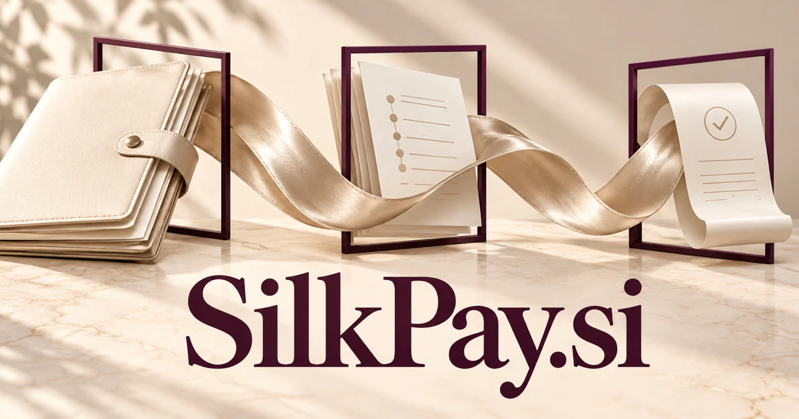

# SilkPay.si — Clearer payment journeys, smoother commercial relationships

Silk suggests a smooth experience; pay gives **SilkPay.si** a clear commercial task. A business could help agencies, creators, merchants, or suppliers explain what is owed, connect an invoice to the work behind it, and resolve the small inconsistencies that make a payment relationship feel difficult.

## What the name opens up

Silk contributes a tactile image of smoothness, softness, and a carefully finished experience. Pay anchors that image to a clear action. The combination can communicate considerate payment journeys, premium presentation, or fewer administrative rough edges. The word [silk](https://www.merriam-webster.com/dictionary/silk) also connects to textiles, so a buyer could build services specifically for fashion suppliers or design businesses. The seven-letter compound is compact enough to support a distinct visual identity while remaining easy to explain.

## Business opportunities

### 1. Client payment requests

A client billing assistant could connect completed client work, agreed milestones, and invoice terms, prepare a clear payment request, and explain disputed details using the original engagement record. Payment links could use the provider the business already chooses. Professional subscriptions would sell a considered commercial experience and a useful record from proposal through final receipt.

### 2. Marketplace reconciliation

A marketplace reconciliation workspace could compare orders, payouts, refunds, and platform fees, trace unmatched amounts to their source events, and give marketplace operators an evidence-backed exception queue. Operators could review the calculation and resolve exceptions before funds are sent through their chosen infrastructure. Organization subscriptions would support a specialist administrative layer around complex commercial relationships.

### 3. Merchant checkout tools

A merchant checkout assistant could connect a shopper’s question with basket contents, delivery constraints, and merchant rules, explain available routes, and reduce confusion without silently changing the customer’s chosen purchase. Teams could preview success, pending, refund, and exception states in context. Component licenses or usage-based tools would let SilkPay become the polished interface layer within another business's existing payment system.

### 4. Premium client portals

A premium client portal could reconcile proposals, staged work, invoices, and communication history, then present a coherent next action that makes a high-touch commercial relationship feel organized rather than fragmented. The product could preserve the tone of a considered service relationship. Subscription tiers could depend on active clients, with paid onboarding for agencies.

### 5. Fashion supplier administration

A supplier administration workspace could connect textile orders, production milestones, shipping documents, and invoice terms, surface mismatches early, and coordinate a reviewed resolution between the buyer and manufacturer. Silk has a literal industry connection here. A vertical software subscription could bring production milestones and payment records into the same view without replacing the supplier's bank.

### 6. Creator commission workspaces

A creator commission service could connect a commission brief with revisions, approvals, licensing terms, and payment milestones, explain outstanding obligations, and help both parties agree what happens next. A creator subscription could include branded storefronts and revision tracking. The smooth-experience interpretation becomes tangible in fewer awkward client handoffs.

### 7. Digital gift purchases

A digital gifting service could reason across an occasion, recipient preferences, delivery timing, and merchant restrictions, suggest appropriate options, and coordinate an approved purchase with a clear redemption explanation. Merchants could personalize presentation and track outstanding balances. Software subscriptions or commerce service fees could fund the business, with the product focused on a pleasurable giving experience.

### 8. Cross-border invoice explanation

A cross-border invoice guide could connect invoice language, currency presentation, contractual terms, and transaction status, explain discrepancies, and prepare specific questions for the relevant payment provider or finance team. Existing payment infrastructure would handle settlement. A paid administrative tool could reduce confusion while keeping currency and fee information explicit.

### 9. Hospitality payment coordination

A hospitality billing workspace could connect guest reservations, group arrangements, approved extras, and payment responsibilities, identify inconsistencies, and help staff present one understandable account before checkout. Staff could reconcile a stay against the original reservation. Per-property subscriptions would suit a product that treats the commercial side as part of the guest experience.

### 10. Payment interface design tools

A payment-interface design tool could compare payment-flow prototypes against customer tasks, error states, and merchant requirements, suggest clearer alternatives, and help teams test comprehension before deploying a revised interface. Preview states could cover pending, paid, partially refunded, or failed transactions. A component license, template store, or design subscription would exploit the name's emphasis on finish and clarity.

## A Super Intelligence product vision

A SilkPay SI product could help an agency manage the entire commercial conversation around a project. It could draft a milestone schedule from the accepted scope, prepare invoices through connected infrastructure, and flag questions about partial payments or changed deliverables. A business owner would approve amounts and communications. The initial revenue model could be an agency subscription. The broader vision is context-aware commercial assistance: an intelligent layer that makes requests, explanations, records, and follow-through feel like one coherent experience for both seller and customer.

## Related names, different purposes

[Pagou.si](pagou-si.md) emphasizes the completed-payment moment and its records. [CloudPOS.si](cloudpos-si.md) centers on merchant operations around checkout, while [Dues.si](dues-si.md) is more directly about recurring obligations, memberships, and shared contributions.

## Explore SilkPay.si

Interested in **SilkPay.si** for one of the opportunities above? Contact [hedge.pike02@icloud.com](mailto:hedge.pike02@icloud.com?subject=Domain%20enquiry%3A%20silkpay.si) to discuss availability, a direct-purchase offer, a possible discount, or a portfolio combination. These are envisioned products and services for a future owner to build.

[View the Dynadot listing](https://www.dynadot.com/market/user-listings/silkpay.si) · [Marketplaces and Escrow.com](../guides/how-to-buy.md) · [Browse all domains](../README.md)

## Sources and further reading

- [Silk — Merriam-Webster](https://www.merriam-webster.com/dictionary/silk) — Literal material meaning behind the smoothness and textile associations.

- [Invoicing documentation](https://docs.stripe.com/invoicing) — Technical background for invoices and payment-status workflows.
