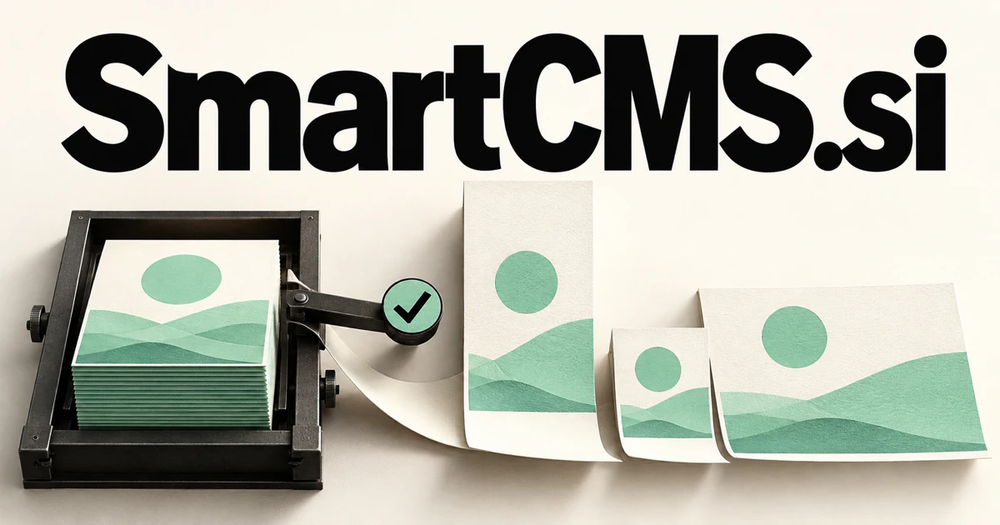

# SmartCMS.si — Keep published knowledge coherent as the business changes

A smart content management system should understand more than where a page is stored. **SmartCMS.si** could serve publishers, product teams, schools, or distributed businesses by connecting sources, editorial decisions, language versions, and delivery channels so a change reaches the places and people it actually affects.

## What the name opens up

CMS is the established abbreviation for content management system, as explained in [MDN's CMS glossary](https://developer.mozilla.org/en-US/docs/Glossary/CMS). Smart adds the expectation of useful assistance, but the interesting opportunity extends beyond generating articles. Content can include product records, instructions, educational units, structured answers, translation variants, and material destined for many interfaces. A buyer could emphasize editorial judgment, reusable data, or automated distribution. The name makes the category visible immediately while leaving room to define what intelligence means in a particular customer's publishing process.

## Business opportunities

### 1. Editorial workspace

An editorial workspace could connect a publication’s evidence, audience questions, style, and release calendar, coordinate research and drafting specialists, and route substantive decisions to editors with their supporting sources. Editors could see the owner of every outstanding question and compare changes before release. Team subscriptions would sell an orderly publishing operation with intelligence embedded in the actual workflow.

### 2. Multilingual publishing

A multilingual publishing assistant could reconcile terminology, intended meaning, local context, and release dependencies, propose language-specific adaptations, and flag changes that require an editor rather than a literal translation. Editors could identify the passages affected by a source change and assign the appropriate review. Workspace subscriptions would support continuity across language editions and the people responsible for keeping them current.

### 3. Content service API

A context-aware content service could understand an application’s intent, available structured knowledge, and delivery constraints, select an appropriate representation, and explain the provenance of each returned content element. Teams could define reusable entries, control publishing rights, and inspect how content is delivered. Usage pricing or organization licenses would serve products that need a maintained content layer across several customer experiences.

### 4. Product knowledge operations

A product-knowledge workspace could connect specification updates, customer questions, support incidents, and catalog entries, identify contradictory claims, and prepare coordinated revisions for the responsible product teams. Editors could see which downstream pages depend on each fact. A subscription based on products and publishing channels could connect commerce information with useful customer-facing content.

### 5. Documentation maintenance

A documentation maintenance tool could trace a code or API change through affected examples and user tasks, draft the necessary updates, and generate checks that reveal whether the revised explanation still works. Changes could trigger review assignments for affected sections. Developer subscriptions could support a product designed around current documentation, maintained examples, and clear source ownership.

### 6. Education content engines

An education content platform could connect curriculum goals with learner responses and available teaching assets, assemble differentiated sequences, and help instructors review both pedagogical choices and factual consistency. Subject experts could approve each component before distribution. A publisher license or institutional subscription could support consistent updates across a growing learning catalog.

### 7. Franchise publishing

A franchise publishing workspace could reconcile central brand rules with local services, opening hours, and customer questions, prepare locally relevant content, and coordinate approval without losing a shared identity. The system could distinguish centrally controlled fields from locally editable information. Per-location pricing would fit a practical business that needs coordinated publishing across many branches.

### 8. Digital signage orchestration

A digital signage planner could combine location, audience, timing, and operational events, propose a coherent signage sequence, and explain why each message is useful in that particular setting. Teams could schedule campaigns, preview different display formats, and assign approval responsibilities. Screen or location subscriptions could turn structured content into a visible physical experience.

### 9. Research-led newsletters

A research newsletter service could connect new source material with subscribers’ recurring questions, compare competing interpretations, and assemble a traceable briefing whose conclusions reflect the evidence rather than publication volume. Reusable background material could remain connected to each new issue. Creator subscriptions or managed publishing services would suit a focused editorial business.

### 10. Multichannel content APIs

A multichannel publishing API could map one approved knowledge object to websites, apps, messages, and devices, preserve its meaning across formats, and coordinate updates when the underlying facts change. Customers could define reusable fields and query approved content through documented interfaces. Usage-based pricing could let the product grow with the channels and volume a publisher actually needs.

## A Super Intelligence product vision

A SmartCMS Super Intelligence workspace could monitor a structured product catalog and identify the pages affected when a specification changes. One agent would draft updates, another would check linked claims, and an editor would inspect the proposed differences before publishing. Translations, help articles, and product summaries could then be queued from the same approved change. A business could begin with a single industry and charge by workspace or content volume. The vision is an intelligent editorial operating system whose value comes from understanding relationships between content objects and their real business context.

## Related names, different purposes

[InWords.si](inwords-si.md) focuses on creating clear expression; [TextVideo.si](textvideo-si.md) specializes in moving that expression into video. [OpenSupport.si](opensupport-si.md) makes a stronger promise when customer help, rather than publishing operations, is the central product.

## Explore SmartCMS.si

Interested in **SmartCMS.si** for one of the opportunities above? Contact [hedge.pike02@icloud.com](mailto:hedge.pike02@icloud.com?subject=Domain%20enquiry%3A%20smartcms.si) to discuss availability, a direct-purchase offer, a possible discount, or a portfolio combination. These are envisioned products and services for a future owner to build.

[View the Dynadot listing](https://www.dynadot.com/market/user-listings/smartcms.si) · [Marketplaces and Escrow.com](../guides/how-to-buy.md) · [Browse all domains](../README.md)

## Sources and further reading

- [CMS — MDN](https://developer.mozilla.org/en-US/docs/Glossary/CMS) — Definition of content management system and its software role.
