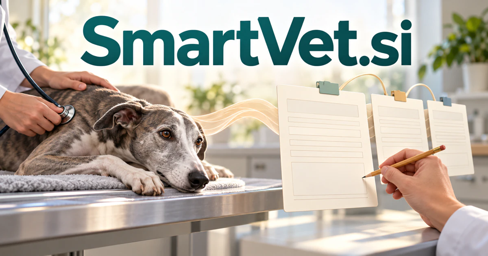

# SmartVet.si — Give veterinary teams a clearer working record

SmartVet.si immediately suggests intelligent assistance for veterinary professionals. Its strongest direction is a workspace that connects consultation notes, animal histories and owner communication, helping a team carry useful context from one encounter to the next. A focused scribing tool could become the first part of a wider practice product, with specialists, shelters and teaching teams served through distinct editions.

[Enquire about SmartVet.si](mailto:hedge.pike02@icloud.com?subject=Domain%20enquiry%3A%20smartvet.si)

## Meaning and naming depth

**Smart** supplies the idea of capable, context-aware assistance. **Vet** gives the compound an immediate professional audience. [Collins records vet](https://www.collinsdictionary.com/dictionary/english/vet) as a familiar term for a veterinarian, and also as a verb meaning to examine or evaluate carefully. The primary veterinary reading can support an identifiable product, while the checking meaning offers a separate route for evidence-review software.

That second meaning should be introduced deliberately if an owner chooses it. A veterinary workspace and a general document-vetting service answer different customer needs. For the veterinary route, the eight-letter name makes it easy to explain who the product serves before introducing individual features, integrations or specialist workflows.

## Business opportunities

### 1. Veterinary consultation scribing

Practices could prepare a draft note from authorized consultation material, organized around the team's preferred structure. The workspace would retain uncertain wording and allow the responsible professional to correct the result before it enters the record. Clinician subscriptions and practice licenses could provide a focused entry product around the everyday work of documenting an encounter.

### 2. Animal-history workspaces

Veterinary teams could connect previous notes, observations, reports and outstanding questions in an authorized case timeline. A retrieval assistant would show the source behind each summarized point and distinguish an owner's account from a documented finding. Organization subscriptions and record-system integrations could help teams prepare for cases with extensive or fragmented histories.

### 3. Owner-facing discharge communication

A clinician's approved plan could become a draft explanation, a practical task list and a set of reviewable follow-up messages for the owner. The system would preserve the original instructions for comparison during review. Practice plans and communication integrations could extend SmartVet from consultation documentation into the information an owner needs after leaving the clinic.

### 4. Client intake preparation

Practices could collect an owner's concerns, previous records and practical visit information in advance. An intake assistant would prepare an editable account of the questions to address, with unanswered details visible to the team. Per-practice subscriptions could serve a clear operational need without presenting an unreviewed intake summary as a clinical conclusion.

### 5. Specialist referral packets

Referring clinicians could assemble the relevant chronology, selected documents and their specific referral question in one place. Agents would organize the packet and check that the intended files and administrative details are present. Referral-network licenses and integration services could make SmartVet useful across general practice and specialist teams that need a clear professional handover.

### 6. Preventive-care coordination

Teams could organize professionally approved schedules, reminders and unfinished administrative tasks around an animal's record. The product would connect each communication to the recorded plan and make the responsible owner of an action visible. Practice subscriptions and client-portal modules could support continuity between appointments without changing who makes the care decisions.

### 7. Source-linked knowledge workspaces

Clinicians could connect a case-related question to selected literature, internal guidance and their own reviewed notes. A research assistant would prepare an evidence map with visible sources and clearly marked unanswered questions. Specialist subscriptions, private libraries and institutional licenses could create a distinct professional product for organizing knowledge around the actual question being investigated.

### 8. Practice operations and handovers

Practice managers could connect bookings, staff handovers, stock questions and unfinished work to the team's own procedures. An operations assistant would prepare a daily briefing and route exceptions to the appropriate person. Location-based subscriptions and service integrations could make SmartVet useful to the whole practice, extending beyond a single clinician's documentation screen.

### 9. Equine and farm visit records

Mobile professionals could relate visit observations, histories and agreed follow-up to an individual animal or a managed group. The workspace would organize documents and practical tasks for review after a field visit. Practitioner plans and organization licenses could support a specialized edition shaped around the records, travel and handovers of these working environments.

### 10. Shelter and transfer coordination

Shelters could prepare a connected record of care notes, approved routines and transfer documents for the next responsible team. An assistant would identify missing practical information and assemble an understandable handover packet. Organization subscriptions and service partnerships could position SmartVet around continuity when responsibility for an animal moves between people or organizations.

### 11. Veterinary teaching workspaces

Educators could prepare case discussions, questions and exercises from approved teaching material. Agents would organize source references and help instructors adapt the level of detail for different learners, with the final lesson remaining under instructional review. Institutional licenses and cohort plans could turn the professional identity of SmartVet into a recognizable learning environment.

### 12. Evidence-vetting tools

Under the separate verb reading, review teams could compare claims, documents and source histories in a structured queue. The product would expose contradictions and unsupported statements for a person to investigate. Team subscriptions and private deployments could support document review, procurement research or editorial checking, with a launch message that clearly distinguishes this route from veterinary software.

## A Super Intelligence product story

SmartVet.si can express Super Intelligence as **coordinated context in support of veterinary work**. One agent organizes a consultation, another retrieves relevant history, and another prepares the owner-facing communication from the approved plan. The team reviews the outputs and retains responsibility for professional decisions.

[RCVS guidance on AI in practice](https://www.rcvs.org.uk/veterinary-professionals/conduct-and-guidance/resources-and-updates/using-artificial-intelligence-ai-in-practice-advice-for-the-profession) describes useful administrative and documentation roles while maintaining professional judgement and manual verification of generated records. That creates a practical foundation for the proposed workspace. Its product value would come from connecting evidence, review and follow-through around a real team, with practice subscriptions, referral tools, institutional licenses and educational editions as separate possible models.

## Why the name works

The two recognizable components explain the primary audience quickly. SmartVet Notes, SmartVet Referrals and SmartVet Learning could organize a suite without making the main brand longer. **“More context for the team. Clearer care records.”** connects the name's intelligence association with an inspectable professional workflow.

## Related names, different directions

- [PawCare.si](pawcare-si.md) — Build an approachable product for pet-owner routines and everyday support.
- [CareWay.si](careway-si.md) — Focus on documentation, coordination and continuity across human care services.
- [TruthCheck.si](truthcheck-si.md) — Give general evidence review and claim checking an explicit identity.
- [TextReader.si](textreader-si.md) — Center a product on understanding and navigating written material.

## Acquire SmartVet.si

[Buy or make an offer on Dynadot](https://www.dynadot.com/market/user-listings/smartvet.si), or email [hedge.pike02@icloud.com](mailto:hedge.pike02@icloud.com?subject=Domain%20enquiry%3A%20smartvet.si) to discuss a direct purchase, a possible discount, or a portfolio bundle. These product directions are proposals for a future owner to develop.

[Purchase options and Escrow.com](../guides/how-to-buy.md) · [Browse all domains](../README.md)

## Research references

- [Collins English Dictionary: vet](https://www.collinsdictionary.com/dictionary/english/vet) — The veterinary meaning and the separate verb of careful examination.
- [RCVS: Using artificial intelligence in practice](https://www.rcvs.org.uk/veterinary-professionals/conduct-and-guidance/resources-and-updates/using-artificial-intelligence-ai-in-practice-advice-for-the-profession) — Primary professional guidance on AI-assisted work and responsibility for clinical decisions and records.
