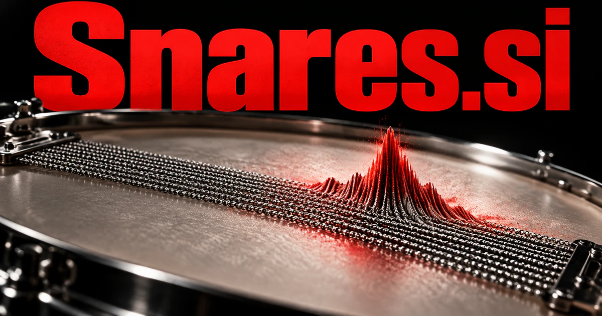

# Snares.si — Capture the sound—or notice the trap

Snares connects a percussion instrument with the idea of catching something. **Snares.si** could become a precise name for drum sounds, practice, or production tools. A separate defensive-analysis direction could use the capture metaphor for software that recognizes consequential patterns and helps a reviewer understand what triggered them.

## What the name opens up

[Snares](https://www.merriam-webster.com/dictionary/snare) has genuinely different meanings: the wires or strings associated with a snare drum, the drum itself, a trap, and a mechanism that catches or holds something. The musical territory is immediate and commercially coherent. The capture metaphor also supports defensive security, pattern detection, and tools that identify problems before they spread. They are separate routes that share a short, vivid word. The plural suits a sound library, a collection of detection rules, or a family of specialist tools.

## Business opportunities

### 1. Snare sound design

A snare-design workbench could relate a producer’s reference track, arrangement, and desired impact, coordinate synthesis and processing experiments, and explain why each snare treatment occupies the intended place in the mix. Users could preserve the reasoning behind a chosen variation. Software licenses or subscriptions would support a focused sound-design tool with a strong specialist identity.

### 2. Percussion sample business

A percussion sample service could connect a musician’s project with sample timbre, articulation, recording context, and usage terms, assemble a coherent kit, and identify missing sounds before a production session. Customers could audition a documented collection and select the material that fits. Pack sales or memberships would connect craft recording knowledge with a practical production catalog.

### 3. Drum practice tools

A drum-practice companion could compare a drummer’s timing and articulation with the current exercise, isolate the pattern causing difficulty, and adapt the next drill around that specific musical obstacle. Ensembles could prepare shared material before rehearsing together. School licenses, studio subscriptions, or instructional collections would create an education business around the literal instrument meaning.

### 4. Drum hardware commerce

A drum-equipment guide could connect a drummer’s playing context, preferred sound, existing setup, and equipment specifications, explain meaningful trade-offs, and prepare useful questions for a specialist fitting or demonstration. Demonstration recordings could be tied to documented setup conditions. Direct commerce, buyer consultations, or studio partnerships would make the literal instrument meaning useful before any software is added.

### 5. Defensive signal detection

A defensive signal investigation tool could connect suspicious events across accounts, devices, and behavior, investigate plausible benign explanations, and prepare a prioritized evidence trail for security staff to review. Analysts could connect alerts to original events and tune false positives. Team subscriptions or managed defensive services would use the trapping metaphor to describe catching suspicious patterns and explaining the relevant evidence.

### 6. Music performance preparation

A live-performance planner could connect a set list, venue conditions, drummer preferences, and equipment setup, anticipate difficult transitions, and coordinate a rehearsal plan that addresses the most consequential gaps. A mobile workspace could preserve what worked at each performance. Professional subscriptions or artist-service packages could serve a practical niche beyond sample creation.

### 7. Percussion education publishing

A percussion learning platform could connect notation, recorded examples, and a learner’s attempted performance, compare different explanations, and propose a lesson sequence that links musical understanding with physical technique. Students could compare their attempts with annotated demonstrations. Course sales, teacher licenses, and workshop events would connect Snares with a focused area of musical expertise.

### 8. Pattern-monitoring developer tools

A pattern-monitoring tool could relate a detected pattern to deployment changes, expected workload, and past incidents, distinguish a genuine trap from ordinary variation, and propose a bounded diagnostic step. Matches could retain enough context for investigation. Usage pricing or developer subscriptions would support a tool whose brand metaphor is concrete and easy to visualize.

### 9. Audio transient libraries

An audio transient collection could connect transient characteristics with musical role, recording conditions, and production intent, organize useful comparisons, and help creators locate material by the effect they want to achieve. Sound designers could compare candidates in context. Pack sales or professional subscriptions would broaden the musical library while retaining the snare's association with a defining hit.

### 10. Problem-solving learning games

An adaptive puzzle game could infer the misconception behind a player’s repeated mistake, generate an instructive alternative challenge, and help the learner recognize a recurring trap across different contexts. Players could identify misleading assumptions, test routes, and explain their reasoning. Consumer game sales, classroom editions, or themed challenge packs could create a distinct entertainment route for the name.

## A Super Intelligence product vision

A Snares SI music product could compare a producer's reference and current track, propose a few drum layers, and explain the timing, envelope, and tonal choices behind each variation. The producer could audition several options and edit the result. A different buyer could build a defensive detection workspace that connects observed events to reviewed rules and source evidence. The common intelligent theme is selective capture: recognizing the particular transient, pattern, or signal that matters, then giving a human clear controls over the next step.

## Related names, different purposes

[DrumLoop.si](drumloop-si.md) centers on repeating rhythmic material, while [SoundX.si](soundx-si.md) spans wider audio production. [Hogwash.si](hogwash-si.md) offers a more explicitly skeptical identity for investigating questionable claims rather than detecting technical signals.

## Explore Snares.si

Interested in **Snares.si** for one of the opportunities above? Contact [hedge.pike02@icloud.com](mailto:hedge.pike02@icloud.com?subject=Domain%20enquiry%3A%20snares.si) to discuss availability, a direct-purchase offer, a possible discount, or a portfolio combination. These are envisioned products and services for a future owner to build.

[View the Dynadot listing](https://www.dynadot.com/market/user-listings/snares.si) · [Marketplaces and Escrow.com](../guides/how-to-buy.md) · [Browse all domains](../README.md)

## Sources and further reading

- [Snare — Merriam-Webster](https://www.merriam-webster.com/dictionary/snare) — Distinct percussion and capture meanings ground the separate business territories.
