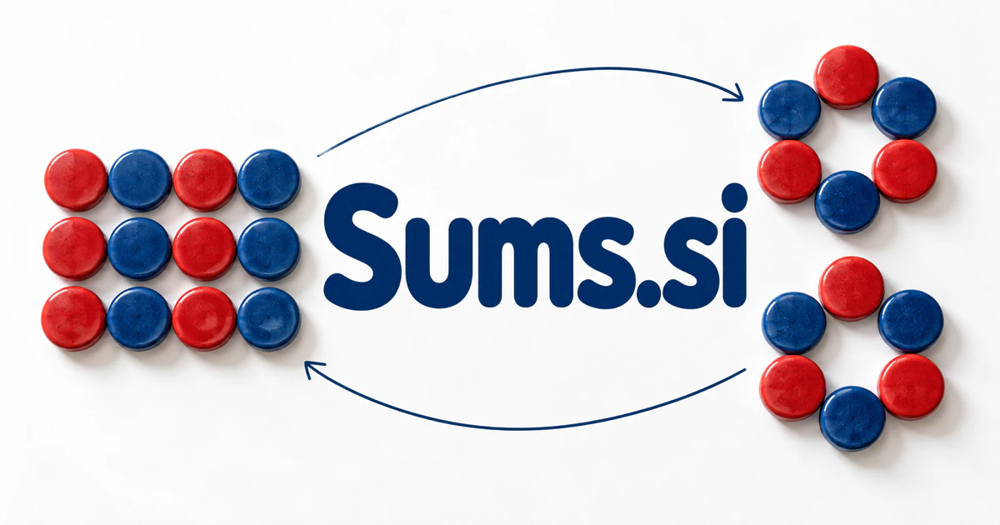

# Sums.si — Make the numbers—and the reasoning—add up

Sums can mean calculations, totals, or the act of bringing parts together. **Sums.si** could serve learners checking their reasoning, teams explaining a spreadsheet, or households comparing practical choices. The common task is to make the result understandable by showing the quantities, assumptions, and relationships behind it.

## What the name opens up

Sums is a compact plural with several useful roots. A [sum](https://www.merriam-webster.com/dictionary/sum) can be an amount of money, an aggregate, an arithmetic result, or the substance of an argument. This gives a buyer both numerical and interpretive territory. Sums could help calculate, collect, summarize, or understand the whole. The four-letter shape is concise and recognizable, and the plural naturally accommodates a library of tools or several product lines. A proposed acronym such as Shared Understanding Management System is also possible, but the real word already provides a stronger starting story.

## Business opportunities

### 1. Math practice

A mathematics tutor could infer the reasoning behind a learner’s answer, compare solution paths, and generate a focused counterexample that helps the learner understand why an operation works. Students could compare several approaches. School licenses or subject subscriptions would support a friendly mathematics product with a concrete teaching purpose.

### 2. Everyday calculators

A practical calculation assistant could connect a user’s real question with quantities, units, assumptions, and relevant constraints, select an appropriate calculation, and explain how changing one input affects the conclusion. Users could inspect the formula and alter the assumptions. A public tool library could introduce professional subscriptions, embedded components, or tailored calculators for particular commercial workflows.

### 3. Teaching materials

A teaching-materials workspace could relate curriculum objectives to observed student misconceptions, assemble worked examples and practice variations, and give teachers evidence for choosing the next explanation. Educators could select suitable difficulty and adapt the context. Resource purchases or institutional libraries would connect the short mathematics name with usable teaching material.

### 4. Financial planning notebooks

A household scenario planner could connect household goals, recurring commitments, and uncertain future scenarios, explain the arithmetic behind alternatives, and help users prepare better questions for qualified financial advice. Users could change inputs and inspect the arithmetic themselves. Consumer subscriptions or adviser editions could support practical planning tools without promising investment outcomes.

### 5. Spreadsheet explanation

A spreadsheet explanation tool could trace a total back through formulas, assumptions, and source tables, compare the calculation with the user’s intent, and identify inconsistencies before they shape a decision. A team could compare different versions and investigate changes. Workspace subscriptions would fit organizations whose important decisions depend on calculations that few people currently understand.

### 6. Meeting and report summaries

A source-linked synthesis workspace could connect a discussion’s claims, source documents, and unresolved decisions, preserve meaningful disagreement, and assemble a summary organized around what the team needs to understand next. Teams could collect the main points, dissenting views, and outstanding questions from selected material. Subscription workspaces could serve professional research and operations without treating every summary as a substitute for its evidence.

### 7. Shared expense calculators

A shared-expense assistant could reconcile receipts, participant agreements, reimbursements, and disputed items, explain each proposed allocation, and prepare a transparent settlement for the group to approve. Users could choose a method and inspect each person's share. A lightweight app, premium group features, or embedded licensing could turn an everyday mathematical problem into a friendly consumer business.

### 8. Commerce margin tools

A commerce planning tool could connect purchasing costs, fees, returns, inventory, and pricing scenarios, expose the assumptions behind a margin, and help merchants compare operational alternatives rather than one isolated total. Transparent calculations could reveal assumptions that need updating. Retail subscriptions or a specialist calculator library could support a useful operational product for small sellers.

### 9. Scientific calculation collections

A scientific calculation notebook could connect a research question with equations, dimensional assumptions, and input uncertainty, coordinate calculation checks, and return a traceable explanation of how the result was obtained. Professional subscriptions or institutional licenses could serve engineering, education, or laboratory teams. The commercial value would be careful implementation and explanation.

### 10. Collective intelligence workspaces

A collective decision workspace could reconcile several contributors’ estimates with their evidence and assumptions, identify where disagreement matters, and propose the next investigation that would most improve the group’s decision. The interface could preserve disagreement and compare proposed assumptions. Organization subscriptions could use the aggregate meaning of sums to make collective judgment more visible and easier to revisit.

## A Super Intelligence product vision

A Sums Super Intelligence workspace could take a business question, organize the relevant figures, show the formula, and explain the conclusion in ordinary language. If assumptions change, the user could see which result changes and why. A learning edition could reveal intermediate steps and compare alternative methods. The product would be strongest when numerical computation and language explanation remain distinct and inspectable. A team subscription could begin with business planning or analytical reporting, with a public calculator library attracting people who need a specific answer before they discover the broader product.

## Related names, different purposes

[Prefactor.si](prefactor-si.md) is more specific to scientific calculations and sensitivity to assumptions. [WordCount.si](wordcount-si.md) gives measurement a writing-focused purpose; [Readouts.si](readouts-si.md) addresses results from instruments, studies, and operations.

## Explore Sums.si

Interested in **Sums.si** for one of the opportunities above? Contact [hedge.pike02@icloud.com](mailto:hedge.pike02@icloud.com?subject=Domain%20enquiry%3A%20sums.si) to discuss availability, a direct-purchase offer, a possible discount, or a portfolio combination. These are envisioned products and services for a future owner to build.

[View the Dynadot listing](https://www.dynadot.com/market/user-listings/sums.si) · [Marketplaces and Escrow.com](../guides/how-to-buy.md) · [Browse all domains](../README.md)

## Sources and further reading

- [Sum — Merriam-Webster](https://www.merriam-webster.com/dictionary/sum) — Arithmetic, aggregate, monetary, and summary senses underpin the distinct territories.
