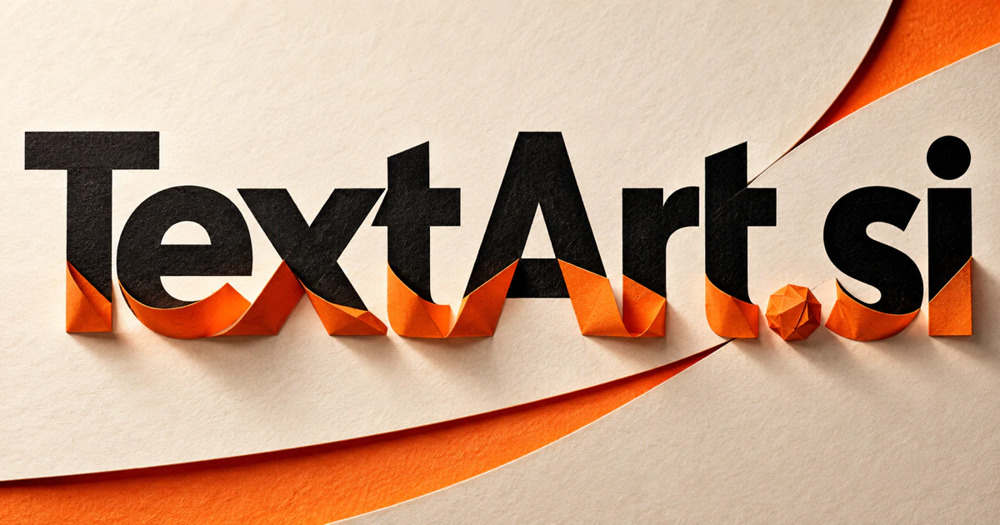

# TextArt.si — Give words a visual voice

Text art sits where language becomes an image. **TextArt.si** could help designers, publishers, educators, and makers explore how lettering, composition, and meaning work together—from a campaign headline or book cover to a visual poem, a printed object, or a large installation.

## What the name opens up

Text Art combines written language with visual creation. It can suggest typographic composition, lettering, ASCII-style imagery, concrete poetry, or images prompted through text. These are related but technically different approaches. The useful commercial bridge is that words can be both a message and a design material. A buyer could build a tool for editable typography with reusable text and layout controls. The [SVG text specification](https://www.w3.org/TR/SVG2/text.html) documents a real vector-text foundation for some proposed implementations. Seven letters make the input and creative outcome recognizable in one compact compound.

## Business opportunities

### 1. Typography creation

A typography workbench could connect wording, emotional intent, legibility, and format constraints, develop distinct lettering treatments, and explain the trade-offs between expressive character and ease of reading. Users could control hierarchy, layout, color, and export dimensions. Creator subscriptions or paid design packs would make the text-to-visual transformation useful in actual publishing and promotion.

### 2. Campaign template studio

A campaign design studio could reason across audience, message hierarchy, visual identity, and distribution formats, coordinate a family of text-led designs, and preserve the central idea through each adaptation. Teams could prepare variants while preserving the chosen typography and hierarchy. Organization subscriptions would support repeatable campaign production across the places a business communicates.

### 3. Personalized merchandise

A personalized merchandise service could connect a buyer’s story and wording with product dimensions, printing constraints, and visual references, propose meaningful variations, and prepare reviewable production-ready concepts. Staff could inspect the approved artwork before production. Product sales or merchant software subscriptions would connect personal expression with a tangible manufactured result.

### 4. Literary visual publishing

A visual publishing studio could connect the structure and imagery of a permitted text with visual rhythm, spacing, and narrative emphasis, helping an editor explore forms that deepen rather than merely decorate the reading experience. Readers could purchase prints or digital editions. A publishing studio could combine editorial selection with original design and physical fulfillment.

### 5. ASCII and terminal art tools

A terminal-art editor could reason across a visual brief, character set, display width, and terminal behavior, generate alternative compositions, and explain how each survives different rendering constraints. Exports could suit terminal interfaces or creative coding projects. Paid collections, creator subscriptions, or commercial licenses would serve a distinct technical-creative niche.

### 6. Event lettering studios

An event lettering studio could connect an occasion’s story with venue layout, guest flow, and fabrication methods, coordinate lettering across touchpoints, and surface practical conflicts before production. Personal details could be edited across a complete set. Design-service fees or template sales would turn the domain into a business with a tangible event deliverable.

### 7. Educational word visualization

A word-visualization learning tool could translate an abstract word relationship into visual examples, compare how learners interpret them, and adapt the illustration so the design supports understanding rather than visual spectacle alone. Teachers could adapt activities and print the results. School licenses or learning packs could connect the creative transformation with a real teaching objective.

### 8. Book cover concepting

A book-cover concept studio could connect a manuscript’s themes, intended audience, and cover hierarchy, develop competing text-led concepts, and help the team explain why one treatment better represents the book. Teams could compare versions at realistic sizes before commissioning final production. Project fees or publishing subscriptions would support a focused professional design business.

### 9. Brand lettering resources

A brand lettering workspace could connect a company’s voice with lettering systems, localization needs, and application contexts, organize adaptable assets, and identify where a visual variation weakens recognition. Buyers could see how a design works on signage, packaging, and digital surfaces. Resource sales or memberships could exploit the domain's clear category without building a complete design suite.

### 10. Public installation concepts

A public-art planning studio could reason across site conditions, community narratives, readability, and changing audiences, coordinate alternative textual installations, and help artists explain the experience each proposal invites. A workspace could organize scale studies, materials, and audience interaction. Commissioned projects and venue licenses would extend TextArt beyond screens into physical experiences.

## A Super Intelligence product vision

A TextArt SI studio could take a short brief and develop several typographic directions that remain editable. It could explain the intended hierarchy, propose line breaks, and adapt the same approved message to a poster, social graphic, and product label. A designer would choose the final wording and appearance. A template shop could provide an initial commerce model, followed by creator subscriptions and team editions. The intelligence ambition is visual reasoning with language: understanding what needs emphasis and giving people controllable options for a meaningful visual message.

## Related names, different purposes

[Hues.si](hues-si.md) concentrates on color and visual systems. [InWords.si](inwords-si.md) focuses on the wording itself, while [TextVideo.si](textvideo-si.md) is better suited to scripts, movement, and a visual narrative unfolding over time.

## Explore TextArt.si

Interested in **TextArt.si** for one of the opportunities above? Contact [hedge.pike02@icloud.com](mailto:hedge.pike02@icloud.com?subject=Domain%20enquiry%3A%20textart.si) to discuss availability, a direct-purchase offer, a possible discount, or a portfolio combination. These are envisioned products and services for a future owner to build.

[View the Dynadot listing](https://www.dynadot.com/market/user-listings/textart.si) · [Marketplaces and Escrow.com](../guides/how-to-buy.md) · [Browse all domains](../README.md)

## Sources and further reading

- [SVG 2 text](https://www.w3.org/TR/SVG2/text.html) — Official reference for vector text elements and layout used in potential editable designs.
