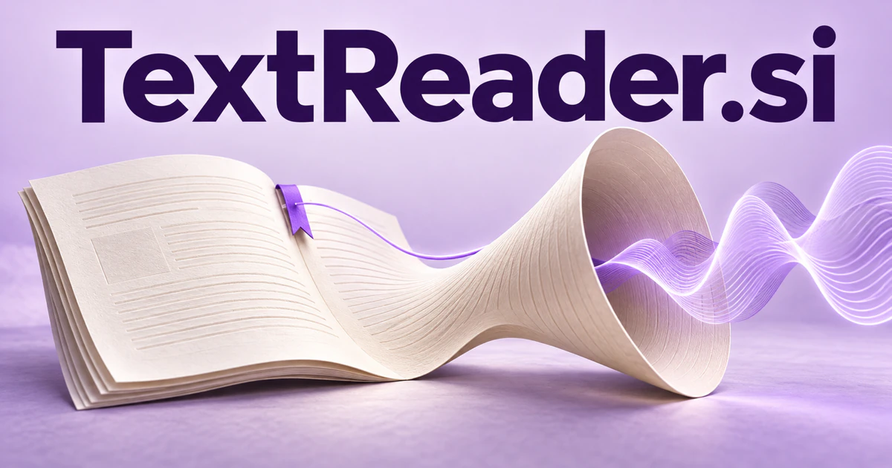

# TextReader.si — Read, listen, and understand the source

**TextReader.si** names a clear practical tool, but reading can mean more than showing text or playing a voice. A product could help readers, students, or professionals move between a document, a spoken explanation, and a specific question without losing the source passage that gives an answer its meaning.

## What the name opens up

Text Reader describes a function in familiar terms, but that function can be much wider than reading a paragraph aloud. Text may originate in a document, photograph, scanned page, subtitle, log, or application interface. A reader can present it, navigate its structure, pronounce it, or help someone understand it. [SpeechSynthesis](https://developer.mozilla.org/en-US/docs/Web/API/SpeechSynthesis) documents one real browser speech-output interface. Extraction, OCR, language understanding, and narration remain different technical stages, giving a buyer several distinct ways to specialize.

## Business opportunities

### 1. Document listening

A document-listening companion could connect a document’s argument, the listener’s questions, and their place in the audio, adjust the explanation on request, and return directly to the source passage behind an answer. Users could choose reading or listening as their situation changes. Personal subscriptions or publisher editions would support a flexible document-consumption experience.

### 2. Accessible reading tools

An accessible reading interface could coordinate visual structure, narration, terminology support, and navigation around chosen user preferences, adapting presentation without losing the source text or the reader’s control. Staff could test the experience with actual users. Institutional licenses would support specific reading needs through controllable features and practical review.

### 3. Embedded document reader

An embedded document assistant could connect the document currently being read with the application’s task context, answer source-grounded questions, and help users move from a passage to the relevant next action. Developers could choose extraction, navigation, highlighting, and optional speech while preserving their existing interface. Application licenses or API usage would make TextReader a recognizable infrastructure offering with documented integration behavior.

### 4. Scanned document workflows

A scan-review workspace could combine recognized text, page structure, tables, and surrounding context, identify ambiguous extraction, and direct a reviewer to the portions that need checking before the information is reused. Staff could correct names, tables, and uncertain passages. Per-document processing or team subscriptions could serve organizations whose working knowledge remains trapped in image-based files.

### 5. Language pronunciation practice

A pronunciation practice tool could connect pronunciation attempts with sentence meaning, stress, and a learner’s prior mistakes, choose focused practice, and explain differences using examples from the selected text. Teachers could choose texts and review attempts. School licenses or personal subscriptions could support a focused language-learning reader built around real material the learner wants to understand.

### 6. Professional manual assistants

A professional manual assistant could connect an operator’s question with equipment identity, procedure versions, and relevant warnings, retrieve the correct passage, and prepare a reviewed task sequence instead of guessing from a generic manual. Search results could point directly to the source section. Enterprise subscriptions could serve equipment suppliers or service organizations that need better access to their own approved documentation.

### 7. Reading proof workflows

A spoken-proofing workspace could compare spoken and visual readings with editorial intent, detect awkward or ambiguous passages, and help an editor distinguish a delivery problem from a problem in the underlying text. Project notes could survive between revisions. A professional subscription could connect narration with the larger editorial workflow.

### 8. Mobile sign and label readers

A mobile sign reader could combine camera text, layout, user intent, and language context, explain a label or sign, and make uncertain recognition visible before the user relies on the interpretation. Users could inspect the captured image and correct recognition errors. A consumer app or travel edition could focus on presentation convenience and practical interpretation.

### 9. Content narration services

A narration production service could connect content structure, audience needs, pronunciation decisions, and listening feedback, coordinate a coherent audio edition, and help editors resolve passages that do not translate cleanly to speech. Usage pricing or publisher subscriptions could connect a reading engine to actual editorial distribution and customer listening preferences.

### 10. Developer reading components

A document-reading toolkit could connect a product’s reading tasks with document structure, interaction patterns, and user preferences, prepare a suitable integration, and test whether important source context remains accessible. Customers could select navigation, highlighting, and speech features. API usage or application licenses would turn TextReader into a clearly named infrastructure product.

## A Super Intelligence product vision

A TextReader SI product could inspect an uploaded manual, preserve its headings and figures, and answer a user's question with a link to the relevant passage. The same source could be presented as synchronized speech, a concise explanation, or a step-by-step checklist chosen by the user. A useful business might begin with professional manuals or student course material. Its intelligence would come from connecting presentation, navigation, and understanding while keeping the original text accessible. Paid editions could serve individuals, publishers, and software teams embedding the reader into existing products.

## Related names, different purposes

[ReadOn.si](readon-si.md) is warmer for a continuing reading or learning relationship. [InWords.si](inwords-si.md) emphasizes expression and transformation into language, while [AudioSearch.si](audiosearch-si.md) helps people find material inside recordings rather than read a text source.

## Explore TextReader.si

Interested in **TextReader.si** for one of the opportunities above? Contact [hedge.pike02@icloud.com](mailto:hedge.pike02@icloud.com?subject=Domain%20enquiry%3A%20textreader.si) to discuss availability, a direct-purchase offer, a possible discount, or a portfolio combination. These are envisioned products and services for a future owner to build.

[View the Dynadot listing](https://www.dynadot.com/market/user-listings/textreader.si) · [Marketplaces and Escrow.com](../guides/how-to-buy.md) · [Browse all domains](../README.md)

## Sources and further reading

- [SpeechSynthesis — MDN](https://developer.mozilla.org/en-US/docs/Web/API/SpeechSynthesis) — Browser speech generation reference; extraction and comprehension are separate proposed features.
