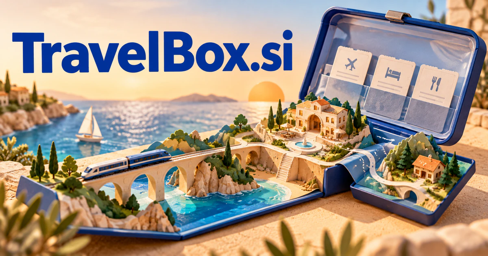

# TravelBox.si — A whole journey, thoughtfully put together

**TravelBox.si** suggests a trip assembled into something organized and ready to open. A travel service could bring plans, reservations, preparation, local experiences, and memories into one coherent package for families, agencies, groups, or business travelers whose needs do not fit a generic itinerary.

## Meaning and context

TravelBox combines movement with a container: a simple promise that a journey’s bookings, ideas, documents, equipment, and memories can be brought together. A box may be digital, physical, curated, or shared. That gives the compound several credible business models beyond a conventional booking website. The strongest common thread is completeness: helping a traveler open one place and find what is needed next. A buyer could begin with an itinerary workspace and grow into agency software, experience gifts, physical equipment, or intelligent journey coordination.

## Ten directions a buyer could build

The following are proposed business opportunities. They show different ways to develop the name, with concrete audiences, workflows, and potential commercial models.

### 1. A shared trip workspace

A shared trip workspace could reconcile group preferences, transport, reservations, and timing, compare realistic trip structures, and maintain a coherent plan when one traveler’s needs or one booked element changes. Consumer subscriptions could include offline-ready itineraries and changing attendance, making the product useful throughout planning rather than only at the moment of purchase.

### 2. Agency itinerary delivery

An agency itinerary assistant could connect a client brief with supplier information, route constraints, and service commitments, assemble a clear itinerary, and help the agent explain the choices and unresolved questions. Per-agency plans could support reusable itinerary components while keeping each traveler’s actual preferences and approved bookings visible.

### 3. Travel preparation kits

A travel preparation service could connect destination conditions, planned activities, traveler needs, and existing possessions, build a practical kit, and explain which items are essential for this trip rather than a generic packing list. Retail margins and gift purchases could connect an attractive physical box with digital packing notes and instructions matched to the customer’s actual journey.

### 4. Experience gift boxes

An experience-gifting service could combine an occasion, recipient interests, travel limitations, and provider availability, propose coherent experience combinations, and help the giver resolve practical details before purchase. Booking commissions and curated retail collections could support recipient choice, clear redemption instructions, and opportunities for friends to contribute together.

### 5. Corporate travel packets

A business-travel coordinator could reconcile meeting goals, company policy, traveler preferences, and disrupted connections, compare alternative arrangements, and prepare an approval-ready travel packet with important dependencies visible. Company subscriptions could connect the administrative record with useful mobile information without requiring staff to search several different internal systems.

### 6. Travel creator storefronts

A travel creator storefront could connect a travel audience’s recurring questions with verified itinerary details, editorial assets, and available experiences, organize useful collections, and help maintain them as conditions change. Creator subscriptions or transaction fees could support original expertise with sample content, paid bundles, and direct updates for customers.

### 7. Family travel coordination

A family trip planner could reason across children’s routines, accessibility preferences, accommodation details, and travel timing, propose workable daily rhythms, and help family members understand the trade-offs together. Paid plans could adapt the preparation process to a family’s own preferences and make handovers between adults straightforward during a busy trip.

### 8. A portable travel memory archive

A portable travel archive could connect photographs, routes, receipts, and personal notes into a meaningful trip narrative, recover the context behind a moment, and help travelers create an archive that can be explored later. Consumer subscriptions and print fulfillment could turn a practical trip record into a photo book, family keepsake, or privately shared travel journal.

### 9. Group and event travel operations

A group-travel operations tool could connect attendee arrivals, rooming needs, event schedules, transport capacity, and exceptions, coordinate approved changes, and give organizers one intelligible view of the next operational decisions. Organization plans could preserve changes and responsibility assignments across a journey involving several suppliers and many travelers.

### 10. Travel software integration

A travel integration service could reconcile travel data formats, booking states, supplier responses, and customer intent, map dependencies across services, and explain where an itinerary requires human confirmation rather than another automated request. Usage-based plans could help other travel businesses deliver a coherent customer experience without rebuilding every document and notification workflow.

## A Super Intelligence product story

TravelBox.si could frame Super Intelligence as a coordinated travel companion. Research agents compare options, a document agent extracts approved booking details, and a planning agent prepares alternatives. The traveler sees one understandable trip pack and approves purchases or itinerary changes before any external action takes place.

## Why this name can carry a business

The compound is easy to picture and comfortable on both packaging and a software interface. “Box” gives an organizing principle across subscriptions, physical kits, curated content, and agency workspaces. A buyer can build a focused entry product while preserving a clear path into a broader travel platform.

## Related names, different purposes

[RouteMapper.si](routemapper-si.md) emphasizes choosing feasible paths and adapting routes. [GiftGuide.si](giftguide-si.md) is more direct for experience gifting, while [HomeGuide.si](homeguide-si.md) addresses a different transition: arriving, relocating, and making a place work.

## Explore TravelBox.si

Interested in **TravelBox.si** for one of the opportunities above? Contact [hedge.pike02@icloud.com](mailto:hedge.pike02@icloud.com?subject=Domain%20enquiry%3A%20travelbox.si) to discuss availability, a direct-purchase offer, a possible discount, or a portfolio combination. These are envisioned products and services for a future owner to build.

[View the Dynadot listing](https://www.dynadot.com/market/user-listings/travelbox.si) · [Marketplaces and Escrow.com](../guides/how-to-buy.md) · [Browse all domains](../README.md)

## Research references

- [Cambridge Dictionary: travel](https://dictionary.cambridge.org/dictionary/english/travel)
- [Cambridge Dictionary: box](https://dictionary.cambridge.org/dictionary/english/box)

[Browse all domains](../README.md)
