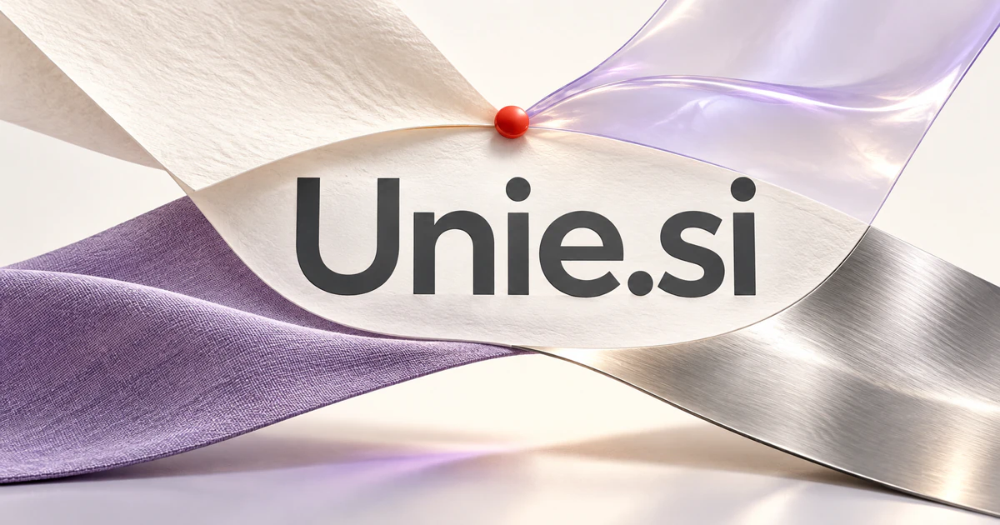

# Unie.si — Bring the pieces into a shared understanding

Unie has real language associations with union and being united. **Unie.si** could name a workspace that connects models, knowledge, people, or applications without making the user manage every handoff. Its short, open form also suits communities, cooperative services, and design brands built around a coherent whole.

## What the name opens up

It is a [Dutch word associated with a union or alliance](https://etymologiebank.nl/trefwoord/unie), and French unie is the feminine form of uni; [Larousse](https://www.larousse.fr/dictionnaires/francais/uni/80537) documents senses involving smoothness and a single color. These readings open two complementary territories: bringing separate things together and making an experience feel consistent. The familiar uni sound also offers an optional university branding cue. Four letters and a soft vowel ending give the buyer a compact master brand.

## Business opportunities

### 1. Team knowledge hub

A shared knowledge hub could connect information scattered across documents, conversations, and projects, reconcile conflicting accounts, and provide colleagues with a source-linked explanation shaped around the decision they need to make. Each item could show its owner and current status. Organization subscriptions would make the unifying promise concrete for firms tired of reconstructing context across disconnected systems.

### 2. Client collaboration

A client collaboration workspace could connect a client’s objectives with proposals, feedback, delivery constraints, and unresolved choices, coordinate the specialist work, and give both sides a shared understanding of the next step. Clients could inspect the latest version and understand what needs their approval. Professional subscriptions would support clearer collaboration without asking every customer to adopt the agency's internal toolset.

### 3. Member coordination

A membership coordination service could reconcile member interests, available expertise, events, and community commitments, suggest useful connections, and help organizers create opportunities that serve different parts of the group. Organizers could connect people around actual needs and shared activities. Community subscriptions would turn a collection of independent participants into a more useful, coordinated network.

### 4. Multi-model workspaces

A multi-model workspace could decompose a difficult question, choose complementary reasoning and retrieval specialists, compare their conclusions, and return a coherent answer with disagreements and evidence still visible. Teams could choose a model for each task while keeping the work together. Workspace subscriptions could fund a practical coordination layer with clear usage reporting.

### 5. Software integration hubs

A software integration hub could connect a business intent with application capabilities, data definitions, and approval boundaries, propose a coordinated workflow, and explain how a change affects the systems around it. Small companies could begin with a few important workflows and expand gradually. Pricing by connected workflow or organization would match the unifying promise without requiring an all-at-once platform migration.

### 6. Portable personal identity

A personal identity workspace could connect a person’s chosen credentials, projects, and permissions with a particular interaction, help assemble an appropriate presentation, and keep unrelated personal information outside that context. Users could publish a concise page or share a tailored view. Consumer subscriptions and professional editions could serve freelancers, creators, and people whose identity is scattered across many services.

### 7. Campus communities

A campus navigation service could connect a student’s question with courses, societies, services, and practical constraints, coordinate a useful path through the available resources, and adapt as the student’s goals develop. Institutional licenses or student-organization subscriptions could support a focused community product that connects clubs, courses, people, and practical campus services.

### 8. Purchasing cooperatives

A purchasing cooperative tool could reconcile buyers’ requirements, supplier terms, demand timing, and shared priorities, compare procurement options, and prepare a collective decision that makes each participant’s trade-offs understandable. Membership fees or a managed procurement service could support the model. The alliance reading makes sense for a product that gives smaller participants a common operating space.

### 9. Minimalist home and fashion

A considered product-design studio could connect an intended lifestyle with materials, dimensions, visual consistency, and everyday use, develop coherent product families, and help customers assemble combinations that suit their own context. Customers could build collections around compatible colors and materials. A direct-to-consumer shop could add a design assistant while retaining a physical product identity with room to grow.

### 10. Shared resource networks

A shared-resource network could connect people’s needs with available spaces, equipment, skills, and booking commitments, propose mutually workable combinations, and help a network resolve conflicts before making promises. Members could book a resource and understand the rules before arrival. Community subscriptions or venue licensing would turn unity into a useful local service.

## A Super Intelligence product vision

A Unie SI workspace could unite a team's documents, connected applications, and specialized agents around one project objective. A research agent would collect permitted evidence, a planning agent would propose the work, and an execution agent would prepare approved changes in the relevant tools. Team members would see what each agent used and which decisions still require attention. A small business could begin as a unified project cockpit and grow into an integration marketplace. The brand's value lies in coherence: separate capabilities feel like a coordinated system.

## Related names, different purposes

[OneNode.si](onenode-si.md) gives connected infrastructure a more technical identity. [BYO.si](byo-si.md) emphasizes user ownership and customization, while [EZLink.si](ezlink-si.md) makes the immediate connection or handoff the central promise.

## Explore Unie.si

Interested in **Unie.si** for one of the opportunities above? Contact [hedge.pike02@icloud.com](mailto:hedge.pike02@icloud.com?subject=Domain%20enquiry%3A%20unie.si) to discuss availability, a direct-purchase offer, a possible discount, or a portfolio combination. These are envisioned products and services for a future owner to build.

[View the Dynadot listing](https://www.dynadot.com/market/user-listings/unie.si) · [Marketplaces and Escrow.com](../guides/how-to-buy.md) · [Browse all domains](../README.md)

## Sources and further reading

- [Uni, unie — Larousse](https://www.larousse.fr/dictionnaires/francais/uni/80537) — French meanings behind the consistency and single-color associations.

- [Unie — ANW](https://anw.ivdnt.org/article/unie) — Dutch spelling, word-class, and pronunciation reference.

- [Unie — Etymologiebank](https://etymologiebank.nl/trefwoord/unie) — Dutch union and association meanings documented in primary etymological dictionary entries.
