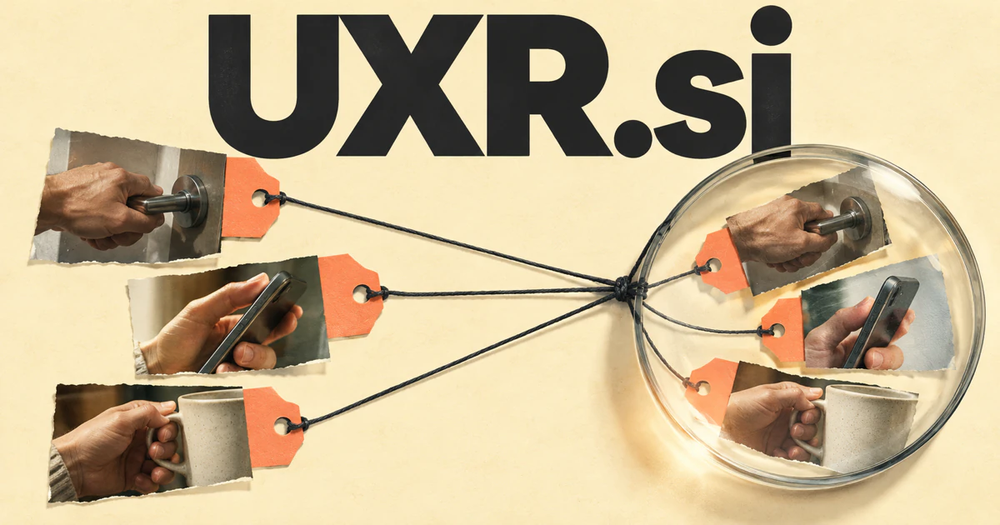

# UXR.si — Keep human evidence close to the product decision

UXR is a familiar shorthand for user experience research. **UXR.si** could help researchers, designers, or product teams connect interview accounts, observed behavior, study context, and earlier decisions. The useful outcome is not another pile of themes: it is knowing which explanation the evidence supports and what should be investigated next.

## Meaning and naming depth

UXR is widely used as shorthand for **user experience research**. The discipline covers more than usability tests at the end of a project: it can investigate needs, existing behavior, concepts, prototypes, and experiences after release. Methods vary according to the question being asked.

That breadth gives the domain room for several distinct products. Researchers need recruitment and scheduling; analysts need evidence and synthesis; organizations need useful findings that remain connected to their source. A founder could also define a creative expansion such as **Unified eXtended Reality** for a different technology business, but that would be a chosen brand story rather than the established research abbreviation.

## Business opportunities

### 1. A searchable research repository

A research repository could connect interviews, observations, study context, and product decisions, retrieve evidence relevant to a new question, and distinguish a recurring finding from a misleading resemblance. Product teams could locate the evidence behind a finding before reusing it. Commercial routes include organizational subscriptions, controlled sharing, and migration services for teams whose research is scattered across projects.

### 2. Study operations software

A study operations workspace could reconcile study objectives, recruitment needs, participant commitments, and team capacity, coordinate a practical plan, and surface the dependency most likely to compromise the evidence. Agencies could offer clients a clear progress view without exposing unrelated projects. The business could offer workspaces by researcher or study volume, with templates for different kinds of qualitative and evaluative work.

### 3. AI-assisted research synthesis

A research synthesis tool could compare participant accounts with observed behavior and business assumptions, preserve conflicting cases, and formulate testable explanations rather than flattening every insight into a consensus theme. The deliverable could be an editable analytical notebook rather than a detached summary. Customers could buy team subscriptions and configured workflows for organizations running recurring research programs.

### 4. Prototype and usability testing

A usability investigation workspace could connect observed hesitation, task intent, prototype states, and participant expectations, investigate competing causes, and help the design team choose the next discriminating experiment. A reviewer could inspect the recorded context before deciding what to change. The commercial offer could combine study tools, participant coordination, and specialist research services for particular product categories.

### 5. Customer journey investigation

A customer-journey research tool could reconcile service touchpoints, customer narratives, operational dependencies, and missing evidence, identify where a problem originates, and propose research that could change the service decision. Teams could identify where responsibilities or information break down. Commercial routes include research engagements, collaborative mapping software, and ongoing programs for organizations improving complex services.

### 6. Research education and practice

A research education service could connect research principles with a learner’s actual study design and evidence, identify a methodological weakness, and create a focused exercise that improves the next investigation. Learners could practice with reviewed examples and peer feedback. The business could offer courses, cohort programs, classroom licenses, and employer training packages under a domain that directly names the profession.

### 7. A specialist research consultancy

A specialist research consultancy could connect a client’s commercial question with user evidence, product constraints, and research methods, coordinate specialist investigations, and present recommendations with their supporting reasoning. The firm could publish useful methods and case-based learning material. Project work, retainers, and training would support a service business with a clear professional identity.

### 8. Research impact and decision records

A research-impact register could trace an insight through the evidence, proposed change, and subsequent outcome, test whether the original assumption still holds, and help teams learn from research that influenced real work. A team could see what it learned and what changed as a result. The commercial offer could combine governance workspaces and integration services to organizations seeking a clearer relationship between research activity and actual work.

### 9. An expert and participant community

A research collaboration community could connect researchers’ questions with participant experience, specialist expertise, and suitable study formats, suggest relevant collaborations, and retain the context that makes a contribution meaningful. The business could sell memberships, job listings, educational events, and organization tools. The concise abbreviation provides a natural community identity for the field.

### 10. Extended-reality experience research

An immersive-experience research tool could connect spatial behavior, interaction attempts, comfort preferences, and environment constraints, compare explanations for user difficulties, and help researchers design the next immersive-product experiment. A studio could combine a research practice with software for reviewing sessions. This connects emerging interaction formats to the established user-research discipline without needing to redefine the initials.

## A Super Intelligence brand

UXR.si can position Super Intelligence around grounded product understanding. A potential system could help plan a study, organize observations, find related evidence, and prepare a reviewable synthesis. Its value would come from assisting a disciplined research process, not substituting generated personas for observed people. The name keeps the human question central even as analytical tools become more capable.

## Why the name works

Three letters are concise enough for a professional community, a conference, a research platform, or an expert practice. UXR Studies, UXR Library, and UXR Academy are natural extensions. **“Know the people behind the product.”** gives the abbreviation a clear benefit that both researchers and business buyers can understand.

## Related names, different purposes

[MyReviews.si](myreviews-si.md) is warmer for feedback, reflection, and personal judgment. [Topoi.si](topoi-si.md) emphasizes conceptual knowledge structures, while [Readouts.si](readouts-si.md) fits the presentation and interpretation of completed study results.

## Explore UXR.si

Interested in **UXR.si** for one of the opportunities above? Contact [hedge.pike02@icloud.com](mailto:hedge.pike02@icloud.com?subject=Domain%20enquiry%3A%20uxr.si) to discuss availability, a direct-purchase offer, a possible discount, or a portfolio combination. These are envisioned products and services for a future owner to build.

[View the Dynadot listing](https://www.dynadot.com/market/user-listings/uxr.si) · [Marketplaces and Escrow.com](../guides/how-to-buy.md) · [Browse all domains](../README.md)

## Sources and further reading

- [UX Research Cheat Sheet](https://www.nngroup.com/articles/ux-research-cheat-sheet/) — Original practitioner guidance on research methods across the design cycle.
- [W3C: Forms Tutorial](https://www.w3.org/WAI/tutorials/forms/) — A primary interaction-design resource relevant to usable research and participant tools.
