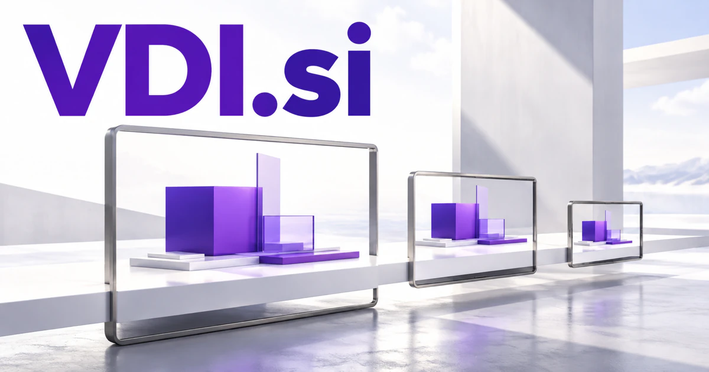

# VDI.si — A digital workspace that fits the work

Virtual desktop infrastructure gives **VDI.si** an established enterprise-computing audience. A service could connect what an employee needs to do with the applications, resources, and support that make a remote workspace useful. Separately chosen visual-data or design interpretations open additional technical markets without changing the concise initials.

## Meaning and naming depth

**Virtual desktop infrastructure** describes an arrangement in which desktop environments are delivered from centrally managed computing resources. It connects the name to a concrete set of needs: access, application delivery, user sessions, image management, and support.

A new owner could also deliberately define VDI as **Visual Data Intelligence**, **Virtual Design Intelligence**, or **Vector Data Infrastructure**. Those are proposed brand expansions here, not alternative dictionary definitions. They broaden the opportunity toward image analysis, simulation, and AI data systems. The consistent theme is an interface between people and computing capability that would otherwise be difficult to operate.

## Business opportunities

### 1. Managed virtual desktops

A managed desktop service could connect employee tasks, application demands, device context, and infrastructure capacity, compare desktop configurations, and prepare reviewed adjustments that improve the actual working experience. The service could organize desktop images, access requests, session information, and user support. Commercial routes include per-user plans, deployment projects, and ongoing management to customers that value a coherent remote working environment.

### 2. Application delivery for specialist teams

A specialist application-delivery service could reconcile specialist workflows, software dependencies, licensing constraints, and deployment options, coordinate a suitable delivery plan, and make the consequences of each technical choice understandable. A provider could package setup and support for a specific profession. Licensing support, managed sessions, and onboarding services offer a focused route into the infrastructure market.

### 3. Desktop experience monitoring

A workspace experience monitor could connect user-reported friction with session telemetry, workload, and recent changes, distinguish infrastructure symptoms from application behavior, and propose targeted checks before resources are changed. Reports could connect technical measurements with the user’s actual experience. Customers could buy monitoring subscriptions, retained diagnostic data, and specialist performance investigations.

### 4. AI support for remote workspaces

A remote-work support assistant could relate a worker’s problem to session state, approved knowledge, and previous incidents, coordinate diagnostic tools, and prepare an explained recovery path with human escalation where needed. Managed service providers could deploy it across customers. Revenue could follow supported users or client organizations, with integrations into existing helpdesk tools.

### 5. Visual data analysis

A visual-data analysis workspace could connect a business question with source datasets, analytical methods, and chart interpretation, explore competing explanations, and produce a traceable investigation rather than a decorative dashboard. Customers might include manufacturers, researchers, and content archives. Commercial routes include dataset workspaces, model evaluation tools, and services for preparing visual information for specific workflows.

### 6. Virtual design and simulation

A virtual design studio could reason across geometry, functional requirements, simulation results, and manufacturing constraints, coordinate specialist analysis, and help engineers compare alternatives before choosing a design direction. A customer could describe a design goal and review generated alternatives. The business could offer studio subscriptions, specialist rendering services, and project workspaces for architecture or product teams.

### 7. Vector data infrastructure

A vector-data workbench could connect vector datasets with topology, source history, and application intent, detect incompatible assumptions, and prepare a coherent data workflow for a mapping or analytical team. Developers could understand how a document became a search result. Usage subscriptions, private deployments, and data migration services would make the acronym relevant to another infrastructure audience.

### 8. Training laboratories

A virtual training laboratory could connect a learner’s actions inside a virtual environment with the task objective and observed mistakes, select the next exercise, and explain the consequences of alternative decisions. Instructors could reset environments and review completed projects. The commercial offer could combine lab hours, institutional licenses, and managed course delivery to schools and enterprise training providers.

### 9. Secure contractor onboarding

A contractor onboarding service could reconcile a contractor’s tasks, required tools, access boundaries, and engagement timeline, coordinate a reviewed workspace setup, and explain what must change when responsibilities end. The product could join access requests with project ownership records. Managed onboarding packages and organization subscriptions would serve professional service businesses.

### 10. A virtual infrastructure consultancy

A virtual infrastructure consultancy could compare an organization’s actual work patterns, cost constraints, support history, and architecture choices, develop alternative plans, and help the client evaluate operational trade-offs before migration. Customers could buy an assessment before committing to a broader rollout. The concise name can support a consultancy, a training division, and a library of specialized software tools.

## A Super Intelligence brand

VDI.si can frame Super Intelligence around a useful working environment: an assistant that understands the current application, gathers relevant context, and helps complete tasks inside a virtual workspace. Alternatively, the Visual Data Intelligence reading could organize multimodal analysis. A founder can choose one entry market while retaining an umbrella identity broad enough for related infrastructure and intelligence products.

## Why the name works

Three letters give the domain a concise enterprise feel. An existing technical reading helps specialists recognize a category; explicitly chosen expansions create other coherent brand narratives. **“A clearer workspace for greater capability.”** would suit a platform that connects virtual access, contextual assistance, and practical work.

## Related names, different purposes

[OneNode.si](onenode-si.md) emphasizes distributed compute and connected resources. [CloudGateway.si](cloudgateway-si.md) centers on access and routing between services, while [ZLP.si](zlp-si.md) offers a different portability story for agents and technical tools.

## Explore VDI.si

Interested in **VDI.si** for one of the opportunities above? Contact [hedge.pike02@icloud.com](mailto:hedge.pike02@icloud.com?subject=Domain%20enquiry%3A%20vdi.si) to discuss availability, a direct-purchase offer, a possible discount, or a portfolio combination. These are envisioned products and services for a future owner to build.

[View the Dynadot listing](https://www.dynadot.com/market/user-listings/vdi.si) · [Marketplaces and Escrow.com](../guides/how-to-buy.md) · [Browse all domains](../README.md)

## Sources and further reading

- [Virtual desktop service overview](https://learn.microsoft.com/en-us/azure/virtual-desktop/overview) — Official examples of desktop and application virtualization capabilities.
- [Kubernetes: Nodes](https://kubernetes.io/docs/concepts/architecture/nodes/) — A reference for the distributed computing concepts behind related infrastructure ideas.
