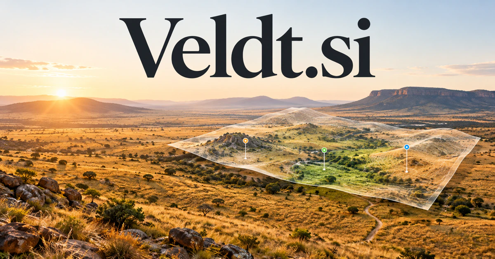

# Veldt.si — Understand a landscape—and the life within it

A veldt is open country, giving **Veldt.si** a visual and ecological starting point. A business could help field researchers, land stewards, agricultural teams, or outdoor travelers connect observations with the landscape that produced them. The same expansive image also suits carefully constructed game worlds and agent-training environments.

## Meaning and context

Veldt is a recognized variant of veld, referring to grassland, especially in southern Africa. [Merriam-Webster](https://www.merriam-webster.com/dictionary/veldt) records the landscape sense and its connection with the word for a field. The name suggests open space, observation, living systems, and exploration. For a technology brand, a field can also be an area of work or a collection of spatial evidence. Veldt therefore connects an unusually compact five-letter identity with environmental data, geospatial tools, creative worlds, and products that help people understand an unfolding landscape.

## Ten directions a buyer could build

The following are proposed business opportunities. They show different ways to develop the name, with concrete audiences, workflows, and potential commercial models.

### 1. Environmental field evidence

A field-evidence workspace could connect observations, location, collection conditions, and previous surveys, compare plausible explanations for change, and help researchers plan the next visit around the most consequential uncertainty. Organization subscriptions could connect each claim in a report with the underlying field record and the person who reviewed it.

### 2. Habitat observation programs

A habitat monitoring tool could reconcile habitat observations, species records, seasonal context, and survey effort, identify patterns worth investigating, and prepare an evidence-backed monitoring plan for conservation teams. Memberships or school licenses could support learning collections and locally reviewed records without treating uncertain identifications as established facts.

### 3. Geospatial imagery review

A geospatial imagery workbench could compare imagery with ground observations, terrain, and collection history, distinguish a genuine landscape change from a data artifact, and direct an analyst to the most useful follow-up evidence. Team plans could preserve sources, spatial boundaries, review decisions, and uncertainty as multiple people work on the same area.

### 4. Agricultural field operations

An agricultural operations planner could connect field observations, weather, equipment availability, and operational goals, compare practical work sequences, and help a farm team prepare reviewed actions under changing conditions. Software subscriptions could combine work planning with practical histories that agronomists and farm managers can review before making operational decisions.

### 5. Outdoor exploration guides

An outdoor exploration guide could connect a visitor’s interests, abilities, route information, and local conditions, assemble meaningful outdoor experiences, and surface information gaps before the journey begins. Paid guides and operator memberships could connect an appealing landscape identity with useful, specific visitor experiences.

### 6. Landscape design collaboration

A landscape-design workspace could reconcile a site’s characteristics, intended use, material choices, and maintenance constraints, develop alternative designs, and help clients understand how each option would function over time. Professional subscriptions could connect a design proposal with the actual observations and measurements that shaped it.

### 7. Simulation environments for agents

An agent simulation environment could connect an agent’s learning objective with environmental rules, observed failures, and scenario variation, generate targeted tests, and expose where apparent competence depends on a narrow setting. Research licenses and hosted simulation services could separate repeatable experimental scenarios from claims about readiness for unsupervised real-world deployment.

### 8. A creative world-building studio

A world-building studio could connect geography, ecology, cultural narratives, and character motives, maintain a coherent fictional landscape, and help creators test whether a new story element fits the world’s rules. Creator subscriptions and asset collections could make spatial coherence and evolving story worlds a distinctive focus.

### 9. Nature-inspired consumer products

A nature-inspired product studio could connect a nature-inspired brief with materials, everyday use, visual identity, and sourcing constraints, coordinate concept alternatives, and help a small brand explain its design choices. Direct retail and selected wholesale could support a coherent aesthetic built around space, texture, and the practical experience of being outside.

### 10. Land stewardship reporting

A land stewardship reporting tool could connect land-use commitments, field evidence, project records, and changing conditions, compare progress against the intended outcomes, and prepare a transparent report for owners and partners. Professional plans could support reporting and contractor coordination while keeping the basis of environmental statements available for scrutiny.

## A Super Intelligence product story

Veldt.si could tell a Super Intelligence story about connecting observations across a living landscape. Agents compare imagery, retrieve permitted records, identify gaps, and prepare questions for a field team. Human reviewers decide what the evidence supports before the system helps publish a report or schedule further observation.

## Why this name can carry a business

Five letters create a compact, textured wordmark with a visual world already attached. The name feels expansive without being vague: it is grounded in land and observation, yet flexible enough for spatial computing, environmental software, design, and imaginative simulation environments.

## Related names, different purposes

[DAQ.si](daq-si.md) emphasizes gathering observations, while [Readouts.si](readouts-si.md) explains the resulting measurements. [TravelBox.si](travelbox-si.md) is more directly about assembling a journey than investigating or managing the landscape itself.

## Explore Veldt.si

Interested in **Veldt.si** for one of the opportunities above? Contact [hedge.pike02@icloud.com](mailto:hedge.pike02@icloud.com?subject=Domain%20enquiry%3A%20veldt.si) to discuss availability, a direct-purchase offer, a possible discount, or a portfolio combination. These are envisioned products and services for a future owner to build.

[View the Dynadot listing](https://www.dynadot.com/market/user-listings/veldt.si) · [Marketplaces and Escrow.com](../guides/how-to-buy.md) · [Browse all domains](../README.md)

## Research references

- [Merriam-Webster: veld / veldt](https://www.merriam-webster.com/dictionary/veldt)

[Browse all domains](../README.md)
