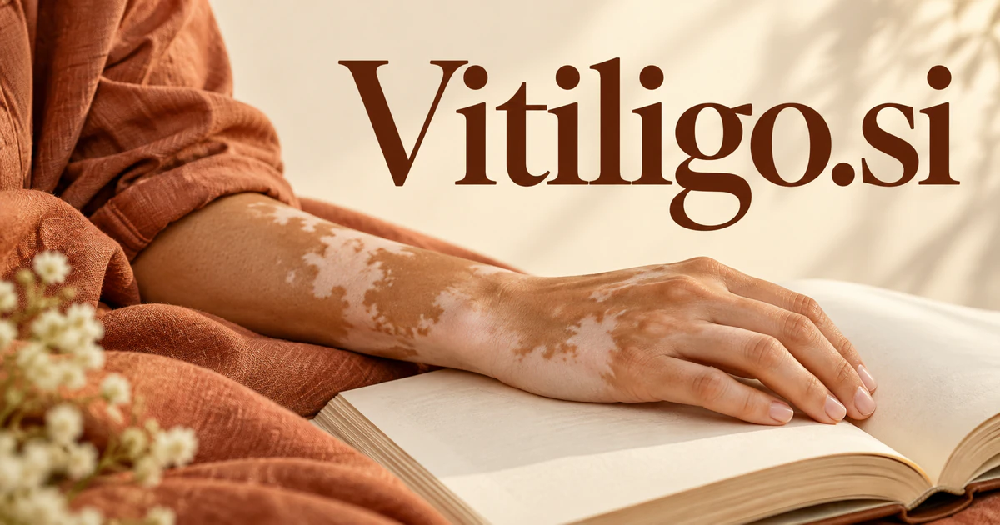

# Vitiligo.si — Clearer knowledge, better questions, shared understanding

Vitiligo is a defined subject with real information needs for patients, families, clinicians, and researchers. **Vitiligo.si** could provide a reviewed learning resource, a research-navigation workspace, or a community service that helps people understand the source behind an explanation and prepare better questions for the people responsible for their care.

## Meaning and context

Vitiligo is the established name of a condition involving loss of skin pigment. The [US National Institute of Arthritis and Musculoskeletal and Skin Diseases](https://www.niams.nih.gov/health-topics/vitiligo) provides an authoritative overview. As a domain, the exact subject name offers immediate clarity for people seeking education, practical resources, research information, or community. A thoughtful business could serve patients, families, educators, clinics, charities, and researchers. Its strongest value would come from reliable information, considerate design, and well-organized support around real human experiences.

## Ten directions a buyer could build

The following are proposed business opportunities. They show different ways to develop the name, with concrete audiences, workflows, and potential commercial models.

### 1. A reviewed patient knowledge hub

A reviewed patient knowledge hub could connect a person’s questions with reviewed information, terminology, and source context, explain unfamiliar concepts, and help the user prepare specific questions for a qualified clinician. Institutional licensing or nonprofit partnerships could fund professional editorial review and clear revision dates, making the collection useful to both individuals and families.

### 2. Community support discovery

A community resource guide could connect people’s stated interests and support preferences with relevant organizations, discussion topics, and practical resources, explain the matches, and preserve the difference between personal experience and clinical evidence. Organization memberships or partnerships could support a considerate community experience with clear participation rules and user control over personal disclosures.

### 3. Clinic education libraries

A clinic education library could connect approved educational materials with recurring patient questions and appointment stages, prepare clearer explanations, and send factual or clinical changes to the appropriate staff for review. Professional subscriptions could make updates easier to manage and help staff direct a person to the right reviewed information after a consultation.

### 4. Research literature navigation

A research literature navigator could connect a question with study methods, populations, findings, and limitations, compare competing evidence, and prepare a source-linked research map for readers who want to understand the field. Institutional plans could serve researchers and specialist publishers, preserving the difference between a study’s findings, its limitations, and questions still being investigated.

### 5. Appointment preparation journals

An appointment preparation journal could organize a person’s own observations, previous questions, and appointment goals, identify missing context, and produce a concise consultation agenda without making a diagnosis or selecting treatment. Consumer or clinic plans could produce a user-approved briefing for a professional appointment, supporting communication and continuity.

### 6. Patient organization operations

A patient-organization workspace could connect recurring community needs with reviewed resources, event plans, and volunteer expertise, coordinate useful programs, and help staff identify where their information collection needs improvement. Organization subscriptions could make useful information easier to maintain while keeping contact preferences and sensitive personal material appropriately controlled.

### 7. Clinical research information services

A clinical-study information guide could reconcile publicly available study descriptions with eligibility language, locations, and participant questions, explain uncertainties, and direct users to the official study team for confirmation. Institutional services could support clearer information access, with eligibility and participation decisions handled by the responsible professionals.

### 8. Representation and creative publishing

An inclusive publishing studio could connect contributors’ approved stories with editorial themes, audience questions, and visual choices, preserve individual context, and help publishers avoid turning different experiences into one generalized narrative. Memberships, books, and events could give people room to describe their experiences in their own terms.

### 9. Education for families and schools

A family learning resource could connect a child’s or family’s questions with age-appropriate reviewed explanations, adapt examples to the situation, and help educators plan a constructive discussion that supports inclusion. Classroom and organization licenses could include age-appropriate materials, facilitator notes, and links to authoritative sources for further questions.

### 10. Information-quality research

A health-information review workspace could trace online claims to their underlying sources, compare the supporting evidence and stated limitations, and prepare a review queue for subject-matter experts to assess. Research contracts or professional tools could support structured reviews and improvement work, including assessment of AI-generated educational drafts.

## A Super Intelligence product story

Vitiligo.si could connect Super Intelligence with better access to carefully maintained knowledge. An assistant searches an approved educational collection, cites relevant passages, and helps a user prepare questions for a clinician. It could also help editors identify outdated materials and organize new research for expert review, making the knowledge service more useful over time.

## Why this name can carry a business

The exact topic name creates clarity and a strong organizing principle for a specialist resource. It accommodates software, education, community, publishing, and institutional services without diluting the subject. A buyer can build lasting value through trust earned by useful work and considerate treatment of the people the resource serves.

## Related names, different purposes

[Zygotic.si](zygotic-si.md) serves a broader biological-research and laboratory audience. [TruthCheck.si](truthcheck-si.md) suits evidence review across subjects, while [HearMe.si](hearme-si.md) emphasizes understanding people’s spoken experiences rather than a particular medical topic.

## Explore Vitiligo.si

Interested in **Vitiligo.si** for one of the opportunities above? Contact [hedge.pike02@icloud.com](mailto:hedge.pike02@icloud.com?subject=Domain%20enquiry%3A%20vitiligo.si) to discuss availability, a direct-purchase offer, a possible discount, or a portfolio combination. These are envisioned products and services for a future owner to build.

[View the Dynadot listing](https://www.dynadot.com/market/user-listings/vitiligo.si) · [Marketplaces and Escrow.com](../guides/how-to-buy.md) · [Browse all domains](../README.md)

## Research references

- [NIAMS: vitiligo overview](https://www.niams.nih.gov/health-topics/vitiligo)
- [NHS: vitiligo information](https://www.nhs.uk/conditions/vitiligo/)

[Browse all domains](../README.md)
