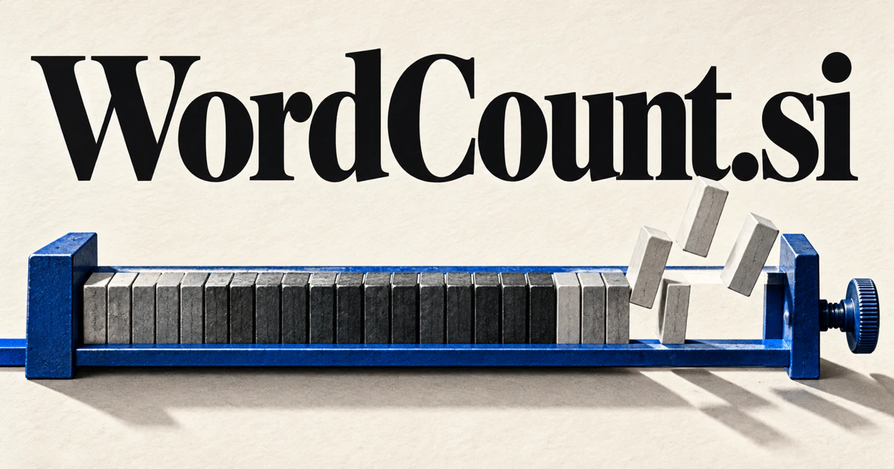

# WordCount.si — Know what the words are doing

A word count measures length; good editorial judgment asks what that length accomplishes. **WordCount.si** could serve writers, editors, translators, or speakers through tools that connect a draft’s purpose with its audience, submission rules, pacing, and revision scope. Counting becomes the starting point for a clearer communication decision.

## What the name opens up

Word Count names a familiar, specific task: measuring how much text a document contains. It also invites the broader idea that words count because language matters. Counting involves choices about language and text boundaries; [Unicode's Text Segmentation annex](https://www.unicode.org/reports/tr29/) explains boundaries for words and other text elements and discusses the need for contextual tailoring. That technical depth gives a buyer room to build multilingual counting, transparent estimation, editorial analytics, and developer services. The domain can start with an immediately useful public utility while supporting a much richer writing business.

## Business opportunities

### 1. Writing checks

A purpose-aware writing tool could connect a draft’s length with its purpose, audience, argument, and publication constraints, identify passages that contribute little, and explain how a revision changes meaning rather than merely deleting words. Users could compare revision options before submission. A public counter could lead into paid personal tools for students, freelancers, and other people working to a defined scope.

### 2. Editorial planning

An editorial planning workspace could reconcile assignment scope, publication capacity, contributor progress, and story dependencies, propose a coherent release plan, and show editors where length problems reflect unresolved reporting questions. Teams could inspect which pieces need attention before layout or release. Workspace subscriptions would connect a basic measurement with the practical work of coordinating several contributors.

### 3. Language service estimates

A language-service scoping tool could connect source text, repetition, terminology, formatting, and delivery requirements, explain the work involved, and prepare a transparent scope for a translator or client to review. Clients could see which source changes affect the commissioned scope. Professional subscriptions would support clearer estimates and a documented conversation about the work involved in a language project.

### 4. Submission requirement checks

A submission-checking assistant could relate a manuscript to the actual instructions, document sections, and counting rules, identify ambiguous requirements, and prepare a focused checklist before the author submits. Users could preserve a source draft while preparing shorter variants. Individual purchases or institutional licenses could fund a utility for consequential submissions where a missed limit creates avoidable rework.

### 5. Speech and script planning

A speech and script planner could connect a script’s length with intended pacing, complex concepts, audience questions, and scene timing, propose alternative structures, and explain what must change to fit the available duration. Presenters could compare section lengths and choose where to focus the talk. Speaker subscriptions or production-team editions could connect text length with a real performance goal.

### 6. Multilingual counting APIs

A multilingual counting API could reconcile language structure, segmentation rules, document format, and customer intent, select a consistent counting approach, and explain why counts differ across systems or languages. Customers could inspect examples and choose an appropriate method. Usage-based pricing would support a focused infrastructure business where predictable behavior matters more than a visually elaborate editor.

### 7. Publishing budget tools

A publishing planning tool could connect manuscript scope, editing effort, layout requirements, and production stages, compare realistic publishing plans, and help teams understand where a longer text creates downstream work. Assignments could have targets, fees, deadlines, and submitted counts in one view. Team subscriptions could turn a familiar measurement into a practical production-planning system.

### 8. Revision scope analysis

A revision-scope workbench could compare versions through argument structure, factual changes, and audience needs, distinguish a minor edit from a substantive rewrite, and explain the review effort each change requires. Agencies could explain why a revised source affects translation, editing, or production work. Professional subscriptions could serve clients who need a clearer commercial discussion than a single new total.

### 9. Writing habit notebooks

A writing practice notebook could connect a writer’s sessions with goals, completed drafts, recurring obstacles, and self-reflection, identify useful patterns, and suggest an exercise that improves the work rather than only increasing output. Counts could be paired with reflections and revision milestones so productive work is not reduced to volume alone. Consumer subscriptions or writing-group editions could create a supportive long-term product.

### 10. Concise communication coaching

A concise communication coach could connect a message with its audience, decision, and required evidence, develop shorter alternatives, and preserve the nuance that would be lost by optimizing for word count alone. Users could compare original and revised versions and explain their choices. Training packages or workplace subscriptions could build a practical communication business.

## A Super Intelligence product vision

A WordCount SI editor could compare a draft with a real assignment brief, show which sections exceed their intended scope, and suggest focused cuts while preserving essential meaning. It could distinguish a calculated word total from an editorial judgment about what deserves space. A translator might use the same engine to compare source revisions and review the impact on a quote. A free counting utility could introduce users to paid workspace features, with transparent definitions and reproducible counts serving as the foundation for more ambitious language assistance.

## Related names, different purposes

[InWords.si](inwords-si.md) emphasizes helping an idea find its expression. [ReadOn.si](readon-si.md) serves the reader’s continuing understanding, while [TextVideo.si](textvideo-si.md) applies scripts and timing to a finished visual narrative.

## Explore WordCount.si

Interested in **WordCount.si** for one of the opportunities above? Contact [hedge.pike02@icloud.com](mailto:hedge.pike02@icloud.com?subject=Domain%20enquiry%3A%20wordcount.si) to discuss availability, a direct-purchase offer, a possible discount, or a portfolio combination. These are envisioned products and services for a future owner to build.

[View the Dynadot listing](https://www.dynadot.com/market/user-listings/wordcount.si) · [Marketplaces and Escrow.com](../guides/how-to-buy.md) · [Browse all domains](../README.md)

## Sources and further reading

- [Unicode Text Segmentation](https://www.unicode.org/reports/tr29/) — Primary technical reference for word boundaries and segmentation considerations.
