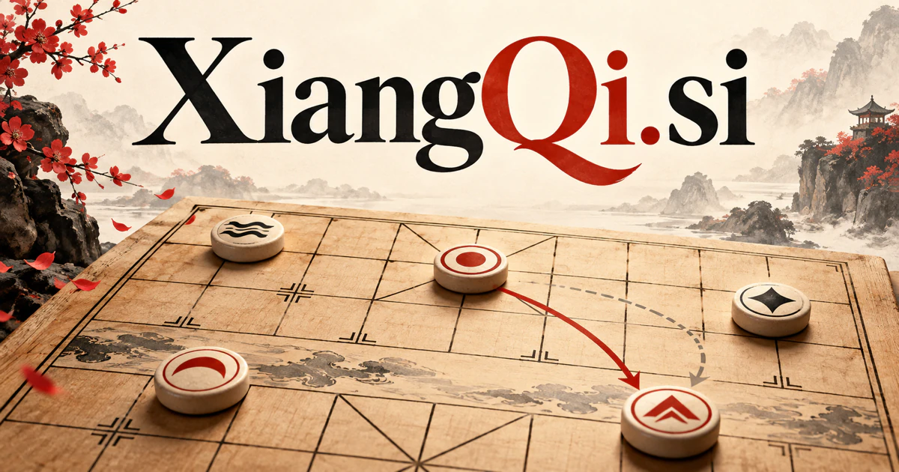

# XiangQi.si — Understand the position. Improve the next move.

Xiangqi is Chinese chess, giving **XiangQi.si** a direct match with a deep strategic game and its community. A product could serve learners, coaches, clubs, or commentators by connecting a move with the plan behind it, explaining alternatives, and turning an analyzed game into a focused next practice session.

## Meaning and context

Xiangqi is the established name of Chinese chess, a strategic board game with its own pieces, board relationships, and rule traditions. The [World Xiangqi Federation rules](https://www.wxf-xiangqi.org/images/wxf-rules/2018_World_XiangQi_Rules_English2018.pdf) provide a primary reference for organized play. The domain gives a dedicated service a direct match with its subject. Its opportunities extend beyond a playing board into education, publishing, competition operations, creator tools, and AI research, while keeping a coherent focus on the game and the people who play it.

## Ten directions a buyer could build

The following are proposed business opportunities. They show different ways to develop the name, with concrete audiences, workflows, and potential commercial models.

### 1. An adaptive learning academy

An adaptive Xiangqi academy could connect a player’s moves with tactical understanding, recurring mistakes, and strategic goals, select an instructive position, and explain the alternatives at a level the learner can use. Memberships and course purchases could organize progress around specific concepts, helping learners understand why a move matters rather than only revealing a stronger answer.

### 2. Online play and practice

A focused practice platform could reconcile opponent strength, learning goals, previous games, and preferred formats, create suitable training encounters, and turn the post-game conversation into a concrete next exercise. Subscriptions or optional purchases could support a welcoming experience for new players and useful practice tools for more experienced members.

### 3. Coach operating software

A coach’s teaching workspace could connect student games, annotations, lesson goals, and practice results, prepare a focused lesson agenda, and help coaches track whether an explanation changed the player’s decisions. Professional plans could connect a student’s games with individualized exercises and make preparation easier across recurring lessons or group classes.

### 4. Club and tournament operations

A club and tournament service could connect player availability, playing strength, venue constraints, and event goals, compare workable pairings and schedules, and help organizers resolve changes with a clear record. Organization subscriptions could support recurring local competitions and published game collections, with human oversight of disputes and the applicable rules.

### 5. A tactical puzzle publication

A tactical puzzle publication could connect a tactical motif with the learner’s reasoning and attempted variations, select a revealing counterexample, and build a progression that teaches transferable judgment rather than memorized solutions. Paid memberships, books, and classroom collections could make editorial quality and clear teaching the distinguishing features rather than an endless stream of automatically generated puzzles.

### 6. Broadcast and commentary tools

A broadcast commentary tool could connect the board position, plausible plans, player history, and audience knowledge, coordinate analytical and explanatory specialists, and help a presenter tell an intelligible strategic story. Event licensing or publisher subscriptions could make competitions easier to follow for viewers who are still learning the game.

### 7. AI analysis workspaces

A game-analysis workbench could compare candidate lines, positional features, and a player’s explanation, expose where a plan fails, and help reviewers distinguish a tactical oversight from a deeper strategic misconception. Paid analysis tools could distinguish engine outputs from human explanation and preserve the specific position, settings, and review context behind a conclusion.

### 8. Board and accessory commerce

A board and accessories guide could connect a player’s intended setting, accessibility preferences, board dimensions, and product details, explain suitable equipment choices, and help retailers assemble practical sets for clubs or learners. Retail revenue could connect a learning service with practical equipment and collections suited to families, clubs, and educational programs.

### 9. Game history and cultural publishing

A game-history publication could connect documented games, historical accounts, terminology, and a reader’s questions, compare interpretations, and preserve the source context behind an engaging story of the game. Editorial memberships and licensed collections could serve readers who value the game’s people and traditions as much as its competitive results.

### 10. Strategic reasoning research

A strategic-reasoning laboratory could connect game states, planning strategies, observed failures, and evaluation goals, construct focused experiments, and help researchers distinguish robust strategic understanding from narrow pattern recall. Research licenses or hosted services could preserve game rules, task data, and evaluation methods so experiments can be examined and repeated.

## A Super Intelligence product story

XiangQi.si could make Super Intelligence a concrete research and learning theme rather than a vague promise. A study assistant would explain an approved analysis line, identify relevant tactical patterns, and prepare exercises for a coach to review. A research product could compare agent behavior on the same well-specified positions.

## Why this name can carry a business

The exact subject name creates immediate topical clarity and room for a substantial specialist brand. Playing, studying, teaching, publishing, and organizing competitions all fit within the same identity. A buyer can serve one audience first and expand without moving away from the domain’s authentic meaning.

## Related names, different purposes

[MatchUps.si](matchups-si.md) suits comparisons and pairings across games or sports. [Charades.si](charades-si.md) explores a different form of interpretation, while [Prelims.si](prelims-si.md) emphasizes preparation and qualifying stages rather than one specific game.

## Explore XiangQi.si

Interested in **XiangQi.si** for one of the opportunities above? Contact [hedge.pike02@icloud.com](mailto:hedge.pike02@icloud.com?subject=Domain%20enquiry%3A%20xiangqi.si) to discuss availability, a direct-purchase offer, a possible discount, or a portfolio combination. These are envisioned products and services for a future owner to build.

[View the Dynadot listing](https://www.dynadot.com/market/user-listings/xiangqi.si) · [Marketplaces and Escrow.com](../guides/how-to-buy.md) · [Browse all domains](../README.md)

## Research references

- [World Xiangqi Federation: official rules](https://www.wxf-xiangqi.org/images/wxf-rules/2018_World_XiangQi_Rules_English2018.pdf)
- [World Xiangqi Federation: introduction](https://www.wxf-xiangqi.org/images/xiangqi-intro/xiangqi-introduction-for-wxf.pdf)

[Browse all domains](../README.md)
