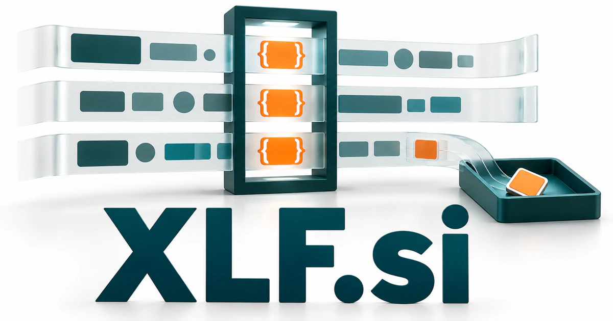

# XLF.si — Preserve meaning as content crosses languages and tools

The .xlf file extension gives **XLF.si** a concrete connection to localization workflows. A product could help software teams and language specialists keep terminology, interface context, translated meaning, and release requirements together. The initials also leave room for a deliberately defined cross-language framework or adaptive learning product.

## Meaning and naming depth

The **.xlf** extension is associated with XLIFF, the XML Localization Interchange File Format. XLIFF is designed to carry localizable content through a translation workflow. The distinction matters: XLF is a compact file association, while the standard’s full acronym is XLIFF.

For a new product, XLF could also be defined creatively as **Cross-Language Framework**, **eXtensible Learning Fabric**, or **eXperience Localization Flow**. These proposed readings connect language, structure, and transformation. Each gives a future owner a deliberately chosen product story alongside the established file-format association. The name’s technical character particularly suits software that organizes complexity behind a concise interface.

## Business opportunities

### 1. Translation-file quality checks

A translation-file review tool could connect translation units with placeholders, source context, interface behavior, and terminology, identify a meaningful inconsistency, and prepare a reviewer queue organized by likely user impact. A release team could review problems before shipping another language. Commercial routes include developer subscriptions, CI integrations, and enterprise workspaces for organizations maintaining many localized applications.

### 2. A translation review portal

A localization review portal could reconcile translator choices, product screenshots, customer language, and editorial feedback, explain competing wording options, and help reviewers settle the decision with sufficient context. The workspace could preserve why a particular wording was approved. The business could offer by reviewer or project volume, with specialized setup services for games, software, and technical publishing.

### 3. Localization workflow automation

A localization workflow coordinator could connect source changes, language dependencies, reviewer capacity, and release milestones, coordinate the next localization steps, and show where an unresolved term could block several downstream tasks. An assistant could prepare draft suggestions while editors handle the final wording. Subscription software could serve smaller product teams, while implementation partners configure larger multilingual content operations.

### 4. File conversion and migration

A file migration workbench could compare source and target file structures, metadata, and application requirements, map the transformation, and identify information that needs a deliberate decision before conversion. Projects could include validation, sample review, and repeatable export procedures. The commercial offer could combine migration services, maintained converters, and team licenses to businesses with complex localization histories.

### 5. Terminology and language memory

A terminology and language memory could connect approved terms with actual usage, product concepts, and audience differences, detect a misleading near-match, and suggest context-sensitive wording with the original evidence attached. Teams could search previous decisions before introducing another variation. Commercial routes include workspaces to technical publishers, multilingual businesses, and agencies responsible for keeping language consistent across channels.

### 6. Multilingual AI evaluation

A multilingual evaluation tool could compare multilingual answers against source meaning, task requirements, and local context, isolate whether a failure comes from retrieval or interpretation, and design targeted follow-up tests. Evaluators could compare outputs against explicit criteria and retain examples. Revenue could come from evaluation workspaces, curated test collections, and tailored assessment services.

### 7. A cross-language developer framework

A cross-language developer framework could connect multilingual application requirements with data formats, language resources, and runtime behavior, propose an integration, and generate checks for the edge cases most likely to affect users. A customer could maintain one schema and inspect generated artifacts. Customers could buy tooling, support, and integration services around a clear engineering task.

### 8. Adaptive language learning

An adaptive language tutor could connect a learner’s expression, intended meaning, and recurring misunderstandings, coordinate explanation and practice specialists, and adapt the next task around a specific gap in understanding. The proposed eXtensible Learning Fabric interpretation supports modular courses and reusable content. The commercial offer could combine individual subscriptions, instructor licenses, and curriculum packages for organizations teaching across several languages.

### 9. Multilingual search infrastructure

A multilingual search service could connect a user’s question with equivalent concepts across languages, compare source contexts, and explain when a literal translation would retrieve the wrong kind of information. The product could preserve original passages alongside translated summaries and source references. Commercial routes include indexed workspaces, hosted APIs, and integration services for document collections that ordinary single-language search leaves fragmented.

### 10. A localization studio and technical publisher

A localization studio could connect client goals, product constraints, editorial decisions, and technical delivery, coordinate a specialist team, and preserve a useful record of why particular language choices were made. A studio could also sell guides and training. XLF provides a concise specialist identity that can house services first and software products later.

## A Super Intelligence brand

XLF.si can position Super Intelligence through language interoperability: an intelligent system should understand context across languages and preserve the structure needed for a useful result. A possible platform could connect product strings, terminology, translated documents, and evaluation records. The opportunity is broader than automatic translation alone; it includes making multilingual operations understandable and repeatable.

## Why the name works

The three-letter shape is concise, and the file-format association gives developers a concrete reason to remember it. XLF Tools, XLF Languages, and XLF Studio can form a coherent family. **“Language in. Possibility out.”** would suit an identity centered on transformation without locking the owner into one translation workflow.

## Related names, different purposes

[InWords.si](inwords-si.md) emphasizes clear expression across more general language tasks. [SmartCMS.si](smartcms-si.md) manages published content and its versions, while [TextReader.si](textreader-si.md) serves the person reading a document rather than the team maintaining its language versions.

## Explore XLF.si

Interested in **XLF.si** for one of the opportunities above? Contact [hedge.pike02@icloud.com](mailto:hedge.pike02@icloud.com?subject=Domain%20enquiry%3A%20xlf.si) to discuss availability, a direct-purchase offer, a possible discount, or a portfolio combination. These are envisioned products and services for a future owner to build.

[View the Dynadot listing](https://www.dynadot.com/market/user-listings/xlf.si) · [Marketplaces and Escrow.com](../guides/how-to-buy.md) · [Browse all domains](../README.md)

## Sources and further reading

- [OASIS: XLIFF 1.2](https://docs.oasis-open.org/xliff/v1.2/os/xliff-core.html) — The localization interchange format and translation-file context.
- [OASIS: XLIFF 2.1](https://docs.oasis-open.org/xliff/xliff-core/v2.1/os/xliff-core-v2.1-os.html) — A subsequent standard describing structured localization workflows.
