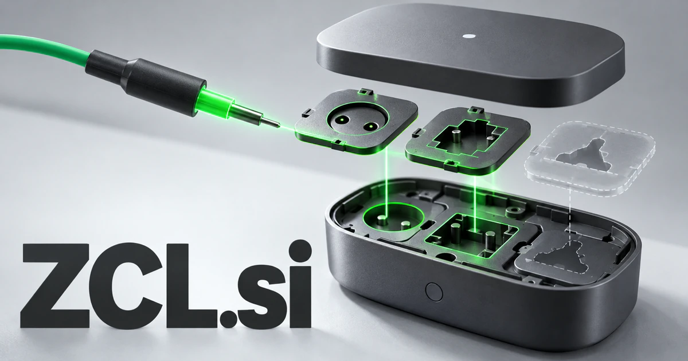

# ZCL.si — Know what the connected device can actually do

Zigbee Cluster Library gives **ZCL.si** an exact technical starting point for manufacturers, embedded developers, and installers. A business could connect documented capabilities with observed behavior, make compatibility questions easier to investigate, and carry the useful context from a laboratory test into a customer’s installed environment.

## Meaning and context

ZCL stands for Zigbee Cluster Library. [NXP's technical documentation](https://mcuxpresso.nxp.com/mcuxsdk/25.09.00/html/middleware/wireless/zigbee/Docs/JNUG3132/ZCL_intro/topics/zigbee_cluster_library_zcl.html) describes clusters, attributes, commands, and the software mechanisms involved in using them. That makes the three-letter domain directly relevant to connected products and their capabilities. A useful business could help manufacturers, integrators, and users understand what a device supports, how it behaves, and what changes between versions. A buyer could also define a distinct product expansion such as Zero-Configuration Linking, clearly presented as a chosen brand phrase.

## Ten directions a buyer could build

The following are proposed business opportunities. They show different ways to develop the name, with concrete audiences, workflows, and potential commercial models.

### 1. Device capability inspection

A device capability inspector could connect exposed capabilities, model documentation, network context, and a user’s intended task, explain what a device can support, and flag uncertain behavior for explicit testing. Team plans could connect an integration question with the specific hardware sample, firmware version, and reference material used to investigate it.

### 2. Connected-product test workspaces

A connected-product test workspace could connect product requirements with observed device responses, firmware versions, and interaction sequences, generate discriminating test cases, and help engineers trace a failure to its likely cause. Professional subscriptions could make a test report traceable without implying that an independent software test automatically establishes a formal certification.

### 3. Smart-home integration guides

A smart-home integration guide could reconcile household goals, device capabilities, existing automations, and user preferences, propose understandable routines, and explain what must be checked before a new interaction is enabled. Memberships or vendor licensing could support clearer handovers between component developers, gateway teams, and installers dealing with actual customer environments.

### 4. Gateway developer tools

A gateway development workbench could connect application intent with device models, protocol observations, and adapter code, prepare a reviewed integration path, and design tests for unsupported or ambiguous behavior. Developer subscriptions could show how behavior changes across versions and keep unresolved compatibility questions visible instead of hiding them behind a generic supported-device label.

### 5. Installer handover portals

An installer handover portal could connect an installation’s actual devices, configuration, room use, and support needs, generate a practical operating guide, and help installers identify questions the owner still needs answered. Per-business plans could connect the installation process with customer education and the practical information needed when somebody returns to service the system.

### 6. Firmware regression tracking

A firmware regression tracker could compare behavior across firmware releases, device combinations, and operating conditions, distinguish a new defect from a configuration difference, and prepare a reproducible investigation for the engineering team. Engineering subscriptions could make it easier to understand which device capability changed and what evidence supports a decision to release or investigate further.

### 7. IoT education modules

An IoT learning laboratory could connect a learner’s network experiment with device behavior and protocol concepts, identify a mistaken assumption, and propose an instructive test with observable results. Classroom licenses could help learners understand attributes, commands, and interaction patterns before they work on a complex product integration.

### 8. A device knowledge repository

A device knowledge repository could reconcile manufacturer documentation, permitted test records, and integration experience, surface conflicting capability claims, and provide a source-linked explanation for a particular device context. Company plans could help support teams provide answers linked to the correct model and version instead of reusing unsuitable generic guidance.

### 9. Low-friction device onboarding

A device onboarding assistant could connect a newly added device with household intent, room context, and existing routines, propose an appropriate setup, and ask the specific questions needed to avoid an unwanted interaction. Manufacturer licensing could reduce confusing handoffs while preserving a clear record of what was connected and which permissions were granted.

### 10. Agent tools for connected environments

A connected-environment coordinator could reason across occupancy, user requests, device state, and permission boundaries, plan coordinated actions, and preserve a clear explanation of what will happen before execution is approved. Business or household subscriptions could expose the actual capabilities available rather than pretending every connected product can perform every requested action.

## A Super Intelligence product story

ZCL.si could position Super Intelligence as a bridge between a human goal and documented device capabilities. An agent checks the approved device profile, proposes supported actions, and asks for confirmation where required. Observations and exceptions return to the same visible record, helping an integrator or owner understand what happened.

## Why this name can carry a business

The initials are compact and have a genuine embedded-systems foundation. A buyer can build a specialist developer utility, a vendor platform, or an integration service and later extend into education, support, and carefully scoped intelligent coordination.

## Related names, different purposes

[SCPI.si](scpi-si.md) is more specific to programmable test instruments and their commands. [OneNode.si](onenode-si.md) suggests connected computing resources, while [CloudGateway.si](cloudgateway-si.md) emphasizes the infrastructure connecting services and environments.

## Explore ZCL.si

Interested in **ZCL.si** for one of the opportunities above? Contact [hedge.pike02@icloud.com](mailto:hedge.pike02@icloud.com?subject=Domain%20enquiry%3A%20zcl.si) to discuss availability, a direct-purchase offer, a possible discount, or a portfolio combination. These are envisioned products and services for a future owner to build.

[View the Dynadot listing](https://www.dynadot.com/market/user-listings/zcl.si) · [Marketplaces and Escrow.com](../guides/how-to-buy.md) · [Browse all domains](../README.md)

## Research references

- [NXP: Zigbee Cluster Library introduction](https://mcuxpresso.nxp.com/mcuxsdk/25.09.00/html/middleware/wireless/zigbee/Docs/JNUG3132/ZCL_intro/topics/zigbee_cluster_library_zcl.html)

[Browse all domains](../README.md)
