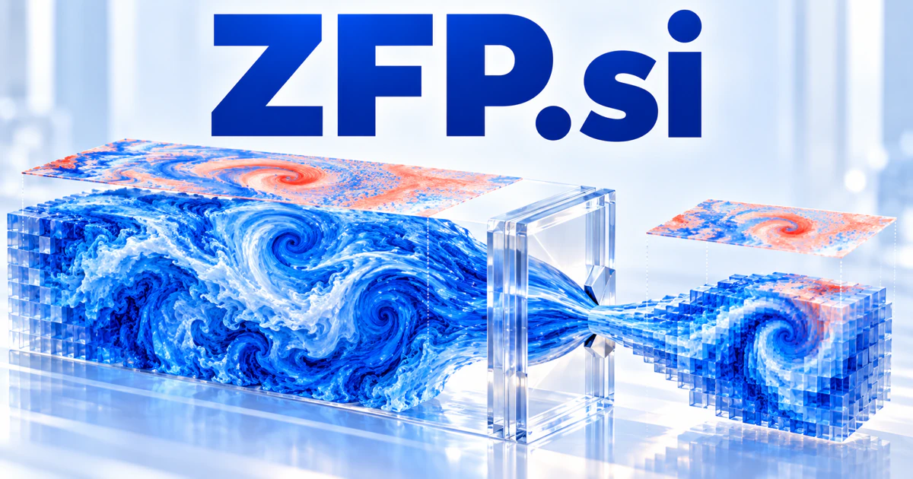

# ZFP.si — Keep scientific meaning inside the representation

**ZFP.si** has separate scientific associations with numerical compression and zinc finger proteins. A computing product could help researchers understand what a representation preserves or changes; a biology product could connect molecular evidence with research context. Both directions suit a compact technical identity that values inspectable methods over an unexplained answer.

## Meaning and naming depth

In scientific computing, **zfp** is associated with numerical compression for multidimensional arrays, with different modes emphasizing rate, precision, accuracy, or reversible operation. A business could build evaluation tools, integrations, and scientific data services around these broader methods.

In molecular biology, **zinc finger proteins** provide a separate ZFP reading. Zinc-binding structural motifs are associated with important molecular interactions, including sequence-specific DNA binding in relevant protein classes. A new owner might also choose a creative **Zero-Footprint Platform** story for lightweight software, with the product story focused on reduced installation and maintenance requirements.

## Business opportunities

### 1. Scientific compression evaluation

A scientific compression workbench could connect an array’s scientific purpose with compression settings, error measures, and downstream analysis, compare alternatives, and help researchers understand which information a smaller representation might change. Customers could choose methods appropriate to their actual analysis. Commercial routes include workspaces, institutional deployments, and specialist evaluation projects for scientific computing organizations.

### 2. HPC storage planning

An HPC storage planner could relate simulation output, storage limits, analysis access patterns, and data-retention needs, model alternative compression plans, and explain the scientific and operational trade-offs. An operator could prepare evidence for a storage policy. The business could offer assessment services, reporting tools, and maintained workflows for high-volume scientific data.

### 3. Numerical array visualization

A numerical-array visualization tool could connect features in a numerical array with provenance, uncertainty, and analytical questions, coordinate useful views, and help researchers avoid mistaking a rendering artifact for a scientific pattern. Researchers could investigate where a setting changes important features. Customers could buy specialist applications, institutional licenses, and extensions for particular scientific disciplines.

### 4. Compression integration services

A compression integration service could reconcile numerical formats, application constraints, validation requirements, and performance observations, propose a compression workflow, and generate checks that test its fitness for the actual research task. Projects could include tests on customer datasets and clear operational documentation. The business could sell engineering engagements, maintained adapters, and support subscriptions.

### 5. Zinc finger literature organization

A zinc-finger literature workspace could connect a zinc-finger research question with experimental methods, biological context, and competing findings, assemble a source-linked map, and make gaps in the available evidence visible. AI could help find related material while preserving the source context. Commercial routes include lab subscriptions, institutional collections, and specialist curation services for a focused research audience.

### 6. Protein research data management

A protein-research data tool could connect protein datasets, sample provenance, analysis methods, and project questions, detect inconsistent annotations, and prepare a traceable comparison for qualified researchers to review. A laboratory could compare results without losing preparation details. The business could offer research workspaces, integration services, and tailored data models appropriate to the lab’s methods and existing tools.

### 7. A scientific education platform

A specialist science-learning platform could connect an abstract scientific concept with worked examples and learner questions, choose a useful representation, and adapt the next exercise around the misunderstanding the learner reveals. Visual explanations and practical exercises could make difficult concepts more approachable. Customers could buy courses, classroom licenses, illustrated resources, and professional workshops under a compact laboratory-style identity.

### 8. An AI-assisted scientific notebook

A reproducible scientific notebook could connect hypotheses, data transformations, code, and interpretations, identify a missing assumption, and help scientists prepare a reproducible reasoning trail for the next experiment. Users could ask questions about their own approved material and inspect the relevant evidence. The commercial offer could combine institutional deployments and configured workflows for specific research domains.

### 9. Lightweight software deployment

A lightweight deployment tool could connect an application’s constraints with dependencies, target environments, and observed failures, compare lightweight packaging options, and prepare a tested rollout proposal for developers. Customers could run useful workflows without maintaining a complex desktop setup. Commercial routes include hosted applications, enterprise workspaces, and integration support.

### 10. A specialist scientific studio

A scientific software studio could connect a client’s research goal with literature, numerical tools, and specialist expertise, coordinate a focused investigation, and present conclusions with their provenance and unresolved assumptions. The concise initials can house several disciplines without forcing them into one product. Project fees and recurring support could finance later development of focused commercial tools.

## A Super Intelligence brand

ZFP.si can position Super Intelligence around scientific depth: connect computational methods, research evidence, and structured experimentation. A computing-focused product might help select and document data representations; a biology-focused product might help organize molecular research. The owner can select one coherent market while keeping the name broad enough for an evolving scientific tool company.

## Why the name works

The short initials work naturally on software, publications, and laboratory tools. The established scientific associations give a naming story more substance than arbitrary letters, while ZFP Lab, ZFP Data, and ZFP Research can form a product family. **“Make complex research workable.”** is a broad benefit grounded in practical tools.

## Related names, different purposes

[LZW.si](lzw-si.md) provides a different established compression association. [Zygotic.si](zygotic-si.md) leans toward developmental biology and research beginnings, while [Prefactor.si](prefactor-si.md) is more directly about scientific calculations and their assumptions.

## Explore ZFP.si

Interested in **ZFP.si** for one of the opportunities above? Contact [hedge.pike02@icloud.com](mailto:hedge.pike02@icloud.com?subject=Domain%20enquiry%3A%20zfp.si) to discuss availability, a direct-purchase offer, a possible discount, or a portfolio combination. These are envisioned products and services for a future owner to build.

[View the Dynadot listing](https://www.dynadot.com/market/user-listings/zfp.si) · [Marketplaces and Escrow.com](../guides/how-to-buy.md) · [Browse all domains](../README.md)

## Sources and further reading

- [Numerical compression documentation](https://zfp.readthedocs.io/en/release1.0.1/) — Primary project documentation of array compression modes and interfaces.
- [NHGRI: Zinc fingers in research](https://www.genome.gov/grabbing-hold-of-cells-and-tissues-with-zinc-fingers) — Primary research-agency explanation of zinc finger structures and DNA interactions.
