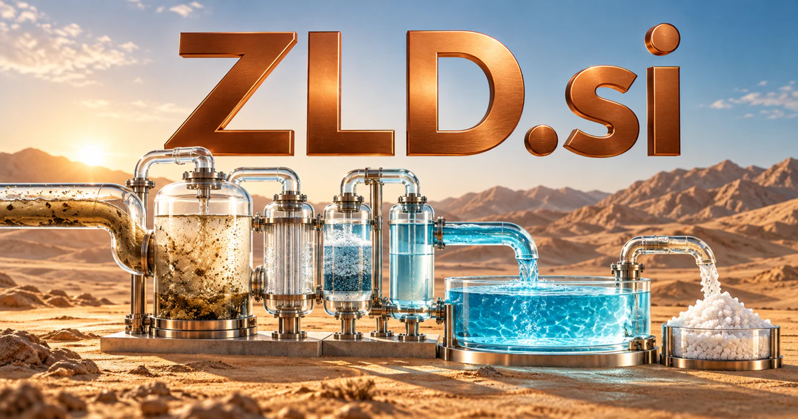

# ZLD.si — Make a complex resource process understandable

Zero liquid discharge gives **ZLD.si** a recognized industrial water-treatment connection. A service could help engineering teams compare process assumptions, investigate operating changes, prepare supplier questions, and preserve the evidence behind a project. A separately chosen Zero-Loss Data story could instead address recoverability and reliability in software systems.

## Meaning and context

ZLD means zero liquid discharge, an established industrial water-treatment concept associated with recovering water and managing the remaining concentrated material. [Veolia's technical overview](https://www.watertechnologies.com/applications/zero-liquid-discharge-zld) provides a primary industry reference. The domain can therefore support engineering software, project preparation, operating records, equipment sourcing, and specialist education. A buyer could also choose a separate software expansion such as Zero-Loss Data, but that would be a deliberate brand interpretation rather than the established water-treatment meaning. The real opportunity is in making complex resource decisions better organized and easier to review.

## Ten directions a buyer could build

The following are proposed business opportunities. They show different ways to develop the name, with concrete audiences, workflows, and potential commercial models.

### 1. Water-treatment project planning

A water-treatment planning workspace could connect feed-water characteristics, treatment objectives, energy constraints, and operational assumptions, compare proposed process routes, and prepare a reviewable planning brief for the responsible engineers. Professional plans could preserve the basis for comparisons and keep unresolved technical constraints visible before a customer requests detailed proposals.

### 2. Plant operating records

A plant operations notebook could relate operating records, laboratory observations, maintenance events, and process conditions, investigate deviations, and help operators prepare a grounded explanation before changing an approved procedure. Site subscriptions could help operators investigate changes and prepare clear handovers while technical control remains with the responsible plant team.

### 3. Equipment sourcing

An equipment sourcing tool could connect equipment requirements, site conditions, supplier specifications, and maintenance needs, expose incompatible assumptions, and prepare useful technical questions for a procurement review. Marketplace fees or procurement subscriptions could support a structured buying process without declaring suitability from a short automated comparison.

### 4. Engineering evidence libraries

An engineering evidence library could connect a treatment question with design records, test evidence, and relevant engineering references, compare explanations, and preserve the source context behind the proposed conclusion. Company subscriptions could help engineers retrieve relevant context and avoid losing important qualifications when a document is reused for a new project.

### 5. Industrial resource reporting

An industrial resource-reporting tool could reconcile water inputs, recovered streams, energy use, and reporting boundaries, trace discrepancies to their records, and prepare a transparent account that specialists can verify. Professional software plans could make reporting clearer while keeping environmental or compliance conclusions subject to appropriate verification.

### 6. Maintenance and service coordination

A maintenance coordination service could connect equipment history, operating symptoms, available parts, and service windows, propose a practical investigation sequence, and help plant teams coordinate the approved work. Per-company plans could connect an operating concern with the actual equipment history and the agreed responsibilities of each participant.

### 7. Treatment-process education

A treatment-process learning platform could connect a treatment-process concept with learner questions, worked balances, and operational examples, expose the assumptions behind each step, and select an exercise that tests actual understanding. Course sales and institutional licenses could make a technical subject accessible without suggesting that a simplified model replaces detailed process design.

### 8. Research experiment workspaces

A research experiment workspace could connect a treatment hypothesis with sample conditions, measurement methods, and previous results, draft alternative experimental plans, and identify the evidence needed to distinguish their explanations. Institutional subscriptions could preserve protocols and uncertainty, helping collaborators understand what a particular experiment establishes and what remains open.

### 9. Operational agent assistance

An operating-procedure assistant could combine current process context, approved procedures, observed exceptions, and staff responsibilities, coordinate a bounded response plan, and require explicit review before a consequential physical change. Business plans could reduce information-search effort without granting generated recommendations direct authority over equipment or process settings.

### 10. A separate data-reliability platform

A data-reliability workbench could connect data lineage, processing state, recovery options, and business commitments, compare failure scenarios, and help engineers design a verifiable route to restoring the intended information. Enterprise plans could support documented tests and exception handling while avoiding an absolute guarantee that no possible data loss can occur.

## A Super Intelligence product story

ZLD.si could connect Super Intelligence with resource-aware industrial work. Agents collect approved project information, identify gaps, compare documented scenarios, and draft a review package for engineers. In operations, they could organize evidence and service tasks while preserving clear approval boundaries around the physical treatment process.

## Why this name can carry a business

The three-letter form has a direct industrial meaning with substantial surrounding workflows. It can carry a specialist engineering product, a service marketplace, or a technical publication. Its concision also leaves room for a deliberately differentiated software identity if the buyer prefers a separate interpretation.

## Related names, different purposes

[Readouts.si](readouts-si.md) emphasizes interpreting measurements; [DAQ.si](daq-si.md) emphasizes collecting them. [SCPI.si](scpi-si.md) would better suit a product centered on laboratory instruments and test commands rather than a water-treatment process.

## Explore ZLD.si

Interested in **ZLD.si** for one of the opportunities above? Contact [hedge.pike02@icloud.com](mailto:hedge.pike02@icloud.com?subject=Domain%20enquiry%3A%20zld.si) to discuss availability, a direct-purchase offer, a possible discount, or a portfolio combination. These are envisioned products and services for a future owner to build.

[View the Dynadot listing](https://www.dynadot.com/market/user-listings/zld.si) · [Marketplaces and Escrow.com](../guides/how-to-buy.md) · [Browse all domains](../README.md)

## Research references

- [Veolia: zero liquid discharge](https://www.watertechnologies.com/applications/zero-liquid-discharge-zld)

[Browse all domains](../README.md)
