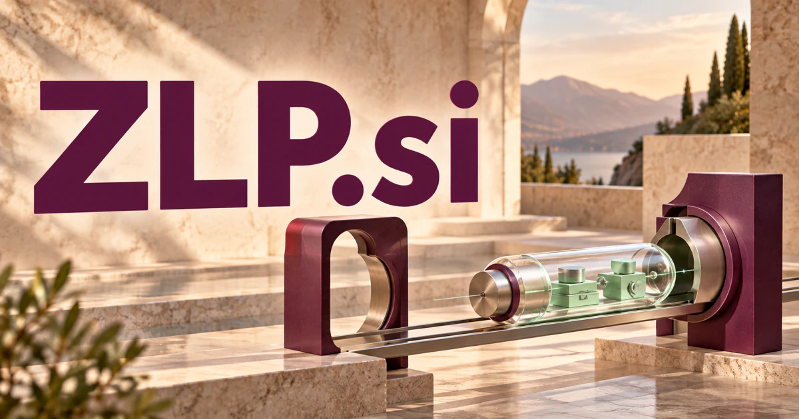

# ZLP.si — Technical tools that carry their context with them

Zero-length packets in USB communication and zero-loss peaks in spectroscopy give **ZLP.si** two established technical associations. A buyer could build a focused diagnostic or scientific tool, or deliberately define a separate portable-agent platform. The strongest common promise is to make complex behavior understandable across devices, data, and working environments.

## Meaning and naming depth

**Zero-length packet** is an established USB concept; **zero-loss peak** is an established spectroscopy term associated with electrons that have not lost measurable energy in the relevant interaction. These are separate fields, not interchangeable meanings. Each gives the initials a genuine technical foundation.

For a different business, **Zero Lock-in Platform**, **Zero-friction Learning Path**, or **Zero-Latency Playground** could be deliberately chosen creative expansions. Each would benefit from a specific product definition: portable deployment, a simpler learning journey, or measured interaction performance. The naming attraction is a compact three-letter frame that can be tied to a precise proposition.

## Business opportunities

### 1. Portable agent infrastructure

A portable agent platform could connect user intent with device capabilities, available tools, and privacy preferences, adapt an approved workflow to the current environment, and explain which tasks require additional resources or review. Customers could test a migration using documented deployment paths. Commercial routes include development workspaces, enterprise deployments, and engineering support.

### 2. USB protocol diagnostics

A USB protocol diagnostic tool could connect captured USB exchanges with device state, timing, and expected behavior, compare competing failure explanations, and propose a reproducible diagnostic experiment for an engineer. Engineers could build repeatable examples for customer issues and firmware changes. The business could offer desktop tools, team licenses, and specialist debugging services to hardware vendors and integration laboratories.

### 3. Spectroscopy analysis workspaces

A spectroscopy analysis workspace could connect a measured spectrum with acquisition conditions, calibration records, and the research question, investigate alternative interpretations, and prepare a source-linked analysis for specialist review. The zero-loss peak provides a particularly relevant naming anchor. Customers could buy lab licenses, data organization tools, and workflow development for instrument users.

### 4. Scientific instrument integration

An instrument integration service could reconcile a laboratory’s intended workflow with device documentation, data formats, and analysis dependencies, propose a tested integration sequence, and expose where manual validation is still needed. A laboratory could retain measurement metadata with the resulting figures. Paid integrations, maintained adapters, and institutional software subscriptions would support a broader scientific computing business.

### 5. Low-latency application testing

A low-latency testing workbench could connect response-time observations with workload, network behavior, and application dependencies, distinguish a local optimization from an end-to-end improvement, and propose focused experiments. Developers could inspect network, processing, and display stages. Commercial routes include benchmarking workspaces and performance investigations based on measured results.

### 6. Learning paths for technical subjects

A technical learning-path companion could connect a learner’s goal with prerequisites, prior attempts, and available practical exercises, identify the next conceptual obstacle, and adapt the pathway as understanding develops. Instructors could adapt the path to different starting points. The business could offer course licenses, tutoring programs, and personalized learning workspaces.

### 7. Hardware interoperability testing

A hardware interoperability laboratory could compare hardware capabilities, firmware versions, interface assumptions, and observed responses, identify a conflicting expectation, and generate a small test that makes the incompatibility reproducible. Results could be stored alongside traces and configuration details. Revenue could come from testing projects, software licenses, and maintained test libraries.

### 8. Research data visualization

A research visualization tool could connect data features, uncertainty, collection context, and analytical goals, coordinate alternative visualizations, and help researchers inspect the assumptions behind an apparent pattern. Users could compare plots and return to the exact source data and settings. The commercial offer could combine specialist visualization applications, laboratory collaboration features, and tailored extensions for different scientific disciplines.

### 9. A developer portability toolkit

A developer portability toolkit could connect an application’s required behavior with platform differences, dependencies, and deployment constraints, propose adaptations, and generate checks that reveal what changed across environments. The product could prepare an actionable migration notebook. Commercial routes include developer plans and consulting services to organizations that want practical options when infrastructure requirements change.

### 10. A technical research and education studio

A technical research studio could connect client questions, technical references, experimental evidence, and specialist perspectives, coordinate an investigation, and turn the findings into an understandable technical learning experience. The concise initials suit a laboratory-style identity across several subjects. A founder could begin with one field of expertise, then create a family of tools and educational products.

## A Super Intelligence brand

ZLP.si could become a Super Intelligence brand about making specialized capability portable and understandable. An agent-oriented product might package tools, configuration, data access, and evaluation records into a deployment a customer can inspect and move. A scientific version might connect instrument knowledge with measurement workflows. Both stories favor clear engineering over an unexplained acronym.

## Why the name works

Three letters provide a compact badge for technical software, equipment, and documentation. The initials can be spoken individually and extended naturally into ZLP Lab, ZLP Tools, or ZLP Cloud. **“Precision without unnecessary friction.”** provides a broad brand promise while leaving a future owner free to select its strongest technical market.

## Related names, different purposes

[ZFP.si](zfp-si.md) emphasizes scientific representations and research information. [SCPI.si](scpi-si.md) focuses on instrument-command workflows, while [VDI.si](vdi-si.md) is more direct for managed desktops and remote working environments.

## Explore ZLP.si

Interested in **ZLP.si** for one of the opportunities above? Contact [hedge.pike02@icloud.com](mailto:hedge.pike02@icloud.com?subject=Domain%20enquiry%3A%20zlp.si) to discuss availability, a direct-purchase offer, a possible discount, or a portfolio combination. These are envisioned products and services for a future owner to build.

[View the Dynadot listing](https://www.dynadot.com/market/user-listings/zlp.si) · [Marketplaces and Escrow.com](../guides/how-to-buy.md) · [Browse all domains](../README.md)

## Sources and further reading

- [USB zero-length packet documentation](https://www.usb.org/sites/default/files/CDC_EEM10.pdf) — Official USB-IF specification discussing zero-length packets in transfers.
- [Electron energy-loss spectroscopy](https://www.eels.info/Technologies/EELS-Techniques/Spectroscopy) — An instrument specialist’s explanation of spectroscopy and electron energy-loss signals.
