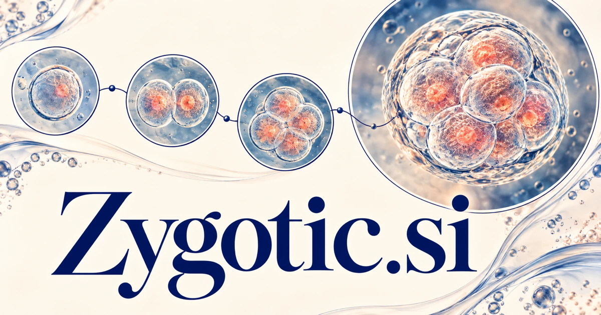

# Zygotic.si — Where a research question—or a new idea—begins

Zygotic relates to a zygote, giving **Zygotic.si** a biological foundation and a metaphor for beginnings. A research product could connect samples, images, methods, and published evidence; a deliberately broader venture or project brand could help teams turn an early idea into its first useful experiment.

## Meaning and context

Zygotic means relating to a zygote, as recorded by [Dictionary.com](https://www.dictionary.com/browse/zygotic). It is a precise biological adjective, giving the seven-letter domain a genuine foundation in developmental biology, genetics, reproduction research, and scientific education. The word also offers a clearly metaphorical brand story about a beginning from which something complex develops. A buyer can choose a rigorous life-science identity or deliberately extend the growth metaphor into research tools, a venture studio, or software that helps an early idea become a structured project.

## Ten directions a buyer could build

The following are proposed business opportunities. They show different ways to develop the name, with concrete audiences, workflows, and potential commercial models.

### 1. Developmental biology research workspaces

A developmental-biology workspace could connect developmental questions with sample context, experimental methods, imaging evidence, and published findings, compare interpretations, and help scientists plan the next discriminating investigation. Institutional subscriptions could connect a research question with the underlying publication and the local observations used to investigate it.

### 2. Laboratory sample records

A laboratory sample-records tool could reconcile sample identity, lineage, handling events, and analysis outputs, flag missing context, and prepare a traceable record that researchers can inspect before drawing conclusions. Professional plans could support traceable work across a study while keeping decisions about experimental interpretation with the relevant scientific team.

### 3. Genetics learning resources

A genetics learning resource could connect a learner’s explanation with biological processes, diagrams, and experimental examples, identify a specific misconception, and create a focused activity that tests the revised understanding. Course sales and institutional licenses could connect foundational ideas with carefully chosen examples, helping students understand what a diagram or experiment actually represents.

### 4. Image annotation for research

A research-image annotation tool could connect research images with annotation criteria, sample history, and competing interpretations, suggest review priorities, and help specialists distinguish ambiguous cases from simple labeling inconsistencies. Laboratory subscriptions could connect a visual observation with its acquisition conditions and the purpose of the research task.

### 5. Reproductive research knowledge

A reproductive-research knowledge service could compare reproductive-research findings through methods, populations, and limitations, organize a source-linked evidence map, and make clear which questions remain research questions rather than clinical conclusions. Professional memberships could serve researchers, educators, and specialist publishers looking for a clearly organized view of a defined field.

### 6. Scientific collaboration planning

A scientific collaboration planner could connect project hypotheses, available expertise, datasets, and experimental dependencies, coordinate a feasible research sequence, and help collaborators see where a missing assumption blocks progress. Institution plans could make the handoff between biology, computation, imaging, and statistical analysis easier to understand and maintain.

### 7. Research agent toolkits

A research-agent toolkit could decompose a research question into literature, data, and analysis tasks, coordinate specialist tools, and return an inspectable reasoning record with unresolved uncertainties retained. Developer or laboratory plans could reduce repetitive information work while preserving citations and the distinction between generated suggestions and scientific findings.

### 8. An early-stage venture studio

An early-stage venture studio could connect an early idea with customer evidence, scientific feasibility, operational constraints, and team capabilities, compare alternative starting points, and design a concrete experiment before a larger commitment. Project fees or studio partnerships could combine customer discovery, prototypes, operating plans, and evidence-based decisions about whether to continue.

### 9. Project genesis software

A project-genesis workspace could connect an initial ambition with stakeholder needs, existing resources, and delivery dependencies, develop several viable paths, and help a team choose the first evidence-producing milestone. Subscription tools could preserve how an early concept changes as practical work reveals what is possible and useful.

### 10. Scientific storytelling and visualization

A scientific storytelling studio could connect a scientific concept with source evidence, audience questions, and visual explanation, compare narrative approaches, and help editors preserve accuracy while making the subject approachable. Studio services and asset licensing could translate complex developmental concepts into material that remains connected to sources and expert interpretation.

## A Super Intelligence product story

Zygotic.si could make Super Intelligence a research assistant for understanding how complex processes begin and unfold. Agents organize approved papers, map terminology, prepare annotated reference collections, and draft questions for scientists. In the metaphorical venture direction, the same name could organize the journey from an initial hypothesis to an evaluated prototype.

## Why this name can carry a business

The real scientific adjective supplies depth and a distinctive sound, while the idea of beginnings creates an expansive secondary story. A buyer can build a specialist biotechnology or education brand with authentic terminology, or choose a clearly metaphorical identity for a studio devoted to developing new ideas.

## Related names, different purposes

[ZFP.si](zfp-si.md) offers a different scientific identity spanning numerical methods and protein research. [Prelims.si](prelims-si.md) emphasizes preparation before a main event, while [EduSpark.si](eduspark-si.md) connects beginnings with curiosity and learning.

## Explore Zygotic.si

Interested in **Zygotic.si** for one of the opportunities above? Contact [hedge.pike02@icloud.com](mailto:hedge.pike02@icloud.com?subject=Domain%20enquiry%3A%20zygotic.si) to discuss availability, a direct-purchase offer, a possible discount, or a portfolio combination. These are envisioned products and services for a future owner to build.

[View the Dynadot listing](https://www.dynadot.com/market/user-listings/zygotic.si) · [Marketplaces and Escrow.com](../guides/how-to-buy.md) · [Browse all domains](../README.md)

## Research references

- [Dictionary.com: zygotic](https://www.dictionary.com/browse/zygotic)
- [NHGRI: genetic material and zygote formation](https://www.genome.gov/genetics-glossary/haploid)

[Browse all domains](../README.md)
